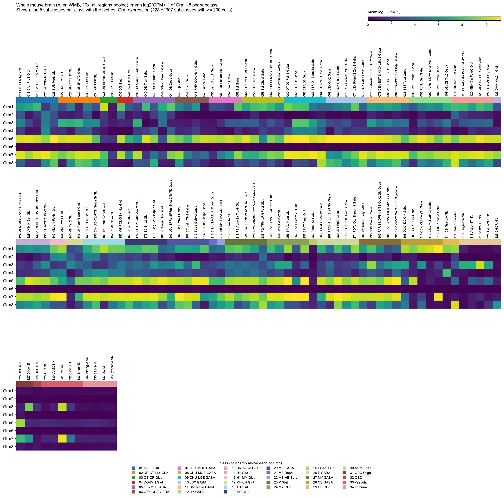
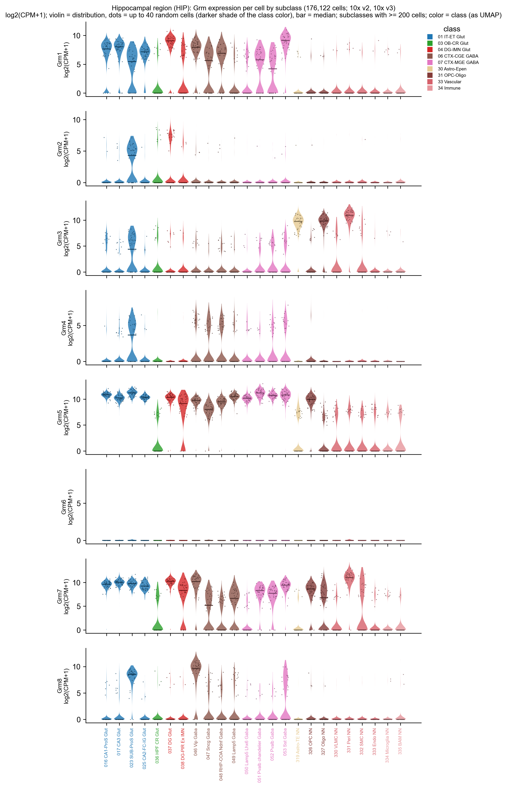
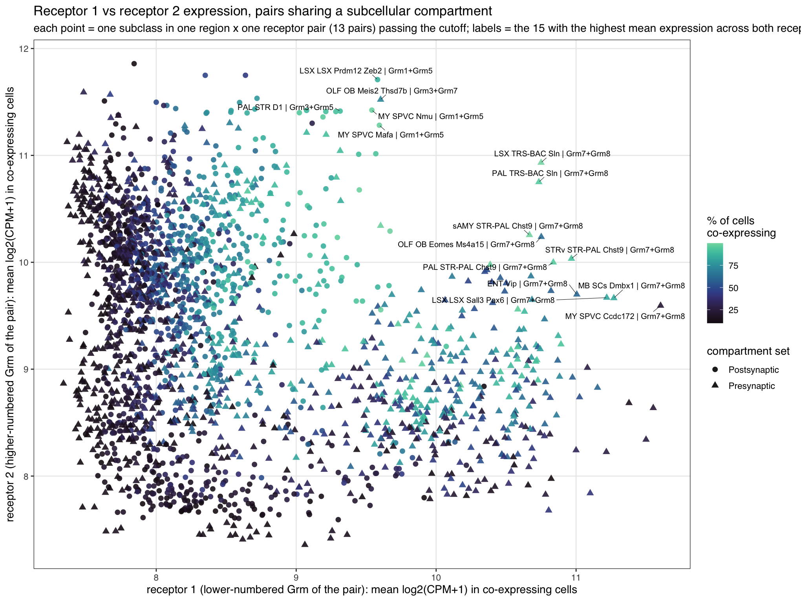
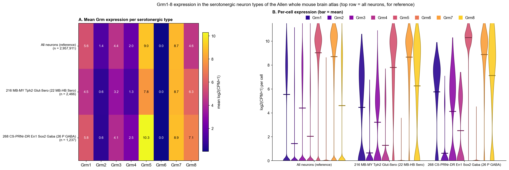
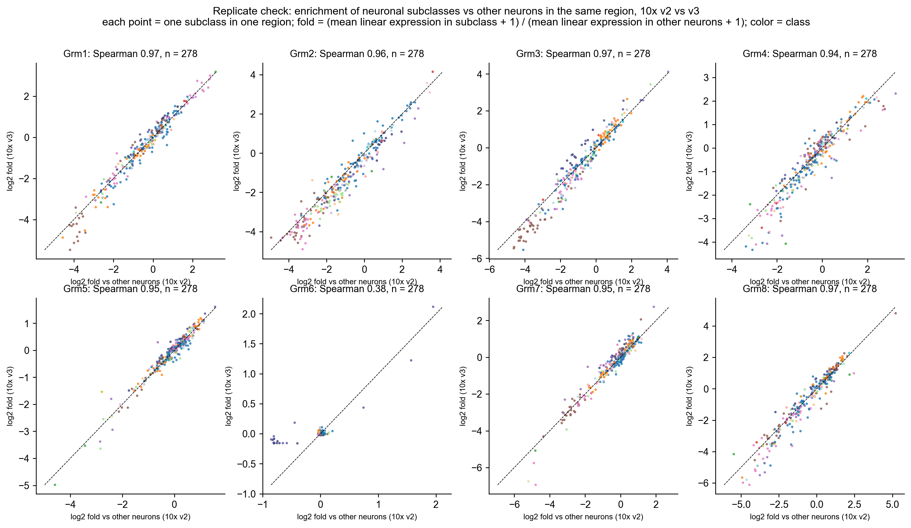

<!-- readme-v2 -->
# mglurs-brain-sc-datasets

Dataset catalogs (human, rodent, repositories): [docs/datasets.md](docs/datasets.md)

Goal: mGluR (Grm1-8) expression by fine cell type and brain region in public single-cell data. The brain has elevated levels of mGluRs - % cells positive for the gene is no longer a good measure of enrichment (as in other tissues where GPCR transcript detection is low).

## Brain regions

🟨 = regions of interest noted before analysis: depression circuits (prefrontal, anterior cingulate, hippocampus, amygdala, striatum) and Parkinson's (striatum). Hippocampus is an example below; all other regions are in the [regions folder](figures/allen_wmb/regions/README.md).

| | | |
|---|---|---|
| 🟨 **[Prelimbic/infralimbic/orbital areas  (PL-ILA-ORB)](figures/allen_wmb/regions/README.md#prelimbicinfralimbicorbital-areas--pl-ila-orb)** | 🟨 **[Anterior cingulate area (ACA)](figures/allen_wmb/regions/README.md#anterior-cingulate-area-aca)** | 🟨 **[Hippocampal region (HIP)](#example-region-hippocampus)** |
| 🟨 **[Cortical subplate (CTXsp)](figures/allen_wmb/regions/README.md#cortical-subplate-ctxsp)** | 🟨 **[Striatum-like amygdalar nuclei (sAMY)](figures/allen_wmb/regions/README.md#striatum-like-amygdalar-nuclei-samy)** | 🟨 **[Striatum dorsal region (STRd)](figures/allen_wmb/regions/README.md#striatum-dorsal-region-strd)** |
| 🟨 **[Striatum ventral region (STRv)](figures/allen_wmb/regions/README.md#striatum-ventral-region-strv)** | [Agranular insular area (AI)](figures/allen_wmb/regions/README.md#agranular-insular-area-ai) | [Auditory areas (AUD)](figures/allen_wmb/regions/README.md#auditory-areas-aud) |
| [Auditory/temporal/perirhinal/ectorhinal areas (AUD-TEa-PERI-ECT)](figures/allen_wmb/regions/README.md#auditorytemporalperirhinalectorhinal-areas-aud-tea-peri-ect) | [Cerebellum (CB)](figures/allen_wmb/regions/README.md#cerebellum-cb) | [Entorhinal area (ENT)](figures/allen_wmb/regions/README.md#entorhinal-area-ent) |
| [Hypothalamus (HY)](figures/allen_wmb/regions/README.md#hypothalamus-hy) | [Lateral septal complex (LSX)](figures/allen_wmb/regions/README.md#lateral-septal-complex-lsx) | [Medulla (MY)](figures/allen_wmb/regions/README.md#medulla-my) |
| [Midbrain (MB)](figures/allen_wmb/regions/README.md#midbrain-mb) | [Olfactory areas (OLF)](figures/allen_wmb/regions/README.md#olfactory-areas-olf) | [Pallidum (PAL)](figures/allen_wmb/regions/README.md#pallidum-pal) |
| [Pons (P)](figures/allen_wmb/regions/README.md#pons-p) | [Primary motor area (MOp)](figures/allen_wmb/regions/README.md#primary-motor-area-mop) | [Primary somatosensory area (SSp)](figures/allen_wmb/regions/README.md#primary-somatosensory-area-ssp) |
| [Retrohippocampal region (RHP)](figures/allen_wmb/regions/README.md#retrohippocampal-region-rhp) | [Retrosplenial area (RSP)](figures/allen_wmb/regions/README.md#retrosplenial-area-rsp) | [Somatomotor - Frontal pole (MO-FRP)](figures/allen_wmb/regions/README.md#somatomotor---frontal-pole-mo-frp) |
| [Somatosensory/gustatory/visceral areas (SS-GU-VISC)](figures/allen_wmb/regions/README.md#somatosensorygustatoryvisceral-areas-ss-gu-visc) | [Temporal/perirhinal/ectorhinal areas  (TEa-PERI-ECT)](figures/allen_wmb/regions/README.md#temporalperirhinalectorhinal-areas--tea-peri-ect) | [Thalamus (TH)](figures/allen_wmb/regions/README.md#thalamus-th) |
| [Visual areas (VIS)](figures/allen_wmb/regions/README.md#visual-areas-vis) | [Visual/posterior parietal  areas (VIS-PTLp)](figures/allen_wmb/regions/README.md#visualposterior-parietal--areas-vis-ptlp) |  |

## Module 1: Allen whole mouse brain (10x)

- Data: Allen ABC Atlas WMB, 4.04M cells, 10x v2/v3/Multiome 3' GEX, log2(CPM+1), 29 dissection regions (ROI)
- Labels: class > subclass > supertype > cluster (Allen taxonomy). UMAP: Allen `x`,`y` (10 nearest neighbours share subclass 80-99%; shuffled 4-43%)
- Colors in all figures = class
- Enrichment = (mean CPM in subclass + 1) / (mean CPM in other neurons of the same region + 1); one-sided rank-sum, BH q < 0.05
- Tables: `results/allen_wmb/` (`master_enrichment.csv.gz`: region x chemistry x gene x subclass)

Overall % of cells detecting each receptor (all 4.04M cells):

| Grm1 | Grm2 | Grm3 | Grm4 | Grm5 | Grm6 | Grm7 | Grm8 |
|---|---|---|---|---|---|---|---|
| 52 | 17 | 60 | 24 | 76 | 0.03 | 77 | 43 |

### Whole brain: subclass x Grm (mean log2 CPM)

All data from Allen Brain Atlas single cell processing pipeline, across different 10x datasets
v2 and v3 are pooled uncorrected, but the chemistry is not a big confound here (see correlation, later in readme)

Top 5 subclasses per class by Grm expression; all subclasses: `figures/allen_wmb/ALL_fig4_heatmap_all_subclasses_full.png`.

### Whole brain: Grm1-8 per neuronal class

The atlas has neuronal classes 01–29; each holds many subclasses (~340 total), and thousands of clusters
Below, are the vln plots showing Grm expression at the toplevel (neuronal classes)

Violin = distribution of per-cell log2(CPM+1) for one Grm across all neurons of a class (color = class).

### Example region: hippocampus

UMAP (x and y coordinates directly from ABA, no reclustering) by class and Grm violins per subclass. Other regions (UMAP + violins): see the [regions folder](figures/allen_wmb/regions/README.md). Feature plots (Grm on UMAP) and enrichment tables: `figures/allen_wmb/`, `results/allen_wmb/master_enrichment.csv.gz`.

### Hippocampal region (HIP)

More regions: [UMAP and violins for all other regions](figures/allen_wmb/regions/README.md).

# mGluR coexpression analysis

## Grm2 and Grm4

log2(CPM) values for Grm2 and Grm4 are plotted, with each subclass represented.  This does not mean the transcripts were detected in the same single-cells, but reports the overall cluster's expression level

all subclasses were filtered for those with >200 cells, using mean log2(CPM+1) for Grm2 and Grm4 pooled over all regions (i.e. PV GABA neurons, pulled from multiple brain regions).  Subclasses were further filtered for those whose mean is in the top quartile (at or above the 75th percentile of subclass means) for both Grm2 and Grm4 (grey shaded zone on the scatter plot).  The number of subclasses in the graphs below was capped at 12; the total that passed the filtering was: 30

For clusters identified in the previous plot as enriched for both Grm2 and 4, expression was examined within single cells. expression thresholds were: Grm2 >= 6.2 and Grm4 >= 6.4 log2(CPM+1) per cell (median of neurons with detected expression). Clusters were selected when both receptors were in the top quartile of subclass means (Grm2 >= 1.5, Grm4 >= 2.9); 12 subclasses are shown

## broader analysis of mGluR pairs - restricted to shared subcellular compartment

The first co-expression analysis tested all 28 receptor pairs across all cell types and regions without regard to subcellular localization; that work (stringency, top hits, pair heatmap, dot plots, region discordance, receptor 1 vs receptor 2 scatters) is in [pairs_coexpression_whole_atlas](figures/allen_wmb/pairs_coexpression_whole_atlas/README.md).

Rationale to filter the analysis: a heteromer at the cell surface requires both receptors to traffic to the same place.
Group I receptors (Grm1, Grm5) are known to traffic to the shafts of dendritic spines (postsynaptic). They detect Glu spillover and DHPG-LTD works through this mechanism.
Group II and III receptors (Grm2, Grm4, Grm7, Grm8, and in part Grm3) are mostly at presynaptic terminals.
Surface heteromers are most likely to form where they are already trafficked to the same subcellular domain - this analysis considers receptor pairs expressed in the same compartment, and uses identical cutoffs and pass rule to the first one.

### Subcellular localization of each receptor

Curated from immuno-electron microscopy literature (from Claude's memory; citation verification needed).

| Receptor | Compartment | Localization | Note | References |
|---|---|---|---|---|
| Grm1 | Postsynaptic | perisynaptic annulus of dendritic spines and shafts (strong in Purkinje cells, thalamus, olfactory bulb) | DHPG-LTD target | Shigemoto 1997; Luján 1996 |
| Grm5 | Postsynaptic | perisynaptic annulus of dendritic spines; also intracellular/nuclear membrane | DHPG-LTD target | Luján 1996; O'Malley 2003 |
| Grm2 | Presynaptic | preterminal axon and extrasynaptic terminal membrane (outside the active zone); some dendritic expression, e.g. cerebellar Golgi cells | senses glutamate spillover | Shigemoto 1997; Ferraguti & Shigemoto 2006 |
| Grm3 | Presynaptic + postsynaptic (+ glia) | terminals, spines (primate prefrontal cortex) and astrocytes; mouse spine localization less certain | mixed | Jin 2018; Ferraguti & Shigemoto 2006 |
| Grm4 | Presynaptic | active zone of terminals (cerebellar parallel fibers, striatopallidal) |  | Bradley 1998; Corti 2002 |
| Grm7 | Presynaptic | active zone, the most widespread; minor dendritic pools on some interneurons | low glutamate affinity | Shigemoto 1996; Dalezios 2002 |
| Grm8 | Presynaptic | terminals (lateral perforant path, olfactory bulb, BNST) |  | Ferraguti 2005 |
| Grm6 | Postsynaptic (retina only) | dendritic tips of ON-bipolar cells | excluded from brain pairs | Nomura 1994 |

### Pairs where both receptors share a compartment

Grm3 is counted in both sets. Grm6 is excluded. Heteromer notes are reports from heterologous-cell studies (Doumazane 2011; Kammermeier 2012; Yin 2014), not shown in vivo; verify citations.

| Set | Pair | Heteromer note |
|---|---|---|
| Postsynaptic | Grm1+Grm5 | reported group I heteromer |
| Postsynaptic | Grm1+Grm3 |  |
| Postsynaptic | Grm5+Grm3 |  |
| Presynaptic | Grm2+Grm3 | reported group II heteromer |
| Presynaptic | Grm2+Grm4 | reported cross-group heteromer |
| Presynaptic | Grm2+Grm7 | reported cross-group heteromer |
| Presynaptic | Grm2+Grm8 |  |
| Presynaptic | Grm3+Grm4 |  |
| Presynaptic | Grm3+Grm7 |  |
| Presynaptic | Grm3+Grm8 |  |
| Presynaptic | Grm4+Grm7 | reported group III heteromer |
| Presynaptic | Grm4+Grm8 | reported group III heteromer |
| Presynaptic | Grm7+Grm8 | reported group III heteromer |

13 of 28 pairs remain (tables: `results/allen_wmb/receptor_compartments.csv`, `compartment_pairs.csv`).

### Results

Same settings as the first analysis (shared absolute cutoff log2(CPM+1) >= 7; a cell type passes at >= 10% co-expressing cells and >= 25 cells), restricted to the 13 pairs in the table above: postsynaptic (Grm1, Grm5, Grm3) and presynaptic (Grm2, Grm3, Grm4, Grm7, Grm8). Circles = postsynaptic pairs, triangles = presynaptic pairs. Figure files: [pairs_coexpression_subcellular_compartments](figures/allen_wmb/pairs_coexpression_subcellular_compartments/).

Labeled points are the 15 with the highest mean expression across both receptors (label = region + subclass | receptor pair). Label key:

- **LSX TRS-BAC Sln | Grm7+Grm8**: Lateral septal complex (LSX); subclass 111 TRS-BAC Sln Glut (class 13 CNU-HYa Glut); Grm7 + Grm8 (presynaptic); 534 cells, 100% co-express
- **PAL TRS-BAC Sln | Grm7+Grm8**: Pallidum (PAL); subclass 111 TRS-BAC Sln Glut (class 13 CNU-HYa Glut); Grm7 + Grm8 (presynaptic); 602 cells, 95% co-express
- **LSX LSX Prdm12 Zeb2 | Grm1+Grm5**: Lateral septal complex (LSX); subclass 071 LSX Prdm12 Zeb2 Gaba (class 10 LSX GABA); Grm1 + Grm5 (postsynaptic); 6,520 cells, 86% co-express
- **MY SPVC Ccdc172 | Grm7+Grm8**: Medulla (MY); subclass 257 SPVC Ccdc172 Glut (class 24 MY Glut); Grm7 + Grm8 (presynaptic); 592 cells, 23% co-express
- **OLF OB Meis2 Thsd7b | Grm3+Grm7**: Olfactory areas (OLF); subclass 039 OB Meis2 Thsd7b Gaba (class 05 OB-IMN GABA); Grm3 + Grm7 (presynaptic); 1,853 cells, 72% co-express
- **STRv STR-PAL Chst9 | Grm7+Grm8**: Striatum ventral region (STRv); subclass 064 STR-PAL Chst9 Gaba (class 09 CNU-LGE GABA); Grm7 + Grm8 (presynaptic); 1,349 cells, 92% co-express
- **OLF OB Eomes Ms4a15 | Grm7+Grm8**: Olfactory areas (OLF); subclass 035 OB Eomes Ms4a15 Glut (class 03 OB-CR Glut); Grm7 + Grm8 (presynaptic); 1,549 cells, 62% co-express
- **MY SPVC Nmu | Grm1+Grm5**: Medulla (MY); subclass 258 SPVC Nmu Glut (class 24 MY Glut); Grm1 + Grm5 (postsynaptic); 960 cells, 98% co-express
- **MB SCs Dmbx1 | Grm7+Grm8**: Midbrain (MB); subclass 207 SCs Dmbx1 Gaba (class 20 MB GABA); Grm7 + Grm8 (presynaptic); 5,592 cells, 84% co-express
- **sAMY STR-PAL Chst9 | Grm7+Grm8**: Striatum-like amygdalar nuclei (sAMY); subclass 064 STR-PAL Chst9 Gaba (class 09 CNU-LGE GABA); Grm7 + Grm8 (presynaptic); 3,766 cells, 99% co-express
- **LSX LSX Sall3 Pax6 | Grm7+Grm8**: Lateral septal complex (LSX); subclass 067 LSX Sall3 Pax6 Gaba (class 10 LSX GABA); Grm7 + Grm8 (presynaptic); 1,029 cells, 83% co-express
- **MY SPVC Mafa | Grm1+Grm5**: Medulla (MY); subclass 256 SPVC Mafa Glut (class 24 MY Glut); Grm1 + Grm5 (postsynaptic); 3,388 cells, 98% co-express
- **PAL STR-PAL Chst9 | Grm7+Grm8**: Pallidum (PAL); subclass 064 STR-PAL Chst9 Gaba (class 09 CNU-LGE GABA); Grm7 + Grm8 (presynaptic); 4,603 cells, 95% co-express
- **PAL STR D1 | Grm3+Grm5**: Pallidum (PAL); subclass 061 STR D1 Gaba (class 09 CNU-LGE GABA); Grm3 + Grm5 (postsynaptic); 5,851 cells, 91% co-express
- **ENT Vip | Grm7+Grm8**: Entorhinal area (ENT); subclass 046 Vip Gaba (class 06 CTX-CGE GABA); Grm7 + Grm8 (presynaptic); 2,003 cells, 60% co-express

The 100 highest-expressing hits with zoomed axes; labeled points are ranks 16-45. Label key:

- **PAL STR D2 | Grm3+Grm5**: Pallidum (PAL); subclass 062 STR D2 Gaba (class 09 CNU-LGE GABA); Grm3 + Grm5 (postsynaptic); 4,970 cells, 92% co-express
- **STRv STR D2 | Grm3+Grm5**: Striatum ventral region (STRv); subclass 062 STR D2 Gaba (class 09 CNU-LGE GABA); Grm3 + Grm5 (postsynaptic); 11,148 cells, 91% co-express
- **PAL OT D3 Folh1 | Grm1+Grm5**: Pallidum (PAL); subclass 060 OT D3 Folh1 Gaba (class 09 CNU-LGE GABA); Grm1 + Grm5 (postsynaptic); 4,471 cells, 93% co-express
- **AUD-TEa-PERI-ECT Vip | Grm7+Grm8**: Auditory/temporal/perirhinal/ectorhinal areas (AUD-TEa-PERI-ECT); subclass 046 Vip Gaba (class 06 CTX-CGE GABA); Grm7 + Grm8 (presynaptic); 610 cells, 58% co-express
- **STRd STR D1 | Grm1+Grm5**: Striatum dorsal region (STRd); subclass 061 STR D1 Gaba (class 09 CNU-LGE GABA); Grm1 + Grm5 (postsynaptic); 16,660 cells, 96% co-express
- **RHP Vip | Grm7+Grm8**: Retrohippocampal region (RHP); subclass 046 Vip Gaba (class 06 CTX-CGE GABA); Grm7 + Grm8 (presynaptic); 2,147 cells, 67% co-express
- **STRv STR D1 | Grm3+Grm5**: Striatum ventral region (STRv); subclass 061 STR D1 Gaba (class 09 CNU-LGE GABA); Grm3 + Grm5 (postsynaptic); 12,350 cells, 89% co-express
- **STRv OT D3 Folh1 | Grm1+Grm5**: Striatum ventral region (STRv); subclass 060 OT D3 Folh1 Gaba (class 09 CNU-LGE GABA); Grm1 + Grm5 (postsynaptic); 7,665 cells, 91% co-express
- **STRd STR D2 | Grm1+Grm5**: Striatum dorsal region (STRd); subclass 062 STR D2 Gaba (class 09 CNU-LGE GABA); Grm1 + Grm5 (postsynaptic); 18,139 cells, 95% co-express
- **LSX LSX Sall3 Lmo1 | Grm1+Grm5**: Lateral septal complex (LSX); subclass 072 LSX Sall3 Lmo1 Gaba (class 10 LSX GABA); Grm1 + Grm5 (postsynaptic); 2,423 cells, 29% co-express
- **STRv STR D2 | Grm3+Grm7**: Striatum ventral region (STRv); subclass 062 STR D2 Gaba (class 09 CNU-LGE GABA); Grm3 + Grm7 (presynaptic); 11,148 cells, 91% co-express
- **LSX LSX Nkx2-1 | Grm1+Grm5**: Lateral septal complex (LSX); subclass 069 LSX Nkx2-1 Gaba (class 10 LSX GABA); Grm1 + Grm5 (postsynaptic); 7,509 cells, 43% co-express
- **CTXsp STR-PAL Chst9 | Grm7+Grm8**: Cortical subplate (CTXsp); subclass 064 STR-PAL Chst9 Gaba (class 09 CNU-LGE GABA); Grm7 + Grm8 (presynaptic); 7,362 cells, 98% co-express
- **PAL STR D1 | Grm3+Grm7**: Pallidum (PAL); subclass 061 STR D1 Gaba (class 09 CNU-LGE GABA); Grm3 + Grm7 (presynaptic); 5,851 cells, 91% co-express
- **CTXsp Vip | Grm7+Grm8**: Cortical subplate (CTXsp); subclass 046 Vip Gaba (class 06 CTX-CGE GABA); Grm7 + Grm8 (presynaptic); 2,081 cells, 72% co-express
- **ACA Vip | Grm7+Grm8**: Anterior cingulate area (ACA); subclass 046 Vip Gaba (class 06 CTX-CGE GABA); Grm7 + Grm8 (presynaptic); 3,932 cells, 56% co-express
- **SS-GU-VISC Vip | Grm7+Grm8**: Somatosensory/gustatory/visceral areas (SS-GU-VISC); subclass 046 Vip Gaba (class 06 CTX-CGE GABA); Grm7 + Grm8 (presynaptic); 1,995 cells, 52% co-express
- **VIS-PTLp Vip | Grm7+Grm8**: Visual/posterior parietal  areas (VIS-PTLp); subclass 046 Vip Gaba (class 06 CTX-CGE GABA); Grm7 + Grm8 (presynaptic); 1,434 cells, 51% co-express
- **STRv STR D1 | Grm3+Grm7**: Striatum ventral region (STRv); subclass 061 STR D1 Gaba (class 09 CNU-LGE GABA); Grm3 + Grm7 (presynaptic); 12,350 cells, 89% co-express
- **MOp Vip | Grm7+Grm8**: Primary motor area (MOp); subclass 046 Vip Gaba (class 06 CTX-CGE GABA); Grm7 + Grm8 (presynaptic); 10,773 cells, 49% co-express
- **sAMY STR D2 | Grm3+Grm5**: Striatum-like amygdalar nuclei (sAMY); subclass 062 STR D2 Gaba (class 09 CNU-LGE GABA); Grm3 + Grm5 (postsynaptic); 1,808 cells, 78% co-express
- **P DTN-LDT-IPN Otp Pax3 | Grm7+Grm8**: Pons (P); subclass 277 DTN-LDT-IPN Otp Pax3 Gaba (class 26 P GABA); Grm7 + Grm8 (presynaptic); 2,410 cells, 67% co-express
- **PL-ILA-ORB Vip | Grm7+Grm8**: Prelimbic/infralimbic/orbital areas  (PL-ILA-ORB); subclass 046 Vip Gaba (class 06 CTX-CGE GABA); Grm7 + Grm8 (presynaptic); 3,277 cells, 55% co-express
- **SSp Vip | Grm7+Grm8**: Primary somatosensory area (SSp); subclass 046 Vip Gaba (class 06 CTX-CGE GABA); Grm7 + Grm8 (presynaptic); 1,068 cells, 47% co-express
- **MY SPVC Mafa | Grm7+Grm8**: Medulla (MY); subclass 256 SPVC Mafa Glut (class 24 MY Glut); Grm7 + Grm8 (presynaptic); 3,388 cells, 23% co-express
- **LSX LSX Sall3 Lmo1 | Grm7+Grm8**: Lateral septal complex (LSX); subclass 072 LSX Sall3 Lmo1 Gaba (class 10 LSX GABA); Grm7 + Grm8 (presynaptic); 2,423 cells, 87% co-express
- **MB SC Lef1 Otx2 | Grm7+Grm8**: Midbrain (MB); subclass 208 SC Lef1 Otx2 Gaba (class 20 MB GABA); Grm7 + Grm8 (presynaptic); 2,400 cells, 89% co-express
- **MB SCop Sln | Grm7+Grm8**: Midbrain (MB); subclass 188 SCop Sln Glut (class 19 MB Glut); Grm7 + Grm8 (presynaptic); 3,096 cells, 97% co-express
- **STRd STR D2 | Grm3+Grm5**: Striatum dorsal region (STRd); subclass 062 STR D2 Gaba (class 09 CNU-LGE GABA); Grm3 + Grm5 (postsynaptic); 18,139 cells, 83% co-express
- **RHP DG | Grm1+Grm5**: Retrohippocampal region (RHP); subclass 037 DG Glut (class 04 DG-IMN Glut); Grm1 + Grm5 (postsynaptic); 1,730 cells, 99% co-express

## mGluR coexpression in serotonin neurons

SSRIs block the serotonin transporter (SERT), which is expressed at high levels across most if not all of the membrane of the serotonergic neuron.  SSRIs thus prolong the time serotonin stays in the synaptic cleft and extracellular space. This acts on the serotonin neurons themselves through autoreceptors: 5-HT1A on the soma and dendrites, 5-HT1B on axon terminals (5-HT1D is also reported as a terminal autoreceptor in some species), and, in mouse, the excitatory 5-HT2B receptor on raphe neurons. It also acts on cells postsynaptic to serotonin, which express a range of other 5-HT receptors that modulate their signaling. Desensitization of 5-HT1A autoreceptors is thought to contribute to the delayed clinical effect of SSRIs.

Serotonin signaling is also less strictly segregated into dendritic input and axonal output than classical synaptic transmission. Raphe neurons release serotonin from axonal varicosities, many without classical synapses, and from the soma and dendrites, with slow, diffusion-based (volume) transmission. This is established for serotonin release (e.g. Quentin et al. 2018, Front Neurosci).

Modulating mGluRs on serotonin neurons could have a synergistic or complementary effect to SSRIs. As an example of analysis done on a pre-defined set of cell types (with >= 30 cells) to consider, mGluR coexpression analysis was conducted on the 2 cell types marked as serotonergic alongside measures for all neurons in aggregate as a reference. 

Grm expression was then explored exclusively in the 2 serotonergic neuron type(s) in this dataset (matched by Allen label name, not by marker expression; types with >= 30 cells): 216 MB-MY Tph2 Glut-Sero (22 MB-HB Sero); 268 CS-PRNr-DR En1 Sox2 Gaba (26 P GABA). Panel A shows mean log2(CPM+1) per receptor; panel B shows the per-cell distributions. The top row is all neurons for reference. Other figures: [serotonergic folder](figures/allen_wmb/serotonergic/).

## Caveats

- Dissection region (ROI) is coarse; fine identity comes from subclass/supertype/cluster
- `mean_log2` averages logs; `mean_cpm` is linear
- Ambient RNA: single-digit % detection is not expression (e.g. Plp1 in 30-50% of neurons)
- Enrichment is relative to other neurons in the same region; small subclasses (< 200 cells) excluded
- Allen data: mouse 10x only, CC BY-NC 4.0. Plate-based, spatial, rat, human: not yet

## Next

- Independent 10x 3' datasets per region (CELLxGENE Census, literature) to replicate Allen patterns
- Supertype/cluster-level breakdown of top hits; ambient-RNA flags

## Appendix

### Replicate check: 10x v2 vs v3

Per region x subclass, log2 enrichment in v2 cells vs v3 cells (only subclasses with enough cells in both).

| Grm1 | Grm2 | Grm3 | Grm4 | Grm5 | **Grm6 ⚠️** | Grm7 | Grm8 |
|---|---|---|---|---|---|---|---|
| 0.97 | 0.96 | 0.97 | 0.94 | 0.95 | **0.38** | 0.95 | 0.97 |

Spearman rho by gene.

**Grm6 does not replicate (rho = 0.38).** Grm6 is detected in only about 0.03% of brain cells (it is a retina-restricted receptor), so its per-subclass fold changes are driven by a handful of cells and background counts rather than real expression, while the other receptors are expressed in many cells and give stable estimates.
