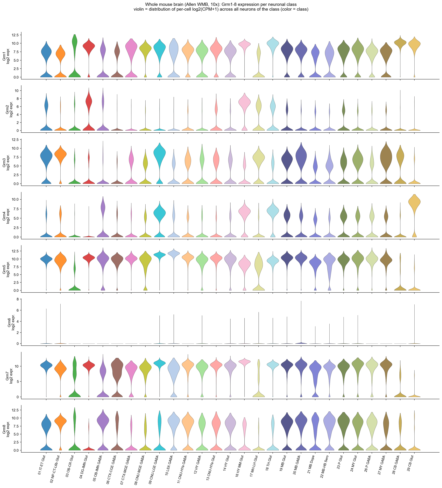
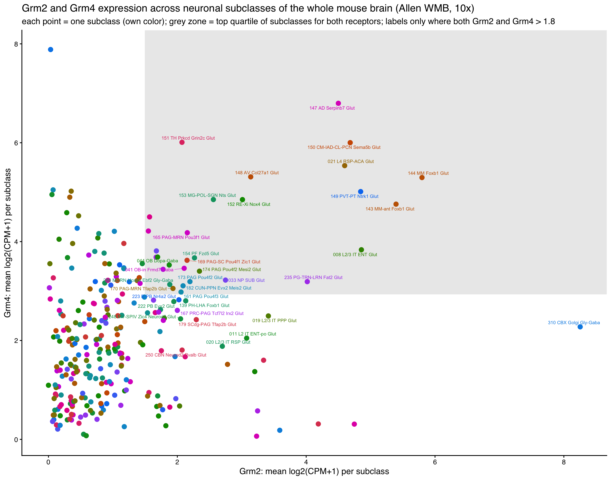
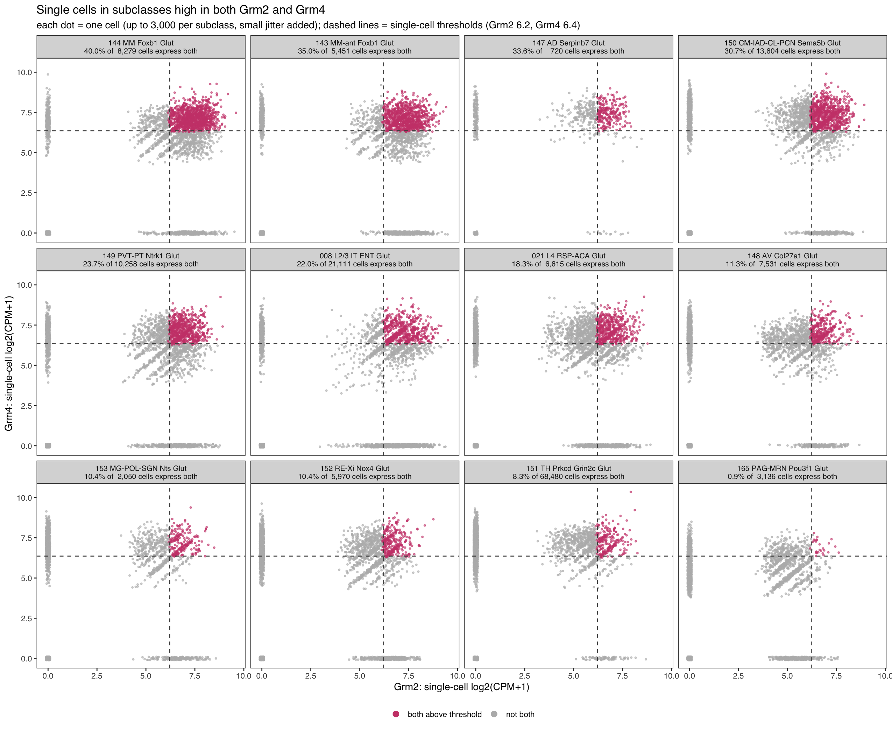

<!-- readme-v2 -->
# mglurs-brain-sc-datasets

Dataset catalogs (human, rodent, repositories): [docs/datasets.md](docs/datasets.md)

Goal: mGluR (Grm1-8) expression by fine cell type and brain region in public single-cell data. Brain needs expression levels, not % detected: detection saturates in neurons.

## Brain regions

🟨 = regions of interest: depression circuits (prefrontal, anterior cingulate, hippocampus, amygdala, striatum) and Parkinson's (striatum). Hippocampus is the worked example below; all other regions are in the [appendix](#appendix-other-regions).

| | | |
|---|---|---|
| 🟨 **[Prelimbic/infralimbic/orbital areas  (PL-ILA-ORB)](#prelimbicinfralimbicorbital-areas--pl-ila-orb)** | 🟨 **[Anterior cingulate area (ACA)](#anterior-cingulate-area-aca)** | 🟨 **[Hippocampal region (HIP)](#hippocampal-region-hip)** |
| 🟨 **[Cortical subplate (CTXsp)](#cortical-subplate-ctxsp)** | 🟨 **[Striatum-like amygdalar nuclei (sAMY)](#striatum-like-amygdalar-nuclei-samy)** | 🟨 **[Striatum dorsal region (STRd)](#striatum-dorsal-region-strd)** |
| 🟨 **[Striatum ventral region (STRv)](#striatum-ventral-region-strv)** | [Agranular insular area (AI)](#agranular-insular-area-ai) | [Auditory areas (AUD)](#auditory-areas-aud) |
| [Auditory/temporal/perirhinal/ectorhinal areas (AUD-TEa-PERI-ECT)](#auditorytemporalperirhinalectorhinal-areas-aud-tea-peri-ect) | [Cerebellum (CB)](#cerebellum-cb) | [Entorhinal area (ENT)](#entorhinal-area-ent) |
| [Hypothalamus (HY)](#hypothalamus-hy) | [Lateral septal complex (LSX)](#lateral-septal-complex-lsx) | [Medulla (MY)](#medulla-my) |
| [Midbrain (MB)](#midbrain-mb) | [Olfactory areas (OLF)](#olfactory-areas-olf) | [Pallidum (PAL)](#pallidum-pal) |
| [Pons (P)](#pons-p) | [Primary motor area (MOp)](#primary-motor-area-mop) | [Primary somatosensory area (SSp)](#primary-somatosensory-area-ssp) |
| [Retrohippocampal region (RHP)](#retrohippocampal-region-rhp) | [Retrosplenial area (RSP)](#retrosplenial-area-rsp) | [Somatomotor - Frontal pole (MO-FRP)](#somatomotor---frontal-pole-mo-frp) |
| [Somatosensory/gustatory/visceral areas (SS-GU-VISC)](#somatosensorygustatoryvisceral-areas-ss-gu-visc) | [Temporal/perirhinal/ectorhinal areas  (TEa-PERI-ECT)](#temporalperirhinalectorhinal-areas--tea-peri-ect) | [Thalamus (TH)](#thalamus-th) |
| [Visual areas (VIS)](#visual-areas-vis) | [Visual/posterior parietal  areas (VIS-PTLp)](#visualposterior-parietal--areas-vis-ptlp) |  |

## Module 1: Allen whole mouse brain (10x)

- Data: Allen ABC Atlas WMB, 4.04M cells, 10x v2/v3/Multiome 3' GEX, log2(CPM+1), 29 dissection regions (ROI)
- Labels: class > subclass > supertype > cluster (Allen taxonomy). UMAP: Allen `x`,`y` (10 nearest neighbours share subclass 80-99%; shuffled 4-43%)
- Colors in all figures = class
- Enrichment = (mean CPM in subclass + 1) / (mean CPM in other neurons of the same region + 1); one-sided rank-sum, BH q < 0.05
- Tables: `results/allen_wmb/` (`master_enrichment.csv.gz`: region x chemistry x gene x subclass)

Overall % of cells detecting each receptor (all 4.04M cells):

| Grm1 | Grm2 | Grm3 | Grm4 | Grm5 | Grm6 | Grm7 | Grm8 |
|---|---|---|---|---|---|---|---|
| 52 | 17 | 60 | 24 | 76 | 0.03 | 77 | 43 |

### Whole brain: subclass x Grm (mean log2 CPM)

All data from Allen Brain Atlas single cell processing pipeline, across different 10x datasets
v2 and v3 are pooled uncorrected, but the chemistry is not a big confound here (see correlation, later in readme)

Top 5 subclasses per class by Grm expression; all subclasses: `figures/allen_wmb/ALL_fig4_heatmap_all_subclasses_full.png`.

### Whole brain: Grm1-8 per neuronal class

The atlas has neuronal classes 01–29; each holds many subclasses (~340 total), and thousands of clusters
Below, are the vln plots showing Grm expression at the toplevel (neuronal classes)

Violin = distribution of per-cell log2(CPM+1) for one Grm across all neurons of a class (color = class).

### Example region: hippocampus

UMAP by class and Grm violins per subclass. All other regions are in the appendix. Feature plots (Grm on UMAP) and enrichment tables: `figures/allen_wmb/`, `results/allen_wmb/master_enrichment.csv.gz`.

### Hippocampal region (HIP)

## Grm2 and Grm4 coexpression preliminary analysis

log2(CPM) values for Grm2 and Grm4 are plotted, with each subclass represented.  This does not mean the transcripts were detected in the same single-cells, but reports the overall cluster's expression level

For clusters identified in the previous plot as enriched for both Grm2 and 4, expression was examined within single cells. expression thresholds were: Grm2 >= 6.2 and Grm4 >= 6.4 log2(CPM+1) per cell (median of neurons with detected expression). Clusters were selected when both receptors were in the top quartile of subclass means (Grm2 >= 1.5, Grm4 >= 2.9); 12 subclasses are shown

## Caveats

- Dissection region (ROI) is coarse; fine identity comes from subclass/supertype/cluster
- `mean_log2` averages logs; `mean_cpm` is linear
- Ambient RNA: single-digit % detection is not expression (e.g. Plp1 in 30-50% of neurons)
- Enrichment is relative to other neurons in the same region; small subclasses (< 200 cells) excluded
- Allen data: mouse 10x only, CC BY-NC 4.0. Plate-based, spatial, rat, human: not yet

## Next

- Independent 10x 3' datasets per region (CELLxGENE Census, literature) to replicate Allen patterns
- Supertype/cluster-level breakdown of top hits; ambient-RNA flags

## Appendix: other regions

Prioritized (depression / Parkinson's) regions first, then the rest alphabetically.

### Replicate check: 10x v2 vs v3

Per region x subclass, log2 enrichment in v2 cells vs v3 cells (only subclasses with enough cells in both).

| Grm1 | Grm2 | Grm3 | Grm4 | Grm5 | **Grm6 ⚠️** | Grm7 | Grm8 |
|---|---|---|---|---|---|---|---|
| 0.97 | 0.96 | 0.97 | 0.94 | 0.95 | **0.38** | 0.95 | 0.97 |

Spearman rho by gene.

**Grm6 does not replicate (rho = 0.38).** Grm6 is detected in only about 0.03% of brain cells (it is a retina-restricted receptor), so its per-subclass fold changes are driven by a handful of cells and background counts rather than real expression, while the other receptors are expressed in many cells and give stable estimates.

### Prelimbic/infralimbic/orbital areas  (PL-ILA-ORB)

### Anterior cingulate area (ACA)

### Cortical subplate (CTXsp)

### Striatum-like amygdalar nuclei (sAMY)

### Striatum dorsal region (STRd)

### Striatum ventral region (STRv)

### Agranular insular area (AI)

### Auditory areas (AUD)

### Auditory/temporal/perirhinal/ectorhinal areas (AUD-TEa-PERI-ECT)

### Cerebellum (CB)

### Entorhinal area (ENT)

### Hypothalamus (HY)

### Lateral septal complex (LSX)

### Medulla (MY)

### Midbrain (MB)

### Olfactory areas (OLF)

### Pallidum (PAL)

### Pons (P)

### Primary motor area (MOp)

### Primary somatosensory area (SSp)

### Retrohippocampal region (RHP)

### Retrosplenial area (RSP)

### Somatomotor - Frontal pole (MO-FRP)

### Somatosensory/gustatory/visceral areas (SS-GU-VISC)

### Temporal/perirhinal/ectorhinal areas  (TEa-PERI-ECT)

### Thalamus (TH)

### Visual areas (VIS)

### Visual/posterior parietal  areas (VIS-PTLp)

