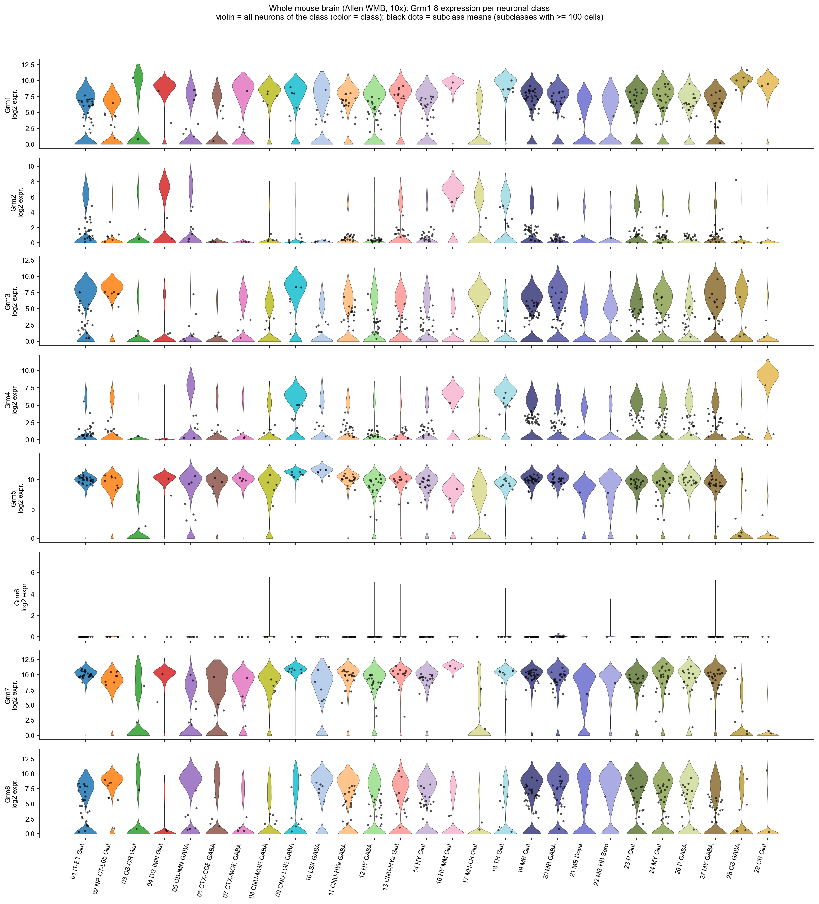
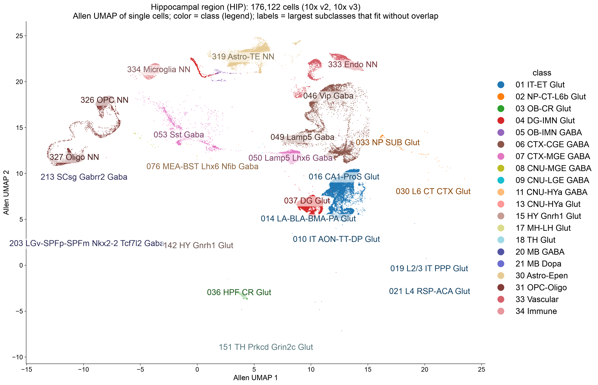
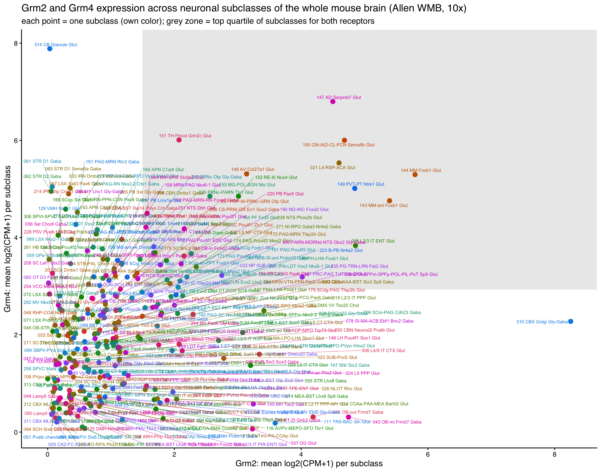
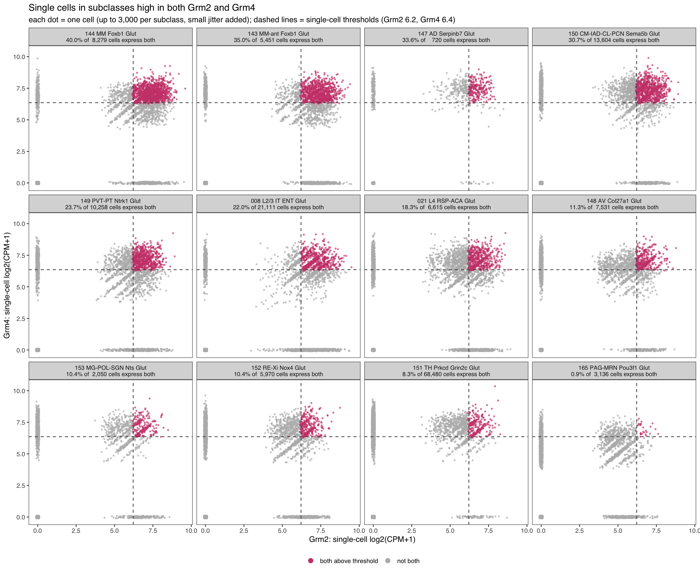
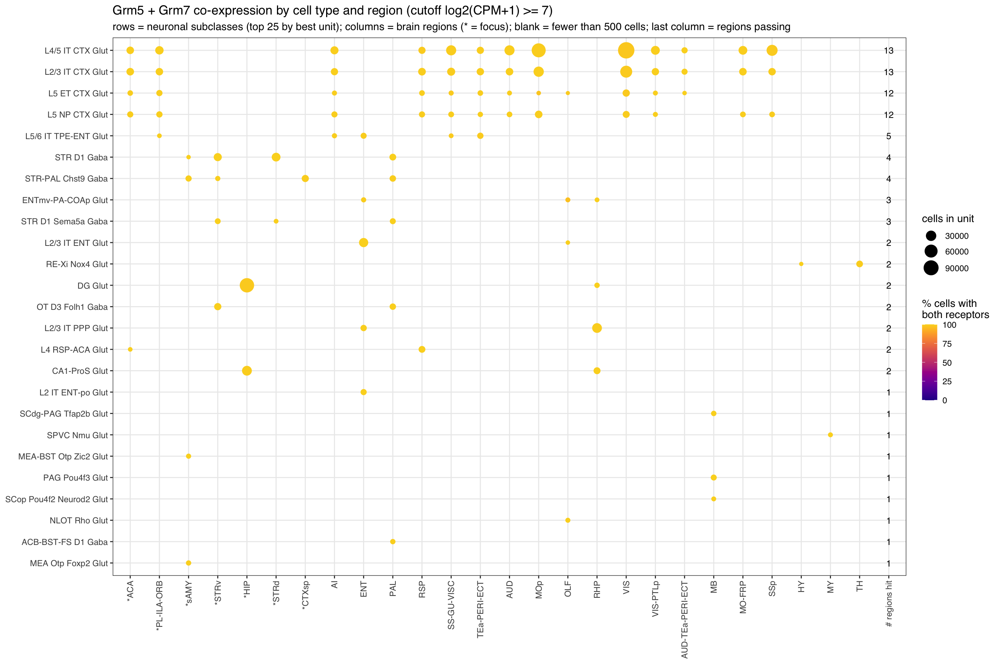
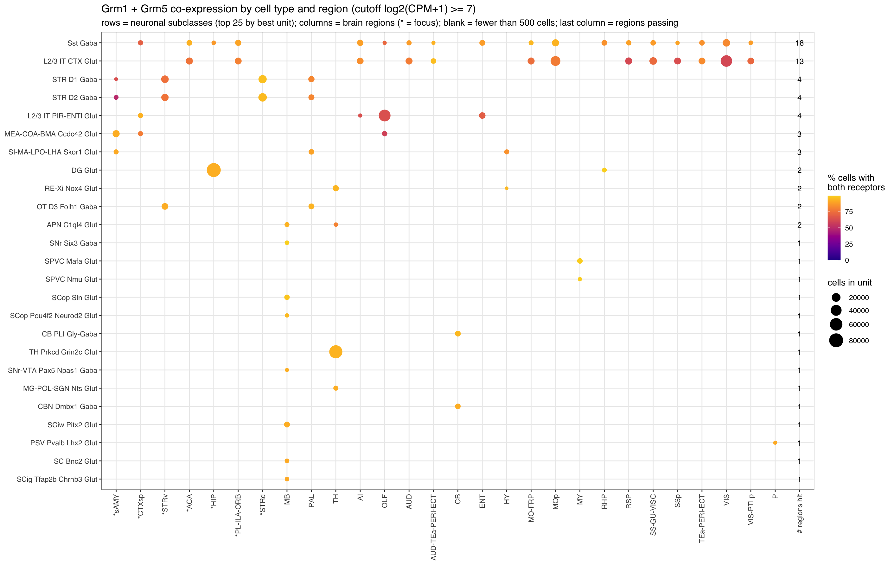
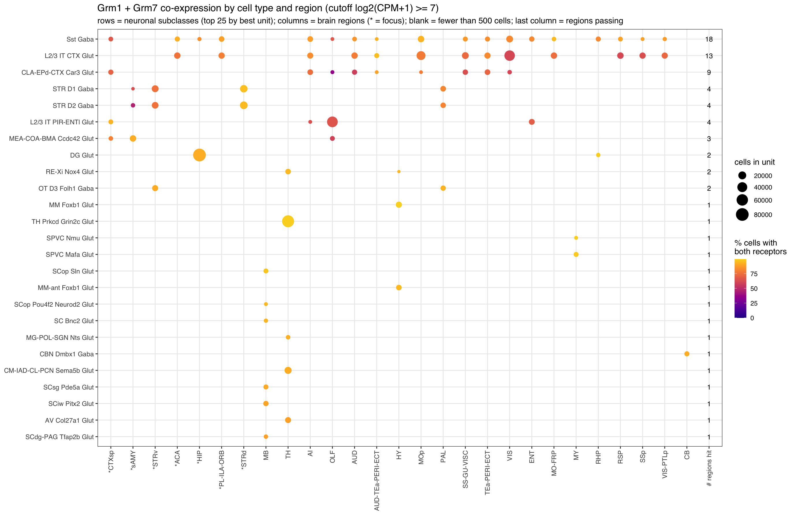
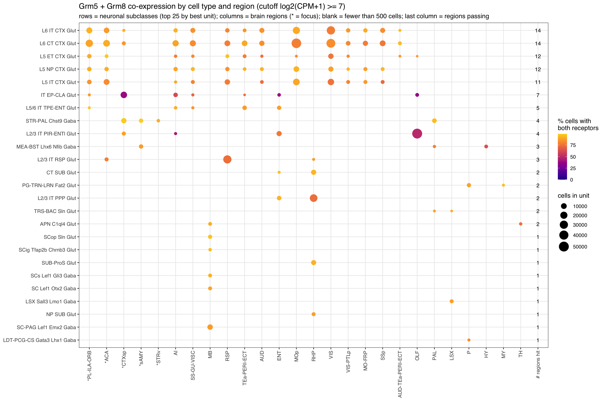
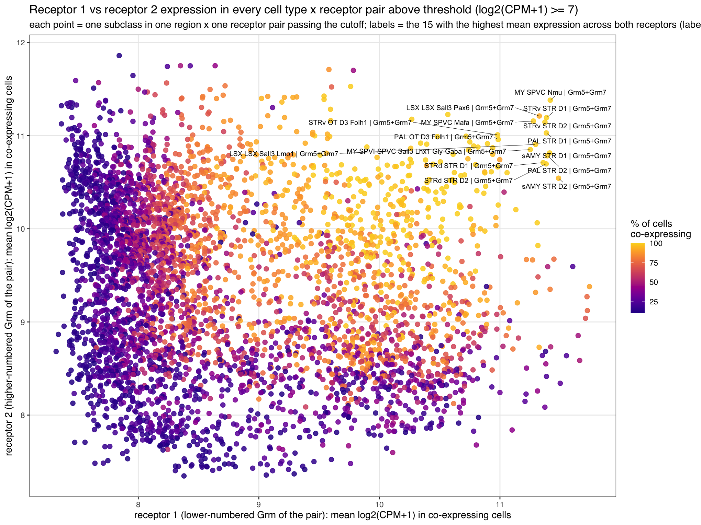

<!-- readme-v2 -->
# mglurs-brain-sc-datasets

Dataset catalogs (human, rodent, repositories): [docs/datasets.md](docs/datasets.md)

Goal: mGluR (Grm1-8) expression by fine cell type and brain region in public single-cell data. Brain needs expression levels, not % detected: detection saturates in neurons.

## Brain regions

🟨 = regions of interest: depression circuits (prefrontal, anterior cingulate, hippocampus, amygdala, striatum) and Parkinson's (striatum). Hippocampus is the worked example below; all other regions are in the [regions folder](figures/allen_wmb/regions/README.md).

| | | |
|---|---|---|
| 🟨 **[Prelimbic/infralimbic/orbital areas  (PL-ILA-ORB)](figures/allen_wmb/regions/README.md#prelimbicinfralimbicorbital-areas--pl-ila-orb)** | 🟨 **[Anterior cingulate area (ACA)](figures/allen_wmb/regions/README.md#anterior-cingulate-area-aca)** | 🟨 **[Hippocampal region (HIP)](#example-region-hippocampus)** |
| 🟨 **[Cortical subplate (CTXsp)](figures/allen_wmb/regions/README.md#cortical-subplate-ctxsp)** | 🟨 **[Striatum-like amygdalar nuclei (sAMY)](figures/allen_wmb/regions/README.md#striatum-like-amygdalar-nuclei-samy)** | 🟨 **[Striatum dorsal region (STRd)](figures/allen_wmb/regions/README.md#striatum-dorsal-region-strd)** |
| 🟨 **[Striatum ventral region (STRv)](figures/allen_wmb/regions/README.md#striatum-ventral-region-strv)** | [Agranular insular area (AI)](figures/allen_wmb/regions/README.md#agranular-insular-area-ai) | [Auditory areas (AUD)](figures/allen_wmb/regions/README.md#auditory-areas-aud) |
| [Auditory/temporal/perirhinal/ectorhinal areas (AUD-TEa-PERI-ECT)](figures/allen_wmb/regions/README.md#auditorytemporalperirhinalectorhinal-areas-aud-tea-peri-ect) | [Cerebellum (CB)](figures/allen_wmb/regions/README.md#cerebellum-cb) | [Entorhinal area (ENT)](figures/allen_wmb/regions/README.md#entorhinal-area-ent) |
| [Hypothalamus (HY)](figures/allen_wmb/regions/README.md#hypothalamus-hy) | [Lateral septal complex (LSX)](figures/allen_wmb/regions/README.md#lateral-septal-complex-lsx) | [Medulla (MY)](figures/allen_wmb/regions/README.md#medulla-my) |
| [Midbrain (MB)](figures/allen_wmb/regions/README.md#midbrain-mb) | [Olfactory areas (OLF)](figures/allen_wmb/regions/README.md#olfactory-areas-olf) | [Pallidum (PAL)](figures/allen_wmb/regions/README.md#pallidum-pal) |
| [Pons (P)](figures/allen_wmb/regions/README.md#pons-p) | [Primary motor area (MOp)](figures/allen_wmb/regions/README.md#primary-motor-area-mop) | [Primary somatosensory area (SSp)](figures/allen_wmb/regions/README.md#primary-somatosensory-area-ssp) |
| [Retrohippocampal region (RHP)](figures/allen_wmb/regions/README.md#retrohippocampal-region-rhp) | [Retrosplenial area (RSP)](figures/allen_wmb/regions/README.md#retrosplenial-area-rsp) | [Somatomotor - Frontal pole (MO-FRP)](figures/allen_wmb/regions/README.md#somatomotor---frontal-pole-mo-frp) |
| [Somatosensory/gustatory/visceral areas (SS-GU-VISC)](figures/allen_wmb/regions/README.md#somatosensorygustatoryvisceral-areas-ss-gu-visc) | [Temporal/perirhinal/ectorhinal areas  (TEa-PERI-ECT)](figures/allen_wmb/regions/README.md#temporalperirhinalectorhinal-areas--tea-peri-ect) | [Thalamus (TH)](figures/allen_wmb/regions/README.md#thalamus-th) |
| [Visual areas (VIS)](figures/allen_wmb/regions/README.md#visual-areas-vis) | [Visual/posterior parietal  areas (VIS-PTLp)](figures/allen_wmb/regions/README.md#visualposterior-parietal--areas-vis-ptlp) |  |

## Module 1: Allen whole mouse brain (10x)

- Data: Allen ABC Atlas WMB, 4.04M cells, 10x v2/v3/Multiome 3' GEX, log2(CPM+1), 29 dissection regions (ROI)
- Labels: class > subclass > supertype > cluster (Allen taxonomy). UMAP: Allen `x`,`y` (10 nearest neighbours share subclass 80-99%; shuffled 4-43%)
- Colors in all figures = class
- Enrichment = (mean CPM in subclass + 1) / (mean CPM in other neurons of the same region + 1); one-sided rank-sum, BH q < 0.05
- Tables: `results/allen_wmb/` (`master_enrichment.csv.gz`: region x chemistry x gene x subclass)

Overall % of cells detecting each receptor (all 4.04M cells):

| Grm1 | Grm2 | Grm3 | Grm4 | Grm5 | Grm6 | Grm7 | Grm8 |
|---|---|---|---|---|---|---|---|
| 52 | 17 | 60 | 24 | 76 | 0.03 | 77 | 43 |

### Whole brain: subclass x Grm (mean log2 CPM)

All data from Allen Brain Atlas single cell processing pipeline, across different 10x datasets
v2 and v3 are pooled uncorrected, but the chemistry is not a big confound here (see correlation, later in readme)

Top 5 subclasses per class by Grm expression; all subclasses: `figures/allen_wmb/ALL_fig4_heatmap_all_subclasses_full.png`.

### Whole brain: Grm1-8 per neuronal class

The atlas has neuronal classes 01–29; each holds many subclasses (~340 total), and thousands of clusters
Below, are the vln plots showing Grm expression at the toplevel (neuronal classes)

Violin = distribution of per-cell log2(CPM+1) for one Grm across all neurons of a class (color = class).

### Example region: hippocampus

UMAP (x and y coordinates directly from ABA, no reclustering) by class and Grm violins per subclass. Other regions (UMAP + violins): see the [regions folder](figures/allen_wmb/regions/README.md). Feature plots (Grm on UMAP) and enrichment tables: `figures/allen_wmb/`, `results/allen_wmb/master_enrichment.csv.gz`.

### Hippocampal region (HIP)

More regions: [UMAP and violins for all other regions](figures/allen_wmb/regions/README.md).

## Grm2 and Grm4 coexpression preliminary analysis

log2(CPM) values for Grm2 and Grm4 are plotted, with each subclass represented.  This does not mean the transcripts were detected in the same single-cells, but reports the overall cluster's expression level

all subclasses were filtered for those with >200 cells, using mean log2(CPM+1) for Grm2 and Grm4 pooled over all regions (i.e. PV GABA neurons, pulled from multiple brain regions).  Subclasses were further filtered for those whose mean is in the top quartile (at or above the 75th percentile of subclass means) for both Grm2 and Grm4 (grey shaded zone on the scatter plot).  The number of subclasses in the graphs below was capped at 12; the total that passed the filtering was: 30

For clusters identified in the previous plot as enriched for both Grm2 and 4, expression was examined within single cells. expression thresholds were: Grm2 >= 6.2 and Grm4 >= 6.4 log2(CPM+1) per cell (median of neurons with detected expression). Clusters were selected when both receptors were in the top quartile of subclass means (Grm2 >= 1.5, Grm4 >= 2.9); 12 subclasses are shown

## Unbiased look at mGluR co-expression (by pairs of receptors) across cell types across the whole ABA dataset

Processing: the unit of analysis is a neuronal subclass within one dissection region (>= 500 cells). All 28 pairs of Grm1-8 were tested. A cell counts as co-expressing a pair when both receptors are above one shared absolute cutoff for all receptors, run at log2(CPM+1) >= 3, 5, 7 (about 7, 31, 127 CPM). A unit passes when >= 10% of its cells (and >= 25 cells) co-express a pair; units and pairs were then ranked at the highest cutoff (log2 >= 7). The dot plots below show, for the top 4 receptor pairs, which cell types pass in which regions. The figures for each processing step (stringency, top hits, pair heatmap, region discordance, threshold check) are in [pairs_coexpression_whole_atlas](figures/allen_wmb/pairs_coexpression_whole_atlas/).

Each point is one cell type (subclass in one region) x receptor pair that passes the cutoff; x and y are the mean expression of the two receptors in the co-expressing cells (receptor 1 is the lower-numbered Grm of the pair); color = % of the unit's cells co-expressing. Labeled points are the 15 with the highest mean expression across both receptors; label = region + subclass | receptor pair.

Label key:

- **MY SPVC Nmu | Grm5+Grm7**: Medulla (MY); subclass 258 SPVC Nmu Glut (class 24 MY Glut); Grm5 + Grm7; 960 cells, 100% co-express
- **STRv STR D1 | Grm5+Grm7**: Striatum ventral region (STRv); subclass 061 STR D1 Gaba (class 09 CNU-LGE GABA); Grm5 + Grm7; 12,350 cells, 100% co-express
- **LSX LSX Sall3 Pax6 | Grm5+Grm7**: Lateral septal complex (LSX); subclass 067 LSX Sall3 Pax6 Gaba (class 10 LSX GABA); Grm5 + Grm7; 1,029 cells, 92% co-express
- **STRv STR D2 | Grm5+Grm7**: Striatum ventral region (STRv); subclass 062 STR D2 Gaba (class 09 CNU-LGE GABA); Grm5 + Grm7; 11,148 cells, 99% co-express
- **MY SPVC Mafa | Grm5+Grm7**: Medulla (MY); subclass 256 SPVC Mafa Glut (class 24 MY Glut); Grm5 + Grm7; 3,388 cells, 99% co-express
- **PAL STR D1 | Grm5+Grm7**: Pallidum (PAL); subclass 061 STR D1 Gaba (class 09 CNU-LGE GABA); Grm5 + Grm7; 5,851 cells, 100% co-express
- **sAMY STR D1 | Grm5+Grm7**: Striatum-like amygdalar nuclei (sAMY); subclass 061 STR D1 Gaba (class 09 CNU-LGE GABA); Grm5 + Grm7; 572 cells, 100% co-express
- **LSX LSX Sall3 Lmo1 | Grm5+Grm7**: Lateral septal complex (LSX); subclass 072 LSX Sall3 Lmo1 Gaba (class 10 LSX GABA); Grm5 + Grm7; 2,423 cells, 99% co-express
- **PAL STR D2 | Grm5+Grm7**: Pallidum (PAL); subclass 062 STR D2 Gaba (class 09 CNU-LGE GABA); Grm5 + Grm7; 4,970 cells, 99% co-express
- **MY SPVI-SPVC Sall3 Lhx1 Gly-Gaba | Grm5+Grm7**: Medulla (MY); subclass 306 SPVI-SPVC Sall3 Lhx1 Gly-Gaba (class 27 MY GABA); Grm5 + Grm7; 2,002 cells, 100% co-express
- **STRd STR D2 | Grm5+Grm7**: Striatum dorsal region (STRd); subclass 062 STR D2 Gaba (class 09 CNU-LGE GABA); Grm5 + Grm7; 18,139 cells, 100% co-express
- **STRd STR D1 | Grm5+Grm7**: Striatum dorsal region (STRd); subclass 061 STR D1 Gaba (class 09 CNU-LGE GABA); Grm5 + Grm7; 16,660 cells, 100% co-express
- **sAMY STR D2 | Grm5+Grm7**: Striatum-like amygdalar nuclei (sAMY); subclass 062 STR D2 Gaba (class 09 CNU-LGE GABA); Grm5 + Grm7; 1,808 cells, 95% co-express
- **STRv OT D3 Folh1 | Grm5+Grm7**: Striatum ventral region (STRv); subclass 060 OT D3 Folh1 Gaba (class 09 CNU-LGE GABA); Grm5 + Grm7; 7,665 cells, 100% co-express
- **PAL OT D3 Folh1 | Grm5+Grm7**: Pallidum (PAL); subclass 060 OT D3 Folh1 Gaba (class 09 CNU-LGE GABA); Grm5 + Grm7; 4,471 cells, 100% co-express

## Caveats

- Dissection region (ROI) is coarse; fine identity comes from subclass/supertype/cluster
- `mean_log2` averages logs; `mean_cpm` is linear
- Ambient RNA: single-digit % detection is not expression (e.g. Plp1 in 30-50% of neurons)
- Enrichment is relative to other neurons in the same region; small subclasses (< 200 cells) excluded
- Allen data: mouse 10x only, CC BY-NC 4.0. Plate-based, spatial, rat, human: not yet

## Next

- Independent 10x 3' datasets per region (CELLxGENE Census, literature) to replicate Allen patterns
- Supertype/cluster-level breakdown of top hits; ambient-RNA flags

## Appendix

### Replicate check: 10x v2 vs v3

Per region x subclass, log2 enrichment in v2 cells vs v3 cells (only subclasses with enough cells in both).

| Grm1 | Grm2 | Grm3 | Grm4 | Grm5 | **Grm6 ⚠️** | Grm7 | Grm8 |
|---|---|---|---|---|---|---|---|
| 0.97 | 0.96 | 0.97 | 0.94 | 0.95 | **0.38** | 0.95 | 0.97 |

Spearman rho by gene.

**Grm6 does not replicate (rho = 0.38).** Grm6 is detected in only about 0.03% of brain cells (it is a retina-restricted receptor), so its per-subclass fold changes are driven by a handful of cells and background counts rather than real expression, while the other receptors are expressed in many cells and give stable estimates.
