<!-- readme-v2 -->
# mglurs-brain-sc-datasets

Dataset catalogs (human, rodent, repositories): [docs/datasets.md](docs/datasets.md)

Goal: mGluR (Grm1-8) expression by fine cell type and brain region in public single-cell data. Brain needs expression levels, not % detected: detection saturates in neurons.

## Module 1: Allen whole mouse brain (10x)

- Data: Allen ABC Atlas WMB, 4.04M cells, 10x v2/v3/Multiome 3' GEX, log2(CPM+1), 29 dissection regions (ROI)
- Labels: class > subclass > supertype > cluster (Allen taxonomy). UMAP: Allen `x`,`y` (10 nearest neighbours share subclass 80-99%; shuffled 4-43%)
- Colors in all figures = class
- Overall % cells detecting: Grm1 52, Grm2 17, Grm3 60, Grm4 24, Grm5 76, Grm6 0.03, Grm7 77, Grm8 43
- Enrichment = (mean CPM in subclass + 1) / (mean CPM in other neurons of the same region + 1); one-sided rank-sum, BH q < 0.05
- Tables: `results/allen_wmb/` (`master_enrichment.csv.gz`: region x chemistry x gene x subclass)

### Whole brain: subclass x Grm (mean log2 CPM)

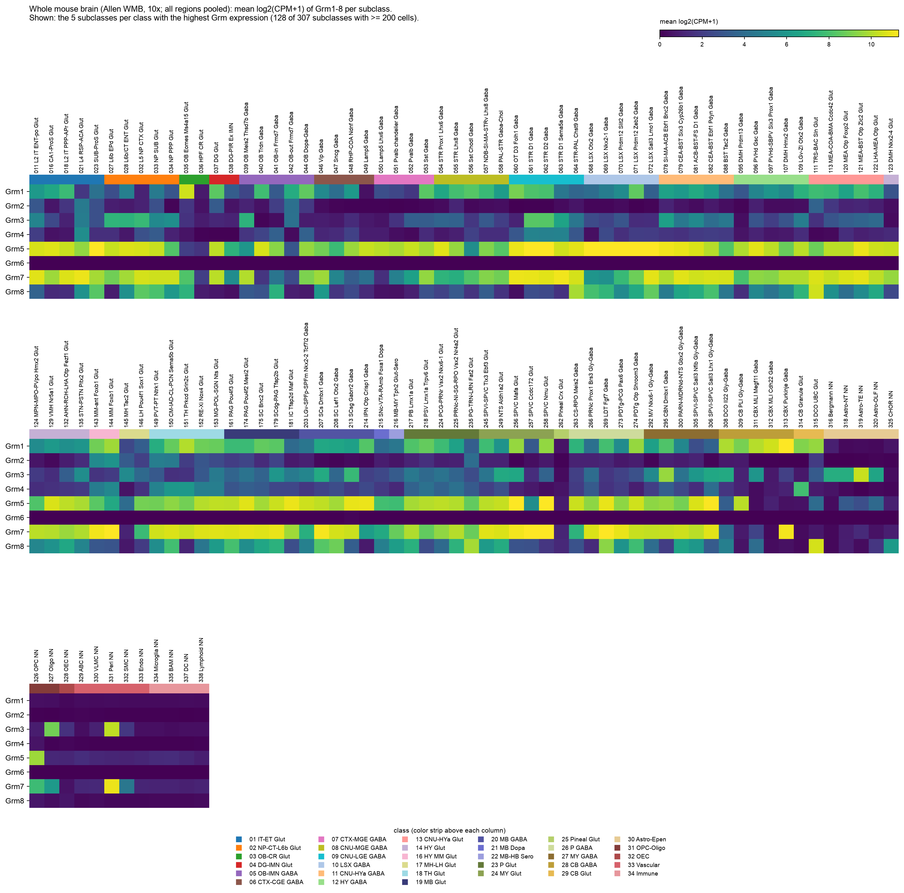

| Gene | Top 3 subclasses (mean log2) |
|---|---|
| Grm1 | 313 CBX Purkinje Gaba (11.7); 312 CBX MLI Cdh22 Gaba (10.5); 035 OB Eomes Ms4a15 Glut (10.5) |
| Grm2 | 310 CBX Golgi Gly-Gaba (8.3); 144 MM Foxb1 Glut (5.8); 143 MM-ant Foxb1 Glut (5.4) |
| Grm3 | 319 Astro-TE NN (10.3); 331 Peri NN (10.2); 295 CBN Dmbx1 Gaba (9.6) |
| Grm4 | 314 CB Granule Glut (7.9); 147 AD Serpinb7 Glut (6.8); 151 TH Prkcd Grin2c Glut (6.0) |
| Grm5 | 071 LSX Prdm12 Zeb2 Gaba (11.7); 070 LSX Prdm12 Slit2 Gaba (11.7); 069 LSX Nkx2-1 Gaba (11.7) |
| Grm6 | 204 SC Otx2 Gcnt4 Gaba (0.3); 213 SCsg Gabrr2 Gaba (0.1); 202 PRT Tcf7l2 Gaba (0.0) |
| Grm7 | 257 SPVC Ccdc172 Glut (11.8); 144 MM Foxb1 Glut (11.5); 110 BST-po Iigp1 Glut (11.4) |
| Grm8 | 315 DCO UBC Glut (10.6); 111 TRS-BAC Sln Glut (10.5); 064 STR-PAL Chst9 Gaba (9.8) |

### Replicate check: 10x v2 vs v3

Per region x subclass, log2 enrichment in v2 cells vs v3 cells (only subclasses with enough cells in both).

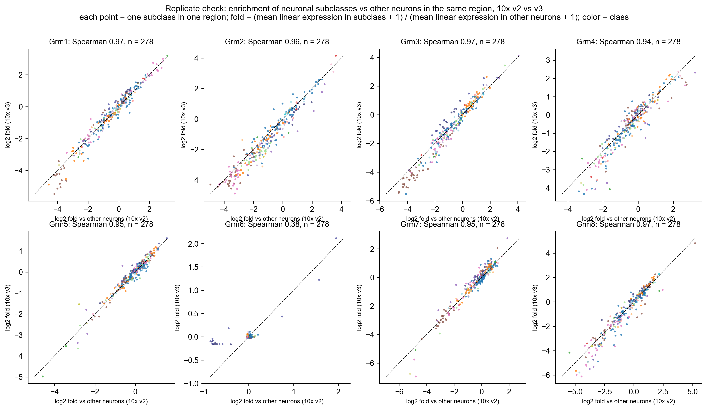

| Grm1 | Grm2 | Grm3 | Grm4 | Grm5 | Grm6 | Grm7 | Grm8 |
|---|---|---|---|---|---|---|---|
| 0.97 | 0.96 | 0.96 | 0.94 | 0.96 | 0.39 | 0.96 | 0.97 |

Spearman rho by gene.

## Regions

Per region: UMAP by class, Grm on UMAP, Grm violins per subclass, top enriched neuronal subclasses (pooled chemistries).

### ACA

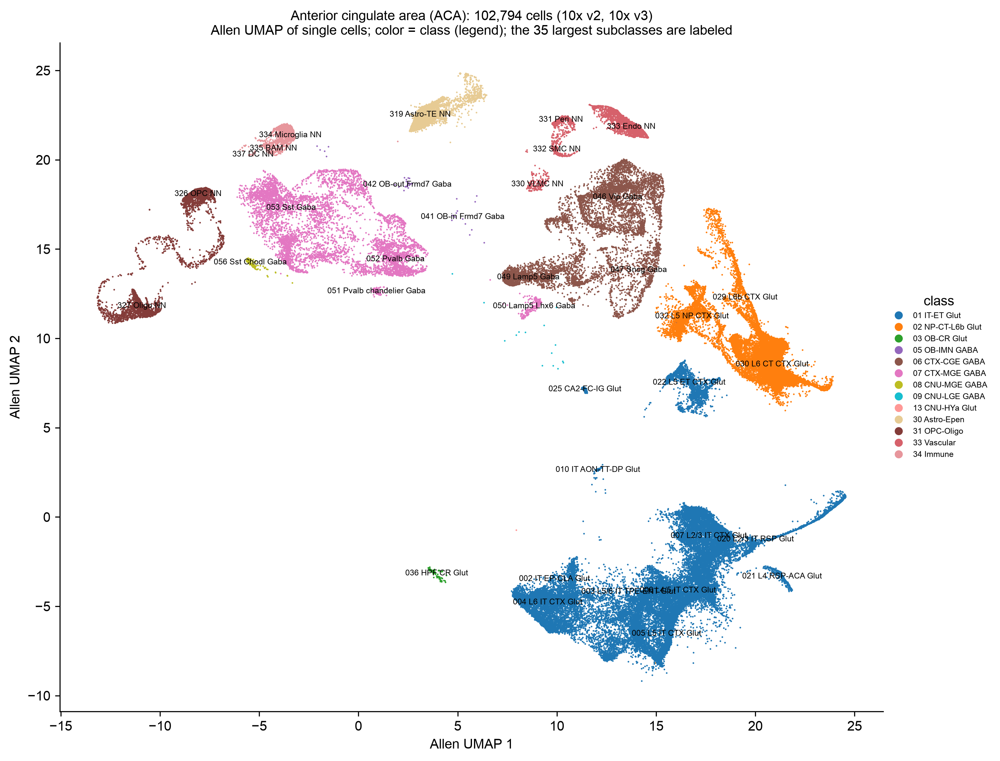

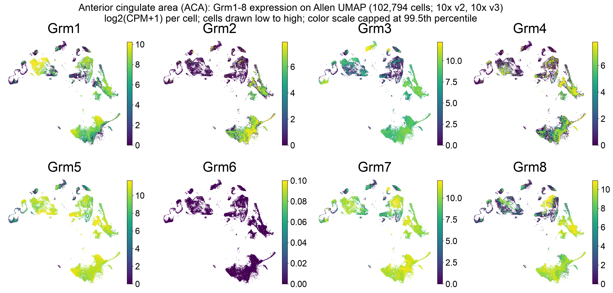

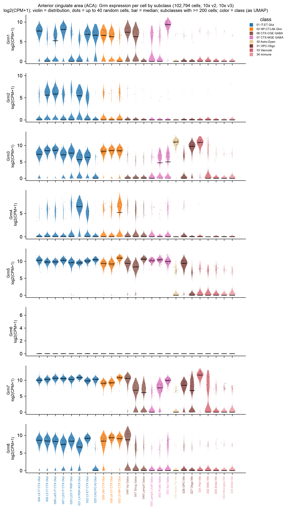

| Gene | Most enriched neuronal subclasses (fold; mean CPM; n cells) |
|---|---|
| Grm1 | 053 Sst Gaba (8.4x; 14230; 3.9k); 007 L2/3 IT CTX Glut (2.4x; 4820; 9.5k); 004 L6 IT CTX Glut (1.5x; 3344; 9.1k) |
| Grm2 | 006 L4/5 IT CTX Glut (3.3x; 547; 9.2k); 005 L5 IT CTX Glut (2.8x; 475; 10.6k); 021 L4 RSP-ACA Glut (1.7x; 358; 675) |
| Grm3 | 006 L4/5 IT CTX Glut (1.9x; 6572; 9.2k); 030 L6 CT CTX Glut (1.8x; 5865; 16.9k); 032 L5 NP CTX Glut (1.6x; 5888; 3.5k) |
| Grm4 | 021 L4 RSP-ACA Glut (6.0x; 852; 675); 032 L5 NP CTX Glut (4.9x; 618; 3.5k); 030 L6 CT CTX Glut (1.3x; 177; 16.9k) |
| Grm5 | 032 L5 NP CTX Glut (2.6x; 60337; 3.5k); 049 Lamp5 Gaba (1.8x; 44288; 2.9k); 052 Pvalb Gaba (1.6x; 40882; 2.0k) |
| Grm7 | 021 L4 RSP-ACA Glut (1.9x; 53917; 675); 032 L5 NP CTX Glut (1.9x; 52036; 3.5k); 046 Vip Gaba (1.8x; 48807; 3.9k) |
| Grm8 | 046 Vip Gaba (2.6x; 18618; 3.9k); 030 L6 CT CTX Glut (2.2x; 13393; 16.9k); 032 L5 NP CTX Glut (1.4x; 10825; 3.5k) |

### AI

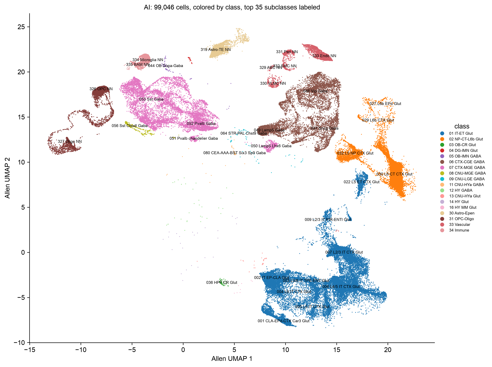

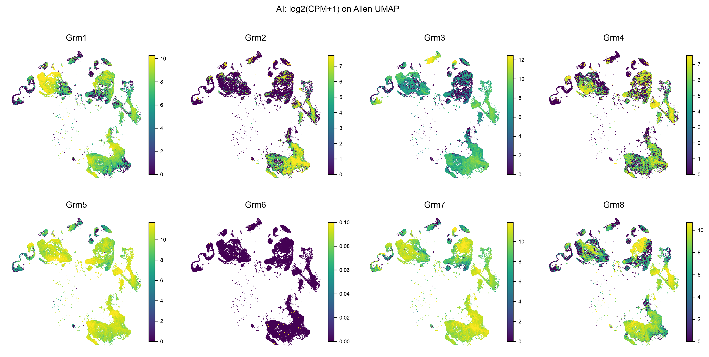

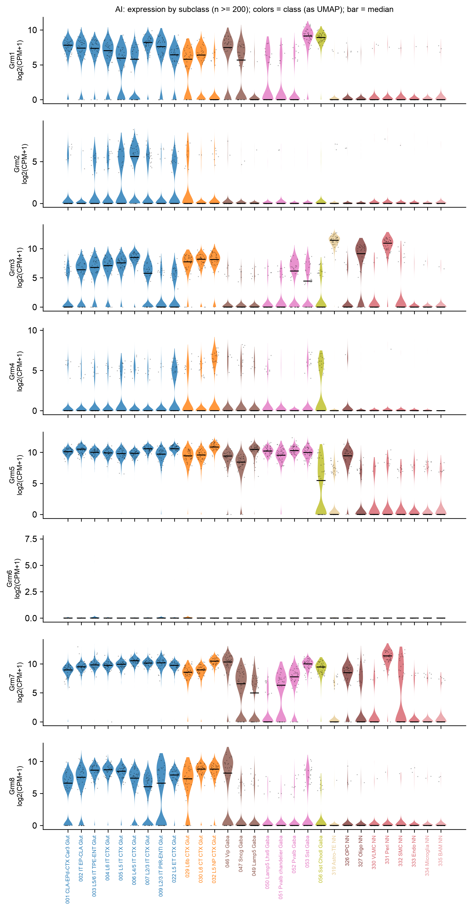

| Gene | Most enriched neuronal subclasses (fold; mean CPM; n cells) |
|---|---|
| Grm1 | 053 Sst Gaba (6.5x; 11972; 6.0k); 056 Sst Chodl Gaba (3.2x; 8477; 360); 007 L2/3 IT CTX Glut (1.9x; 4665; 7.7k) |
| Grm2 | 006 L4/5 IT CTX Glut (7.1x; 477; 12.2k); 005 L5 IT CTX Glut (1.8x; 237; 843); 029 L6b CTX Glut (1.4x; 182; 439) |
| Grm3 | 006 L4/5 IT CTX Glut (3.4x; 6319; 12.2k); 030 L6 CT CTX Glut (2.1x; 4557; 13.1k); 032 L5 NP CTX Glut (1.9x; 4789; 3.4k) |
| Grm4 | 032 L5 NP CTX Glut (5.1x; 456; 3.4k); 056 Sst Chodl Gaba (1.9x; 195; 360); 053 Sst Gaba (1.6x; 163; 6.0k) |
| Grm5 | 032 L5 NP CTX Glut (2.2x; 59651; 3.4k); 007 L2/3 IT CTX Glut (1.6x; 42669; 7.7k); 022 L5 ET CTX Glut (1.6x; 43703; 1.1k) |
| Grm6 | 003 L5/6 IT TPE-ENT Glut (1.5x; 1; 1.3k) |
| Grm7 | 006 L4/5 IT CTX Glut (2.3x; 42322; 12.2k); 046 Vip Gaba (2.0x; 43879; 3.7k); 032 L5 NP CTX Glut (1.9x; 40831; 3.4k) |
| Grm8 | 046 Vip Gaba (3.6x; 14223; 3.7k); 030 L6 CT CTX Glut (2.4x; 8603; 13.1k); 032 L5 NP CTX Glut (2.0x; 8572; 3.4k) |

### AUD-TEa-PERI-ECT

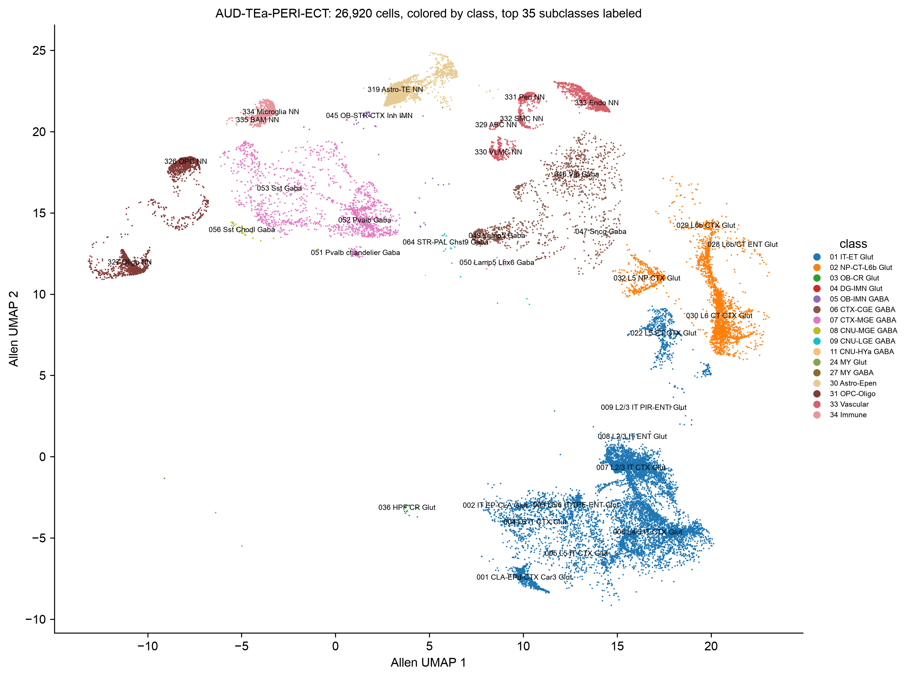

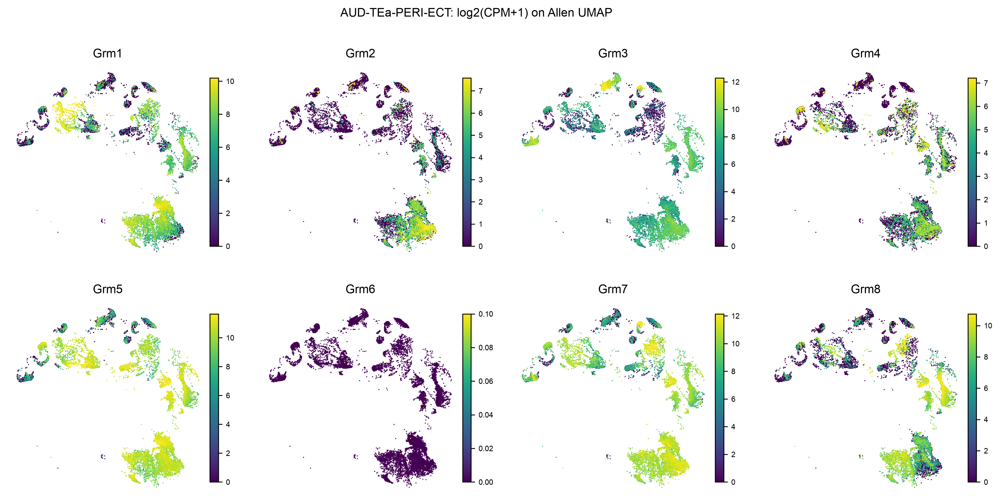

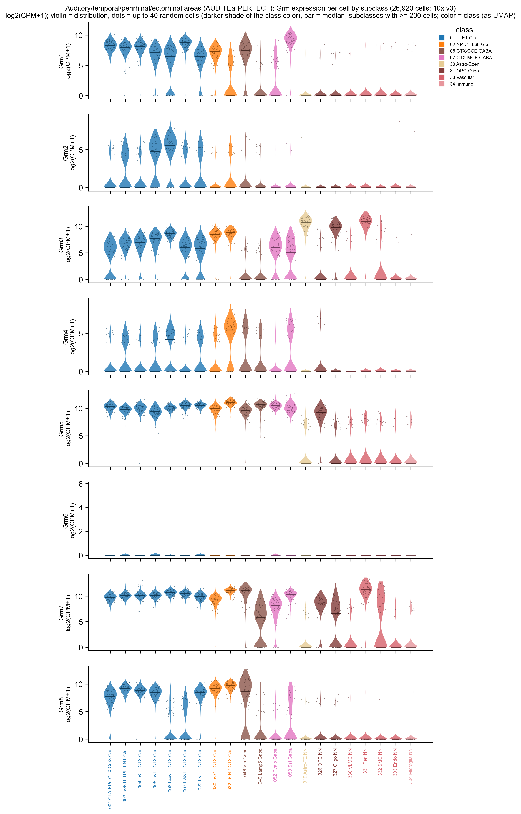

| Gene | Most enriched neuronal subclasses (fold; mean CPM; n cells) |
|---|---|
| Grm1 | 053 Sst Gaba (4.6x; 14782; 713); 007 L2/3 IT CTX Glut (2.7x; 7462; 3.3k); 001 CLA-EPd-CTX Car3 Glut (1.4x; 5213; 774) |
| Grm2 | 006 L4/5 IT CTX Glut (8.2x; 455; 3.7k); 005 L5 IT CTX Glut (1.6x; 229; 318) |
| Grm3 | 006 L4/5 IT CTX Glut (3.1x; 7026; 3.7k); 032 L5 NP CTX Glut (2.5x; 7968; 430); 030 L6 CT CTX Glut (2.0x; 5825; 2.2k) |
| Grm4 | 032 L5 NP CTX Glut (4.5x; 374; 430); 053 Sst Gaba (2.5x; 216; 713); 046 Vip Gaba (2.2x; 193; 610) |
| Grm5 | 032 L5 NP CTX Glut (2.2x; 68133; 430); 007 L2/3 IT CTX Glut (1.5x; 42439; 3.3k); 049 Lamp5 Gaba (1.4x; 43909; 500) |
| Grm6 | 022 L5 ET CTX Glut (1.1x; 0; 590) |
| Grm7 | 046 Vip Gaba (2.2x; 71591; 610); 032 L5 NP CTX Glut (2.2x; 71735; 430); 006 L4/5 IT CTX Glut (1.7x; 49347; 3.7k) |
| Grm8 | 032 L5 NP CTX Glut (4.3x; 19019; 430); 046 Vip Gaba (4.0x; 17225; 610); 030 L6 CT CTX Glut (3.5x; 12569; 2.2k) |

### AUD

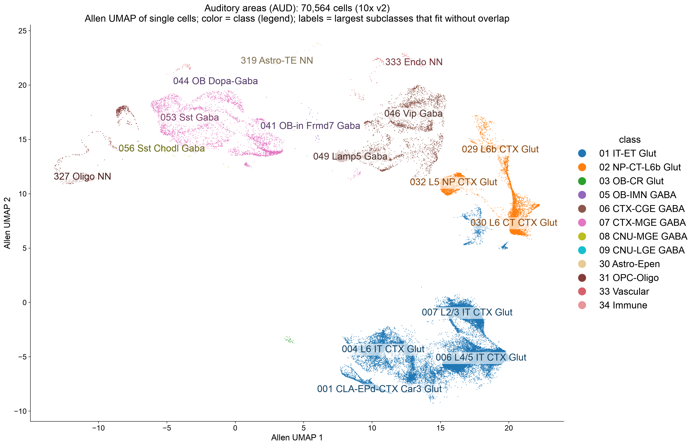

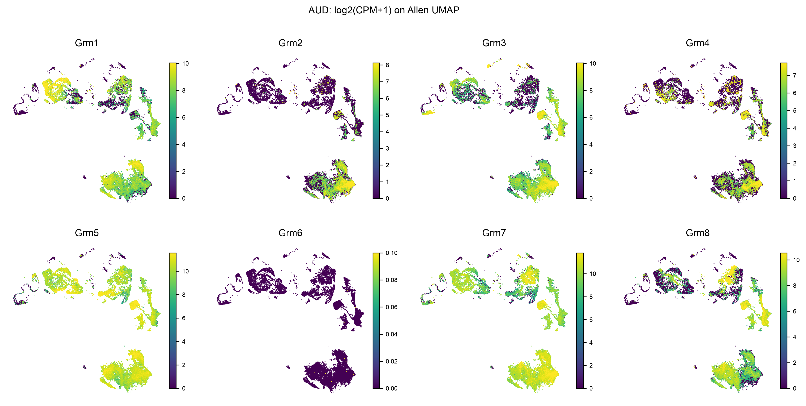

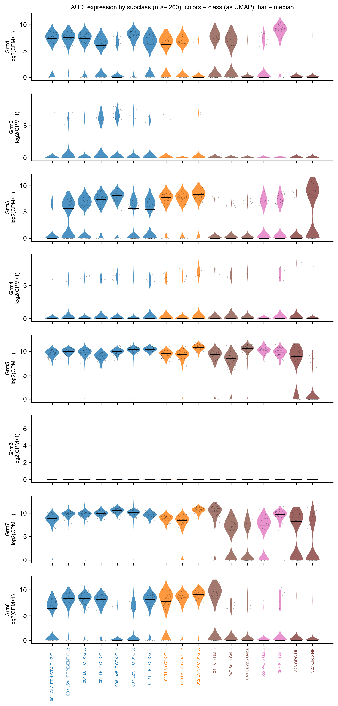

| Gene | Most enriched neuronal subclasses (fold; mean CPM; n cells) |
|---|---|
| Grm1 | 053 Sst Gaba (7.8x; 11183; 2.4k); 007 L2/3 IT CTX Glut (3.0x; 4198; 9.3k); 003 L5/6 IT TPE-ENT Glut (1.6x; 2931; 287) |
| Grm2 | 006 L4/5 IT CTX Glut (6.8x; 417; 27.1k); 005 L5 IT CTX Glut (1.2x; 242; 1.8k) |
| Grm3 | 006 L4/5 IT CTX Glut (2.8x; 4277; 27.1k); 032 L5 NP CTX Glut (2.2x; 5544; 2.2k); 030 L6 CT CTX Glut (1.2x; 3073; 7.3k) |
| Grm4 | 032 L5 NP CTX Glut (2.8x; 309; 2.2k); 006 L4/5 IT CTX Glut (1.9x; 165; 27.1k); 053 Sst Gaba (1.6x; 184; 2.4k) |
| Grm5 | 032 L5 NP CTX Glut (2.3x; 53451; 2.2k); 049 Lamp5 Gaba (1.8x; 42841; 2.0k); 052 Pvalb Gaba (1.5x; 36623; 1.5k) |
| Grm7 | 006 L4/5 IT CTX Glut (2.2x; 43806; 27.1k); 032 L5 NP CTX Glut (1.6x; 46166; 2.2k); 046 Vip Gaba (1.5x; 42915; 1.9k) |
| Grm8 | 046 Vip Gaba (5.9x; 13922; 1.9k); 032 L5 NP CTX Glut (4.7x; 11365; 2.2k); 030 L6 CT CTX Glut (3.2x; 6957; 7.3k) |

### CB

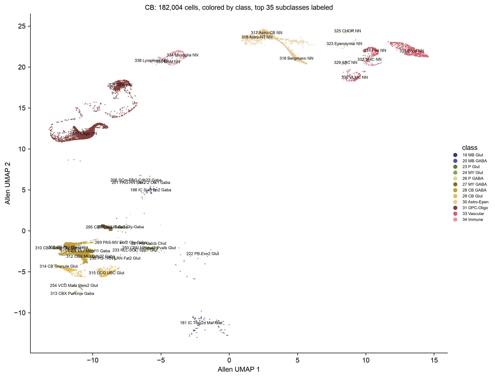

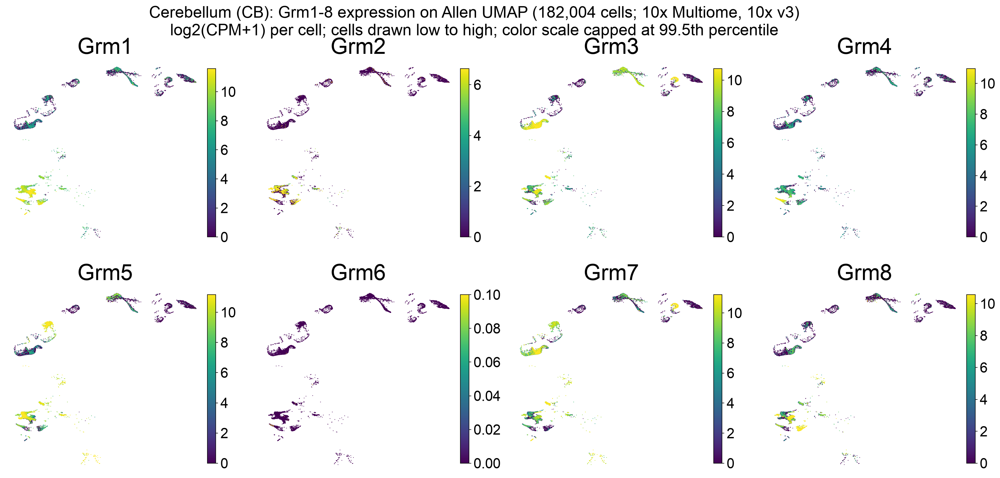

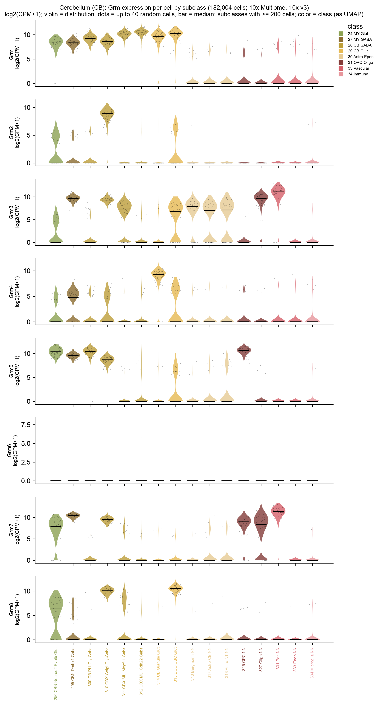

| Gene | Most enriched neuronal subclasses (fold; mean CPM; n cells) |
|---|---|
| Grm1 | 312 CBX MLI Cdh22 Gaba (1.9x; 41745; 12.8k); 315 DCO UBC Glut (1.3x; 31336; 486); 311 CBX MLI Megf11 Gaba (1.3x; 29259; 30.8k) |
| Grm2 | 310 CBX Golgi Gly-Gaba (882.8x; 8976; 242); 315 DCO UBC Glut (13.2x; 294; 486); 250 CBN Neurod2 Pvalb Glut (4.2x; 96; 259) |
| Grm3 | 295 CBN Dmbx1 Gaba (22.4x; 17877; 3.6k); 310 CBX Golgi Gly-Gaba (11.9x; 13649; 242); 311 CBX MLI Megf11 Gaba (4.9x; 3324; 30.8k) |
| Grm4 | 314 CB Granule Glut (162.8x; 13956; 113.8k) |
| Grm5 | 309 CB PLI Gly-Gaba (61.1x; 40518; 4.2k); 250 CBN Neurod2 Pvalb Glut (25.4x; 40897; 259); 295 CBN Dmbx1 Gaba (12.4x; 16625; 3.6k) |
| Grm7 | 295 CBN Dmbx1 Gaba (86.8x; 35887; 3.6k); 310 CBX Golgi Gly-Gaba (13.3x; 15358; 242); 250 CBN Neurod2 Pvalb Glut (5.5x; 6462; 259) |
| Grm8 | 315 DCO UBC Glut (44.5x; 42232; 486); 310 CBX Golgi Gly-Gaba (24.5x; 25381; 242); 311 CBX MLI Megf11 Gaba (15.6x; 4511; 30.8k) |

### CTXsp

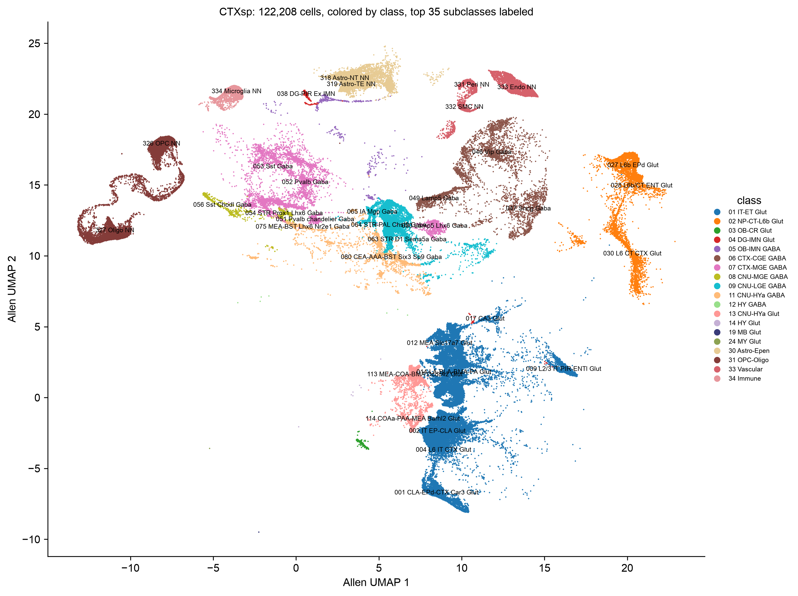

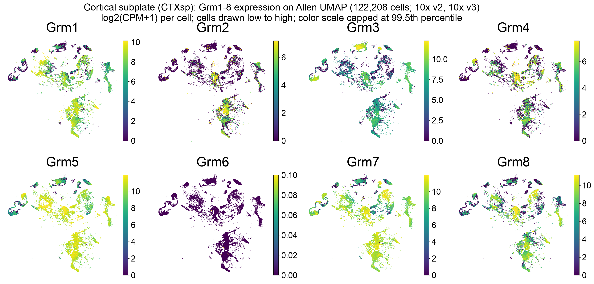

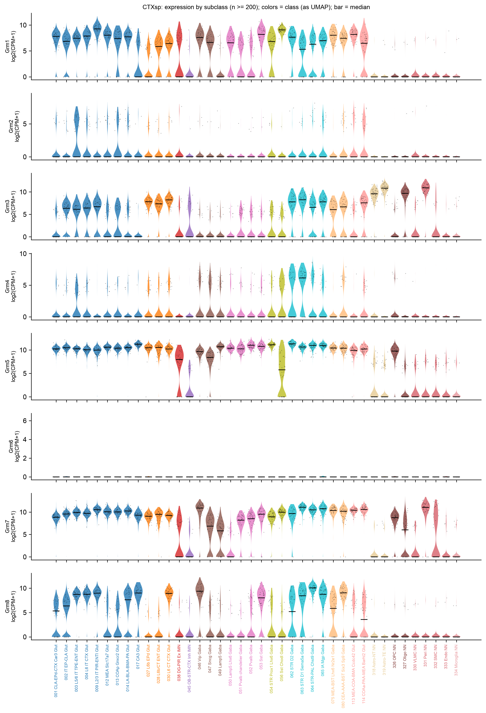

| Gene | Most enriched neuronal subclasses (fold; mean CPM; n cells) |
|---|---|
| Grm1 | 009 L2/3 IT PIR-ENTl Glut (5.6x; 13975; 2.8k); 056 Sst Chodl Gaba (3.3x; 9426; 448); 053 Sst Gaba (2.3x; 6331; 2.6k) |
| Grm2 | 003 L5/6 IT TPE-ENT Glut (2.6x; 184; 269); 014 LA-BLA-BMA-PA Glut (2.4x; 130; 16.8k); 113 MEA-COA-BMA Ccdc42 Glut (2.3x; 156; 2.2k) |
| Grm3 | 063 STR D1 Sema5a Gaba (4.8x; 5866; 289); 030 L6 CT CTX Glut (4.4x; 4913; 2.5k); 062 STR D2 Gaba (4.2x; 5163; 267) |
| Grm4 | 063 STR D1 Sema5a Gaba (6.5x; 655; 289); 064 STR-PAL Chst9 Gaba (5.7x; 399; 7.4k); 062 STR D2 Gaba (4.7x; 472; 267) |
| Grm5 | 062 STR D2 Gaba (2.2x; 88296; 267); 017 CA3 Glut (1.9x; 78127; 347); 052 Pvalb Gaba (1.8x; 71418; 1.3k) |
| Grm7 | 063 STR D1 Sema5a Gaba (2.5x; 67745; 289); 046 Vip Gaba (2.5x; 65036; 2.1k); 065 IA Mgp Gaba (2.1x; 56606; 1.3k) |
| Grm8 | 064 STR-PAL Chst9 Gaba (6.7x; 29647; 7.4k); 046 Vip Gaba (2.8x; 18326; 2.1k); 017 CA3 Glut (1.9x; 13067; 347) |

### ENT

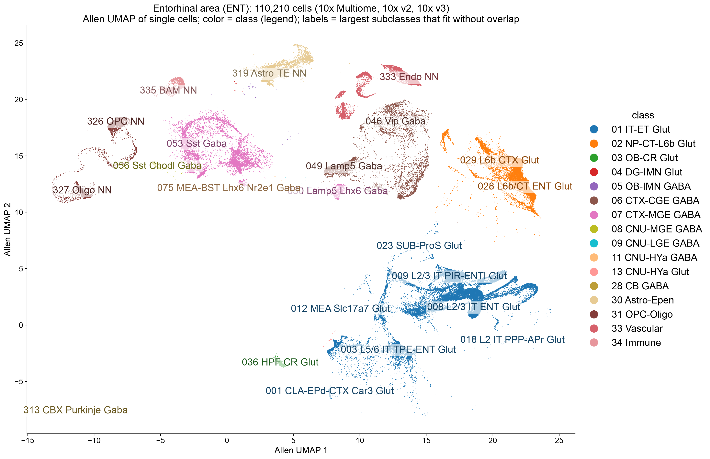

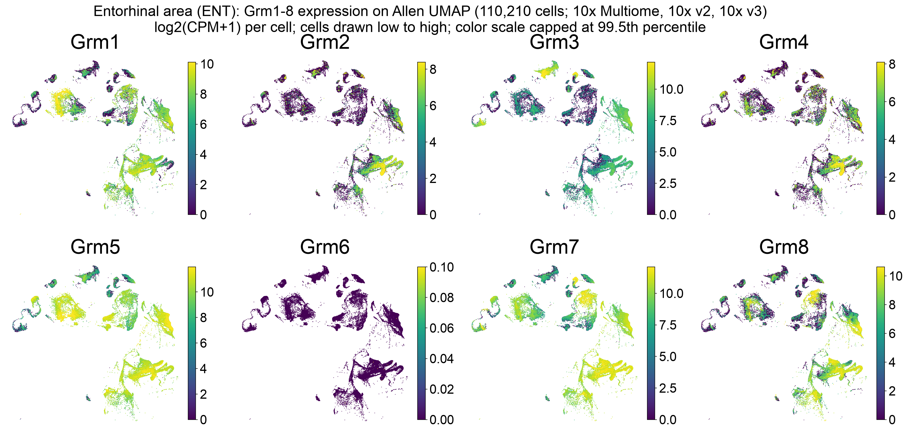

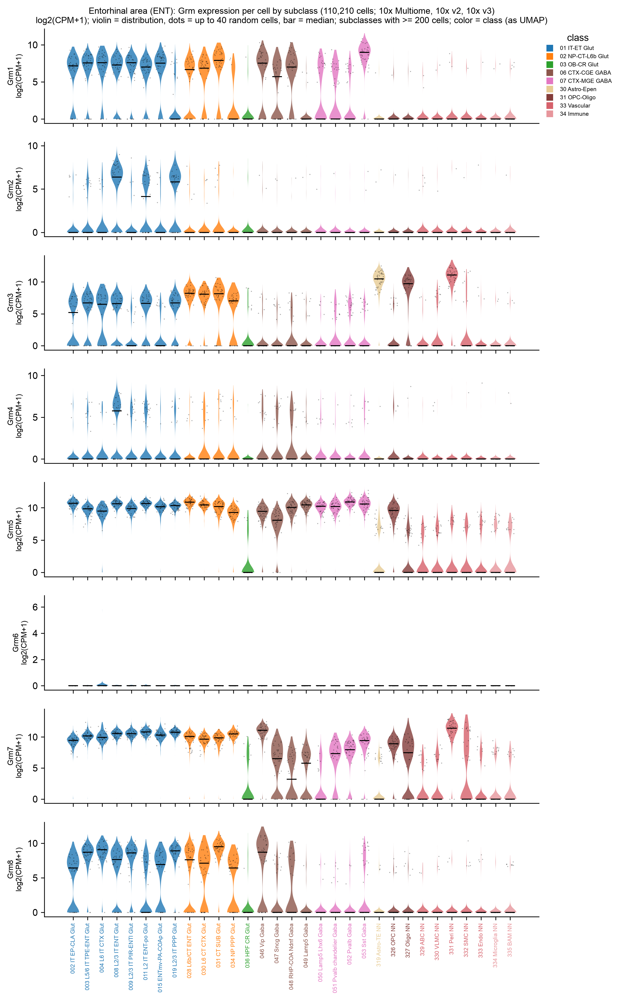

| Gene | Most enriched neuronal subclasses (fold; mean CPM; n cells) |
|---|---|
| Grm1 | 053 Sst Gaba (6.2x; 11509; 4.4k); 031 CT SUB Glut (1.8x; 4211; 724); 046 Vip Gaba (1.3x; 3181; 2.0k) |
| Grm2 | 008 L2/3 IT ENT Glut (8.1x; 980; 19.9k); 019 L2/3 IT PPP Glut (1.7x; 553; 4.2k) |
| Grm3 | 028 L6b/CT ENT Glut (5.6x; 5526; 19.8k); 031 CT SUB Glut (2.6x; 5440; 724); 030 L6 CT CTX Glut (2.0x; 4207; 414) |
| Grm4 | 008 L2/3 IT ENT Glut (5.7x; 618; 19.9k) |
| Grm5 | 052 Pvalb Gaba (1.6x; 65286; 3.5k); 028 L6b/CT ENT Glut (1.5x; 56624; 19.8k); 053 Sst Gaba (1.2x; 52168; 4.4k) |
| Grm6 | 004 L6 IT CTX Glut (2.1x; 1; 281) |
| Grm7 | 046 Vip Gaba (2.3x; 74014; 2.0k); 011 L2 IT ENT-po Glut (1.8x; 57254; 3.5k); 019 L2/3 IT PPP Glut (1.6x; 50794; 4.2k) |
| Grm8 | 046 Vip Gaba (3.5x; 16698; 2.0k); 031 CT SUB Glut (3.4x; 16874; 724); 004 L6 IT CTX Glut (2.3x; 11414; 281) |

### HIP

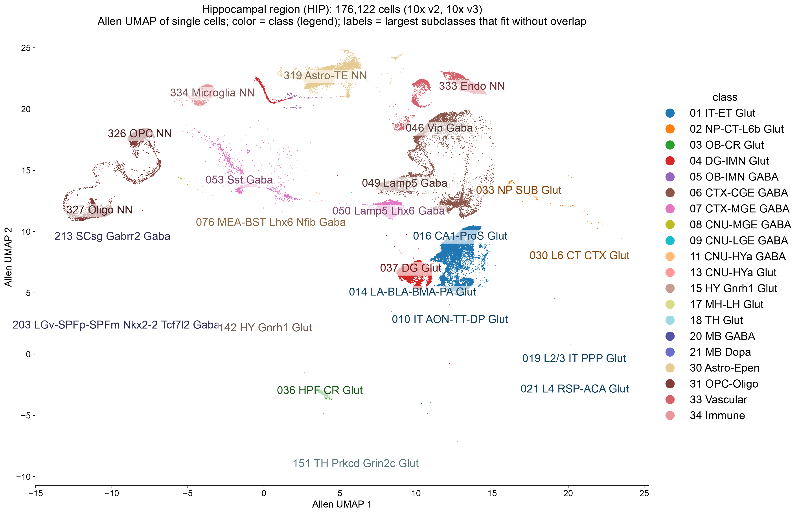

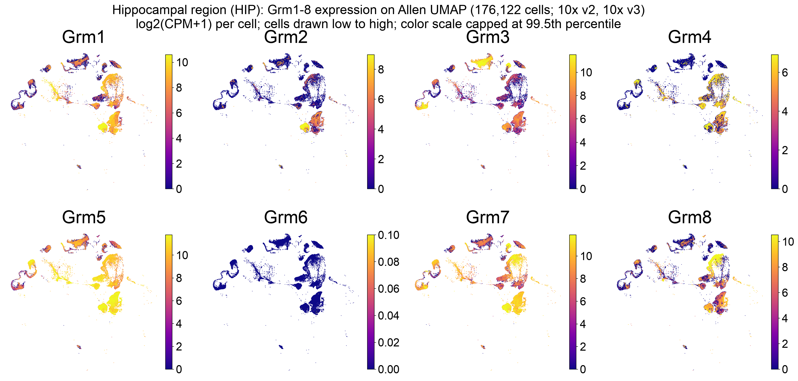

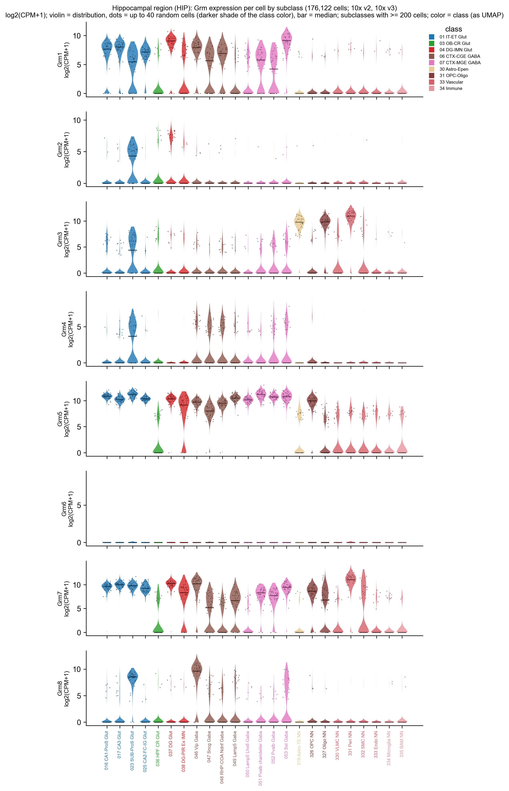

| Gene | Most enriched neuronal subclasses (fold; mean CPM; n cells) |
|---|---|
| Grm1 | 037 DG Glut (3.6x; 10649; 80.3k); 053 Sst Gaba (1.7x; 12972; 1.3k) |
| Grm2 | 037 DG Glut (27.2x; 933; 80.3k) |
| Grm3 | 023 SUB-ProS Glut (2.1x; 687; 384); 053 Sst Gaba (1.3x; 424; 1.3k); 016 CA1-ProS Glut (1.1x; 359; 24.9k) |
| Grm4 | 046 Vip Gaba (7.3x; 163; 4.1k); 047 Sncg Gaba (5.7x; 147; 1.1k); 048 RHP-COA Ndnf Gaba (5.7x; 142; 2.1k) |
| Grm5 | 051 Pvalb chandelier Gaba (2.4x; 88217; 281); 023 SUB-ProS Glut (2.2x; 82444; 384); 053 Sst Gaba (1.7x; 64667; 1.3k) |
| Grm6 | 047 Sncg Gaba (1.2x; 0; 1.1k); 023 SUB-ProS Glut (1.1x; 0; 384); 017 CA3 Glut (1.0x; 0; 4.8k) |
| Grm7 | 037 DG Glut (2.1x; 33985; 80.3k); 046 Vip Gaba (1.4x; 37984; 4.1k) |
| Grm8 | 046 Vip Gaba (72.3x; 22144; 4.1k); 023 SUB-ProS Glut (5.8x; 5705; 384); 053 Sst Gaba (3.4x; 3277; 1.3k) |

### HY

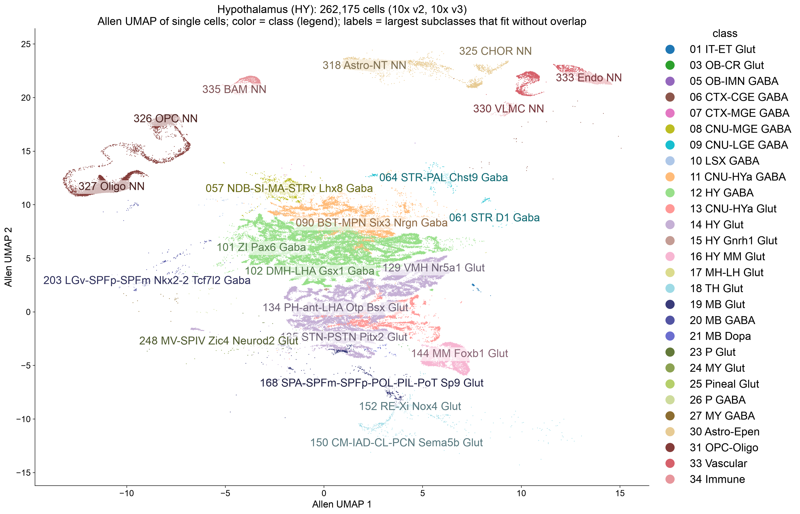

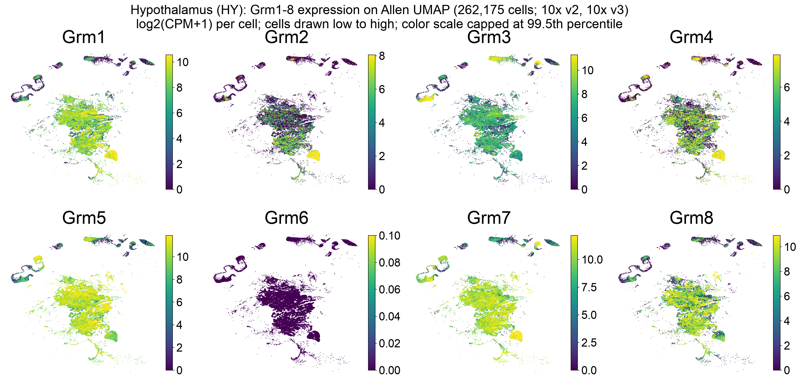

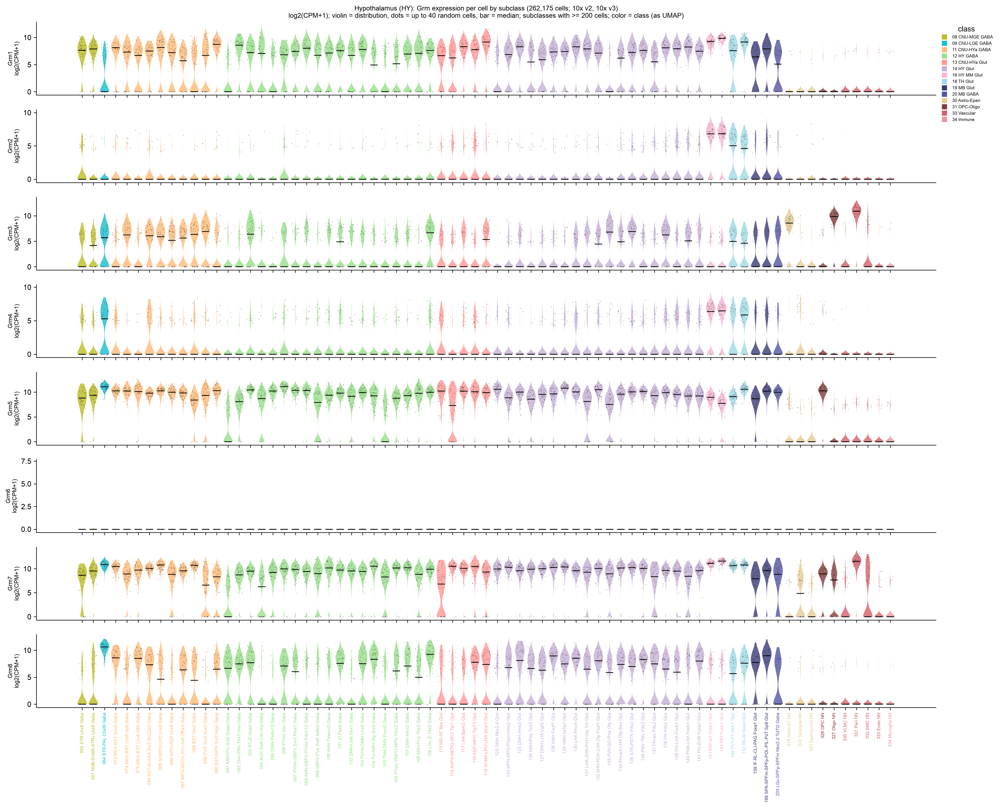

| Gene | Most enriched neuronal subclasses (fold; mean CPM; n cells) |
|---|---|
| Grm1 | 144 MM Foxb1 Glut (5.4x; 20141; 8.3k); 119 SI-MA-LPO-LHA Skor1 Glut (3.5x; 15008; 2.2k); 143 MM-ant Foxb1 Glut (2.8x; 12039; 5.4k) |
| Grm2 | 144 MM Foxb1 Glut (15.9x; 1298; 8.3k); 143 MM-ant Foxb1 Glut (11.8x; 1218; 5.4k); 149 PVT-PT Ntrk1 Glut (3.0x; 405; 392) |
| Grm3 | 133 PVH-SO-PVa Otp Glut (5.2x; 3590; 6.1k); 089 PVR Six3 Sox3 Gaba (4.8x; 3532; 3.2k); 093 RT-ZI Gnb3 Gaba (4.8x; 3635; 1.6k) |
| Grm4 | 144 MM Foxb1 Glut (6.6x; 850; 8.3k); 143 MM-ant Foxb1 Glut (5.8x; 820; 5.4k); 152 RE-Xi Nox4 Glut (3.9x; 625; 519) |
| Grm5 | 064 STR-PAL Chst9 Gaba (3.2x; 74656; 343); 096 PVHd Gsc Gaba (3.0x; 70638; 224); 129 VMH Nr5a1 Glut (2.5x; 56488; 7.8k) |
| Grm6 | 103 PVHd-DMH Lhx6 Gaba (1.4x; 0; 3.1k); 102 DMH-LHA Gsx1 Gaba (1.0x; 0; 6.8k) |
| Grm7 | 144 MM Foxb1 Glut (4.1x; 112018; 8.3k); 143 MM-ant Foxb1 Glut (2.5x; 74801; 5.4k); 064 STR-PAL Chst9 Gaba (1.9x; 59699; 343) |
| Grm8 | 064 STR-PAL Chst9 Gaba (10.9x; 49427; 343); 109 LGv-ZI Otx2 Gaba (4.4x; 20228; 692); 125 DMH Hmx2 Glut (3.3x; 14832; 2.3k) |

### LSX

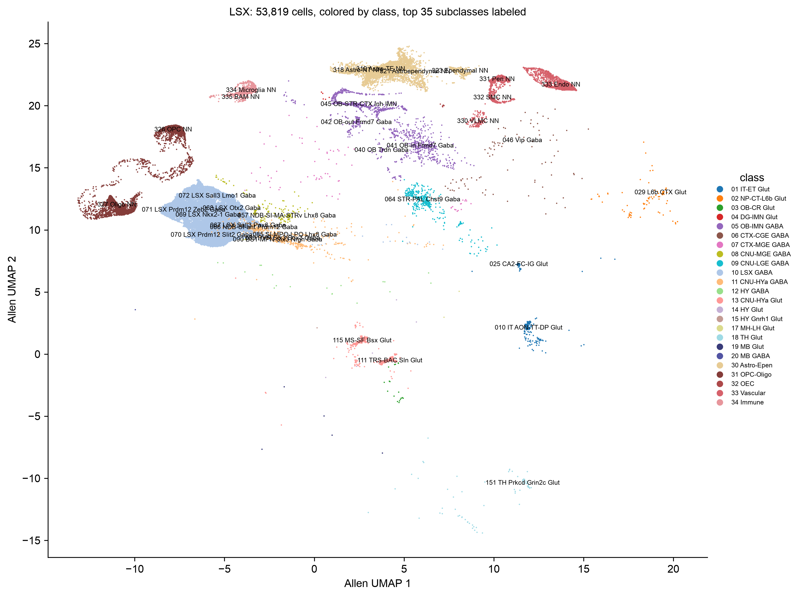

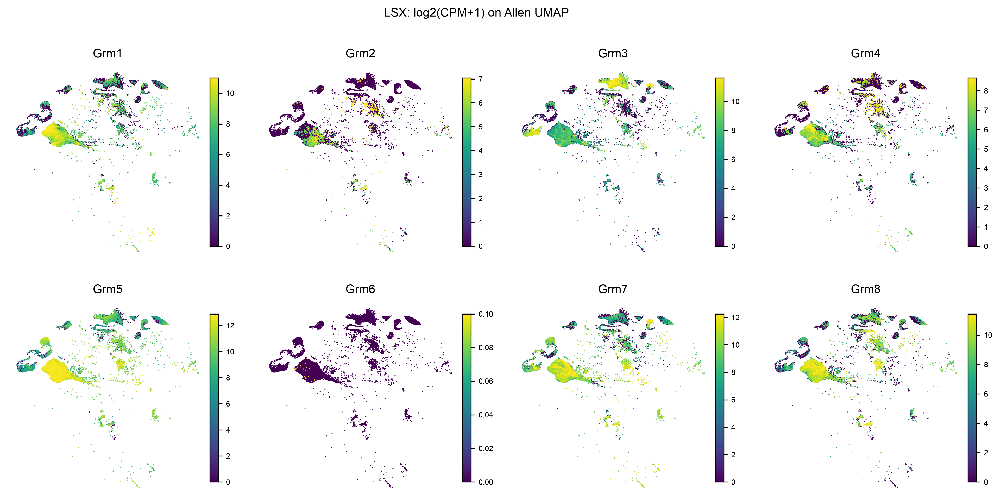

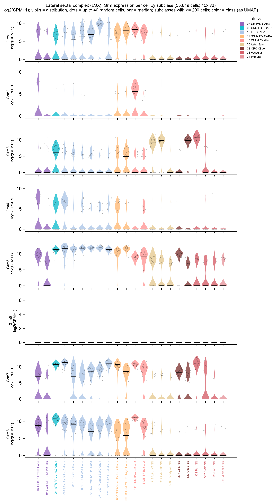

| Gene | Most enriched neuronal subclasses (fold; mean CPM; n cells) |
|---|---|
| Grm1 | 071 LSX Prdm12 Zeb2 Gaba (5.0x; 17563; 6.5k) |
| Grm2 | 041 OB-in Frmd7 Gaba (27.5x; 818; 461); 111 TRS-BAC Sln Glut (16.3x; 532; 534); 090 BST-MPN Six3 Nrgn Gaba (1.0x; 41; 259) |
| Grm3 | 064 STR-PAL Chst9 Gaba (3.5x; 1483; 324); 066 NDB-SI-ant Prdm12 Gaba (1.8x; 789; 267); 090 BST-MPN Six3 Nrgn Gaba (1.7x; 752; 259) |
| Grm4 | 041 OB-in Frmd7 Gaba (5.9x; 1688; 461); 067 LSX Sall3 Pax6 Gaba (3.9x; 1093; 1.0k); 069 LSX Nkx2-1 Gaba (3.2x; 654; 7.5k) |
| Grm5 | 070 LSX Prdm12 Slit2 Gaba (1.2x; 143338; 7.6k); 071 LSX Prdm12 Zeb2 Gaba (1.2x; 144074; 6.5k); 069 LSX Nkx2-1 Gaba (1.2x; 139780; 7.5k) |
| Grm6 | 071 LSX Prdm12 Zeb2 Gaba (1.1x; 0; 6.5k) |
| Grm7 | 067 LSX Sall3 Pax6 Gaba (4.9x; 96092; 1.0k); 072 LSX Sall3 Lmo1 Gaba (4.4x; 77782; 2.4k); 066 NDB-SI-ant Prdm12 Gaba (2.8x; 60530; 267) |
| Grm8 | 111 TRS-BAC Sln Glut (6.2x; 65251; 534); 064 STR-PAL Chst9 Gaba (4.9x; 53852; 324); 067 LSX Sall3 Pax6 Gaba (2.0x; 22001; 1.0k) |

### MB

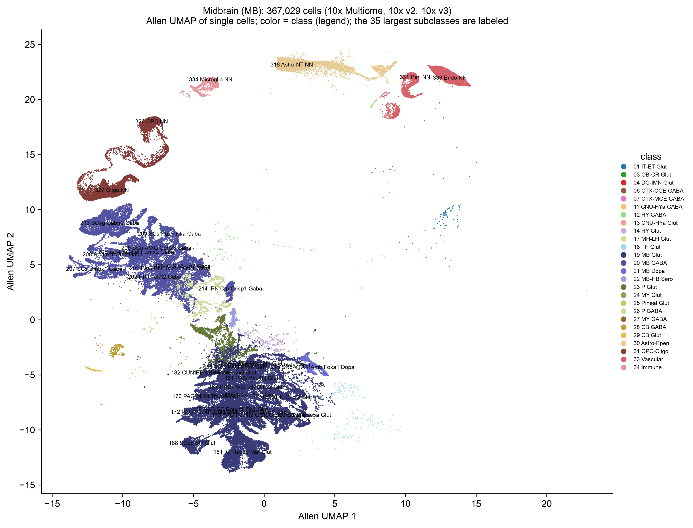

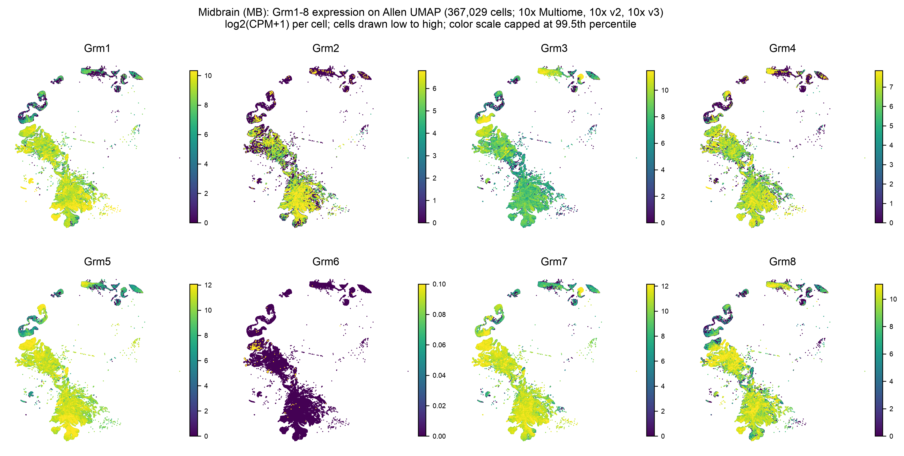

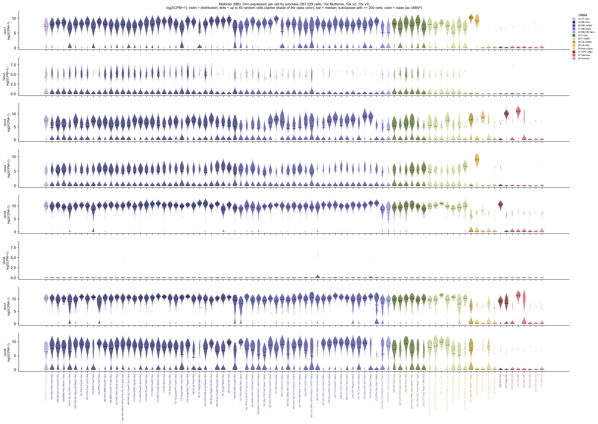

| Gene | Most enriched neuronal subclasses (fold; mean CPM; n cells) |
|---|---|
| Grm1 | 311 CBX MLI Megf11 Gaba (6.5x; 28911; 364); 197 SNr Six3 Gaba (4.4x; 19405; 1.4k); 314 CB Granule Glut (3.6x; 16101; 492) |
| Grm2 | 179 SCdg-PAG Tfap2b Glut (2.6x; 155; 1.8k); 167 PRC-PAG Tcf7l2 Irx2 Glut (2.4x; 142; 2.5k); 169 PAG-SC Pou4f1 Zic1 Glut (2.2x; 131; 4.7k) |
| Grm3 | 212 SCs Lef1 Gli3 Gaba (8.1x; 15512; 2.1k); 213 SCsg Gabrr2 Gaba (5.1x; 8188; 13.6k); 198 IC Six3 En2 Gaba (2.9x; 5784; 4.4k) |
| Grm4 | 314 CB Granule Glut (45.3x; 10527; 492); 277 DTN-LDT-IPN Otp Pax3 Gaba (4.1x; 1034; 1.6k); 187 SCsg Pde5a Glut (2.7x; 680; 3.3k) |
| Grm5 | 181 IC Tfap2d Maf Glut (2.1x; 71342; 20.0k); 214 IPN Otp Crisp1 Gaba (2.0x; 74803; 3.0k); 213 SCsg Gabrr2 Gaba (1.8x; 66460; 13.6k) |
| Grm6 | 204 SC Otx2 Gcnt4 Gaba (16.1x; 34; 1.0k); 213 SCsg Gabrr2 Gaba (10.8x; 14; 13.6k); 202 PRT Tcf7l2 Gaba (1.0x; 1; 4.3k) |
| Grm7 | 269 LDT Fgf7 Gaba (2.7x; 99789; 359); 207 SCs Dmbx1 Gaba (2.5x; 87158; 5.6k); 203 LGv-SPFp-SPFm Nkx2-2 Tcf7l2 Gaba (2.0x; 75044; 243) |
| Grm8 | 269 LDT Fgf7 Gaba (2.8x; 22694; 359); 222 PB Evx2 Glut (2.7x; 21477; 837); 191 PAG-MRN Rln3 Gaba (2.6x; 20783; 216) |

### MO-FRP

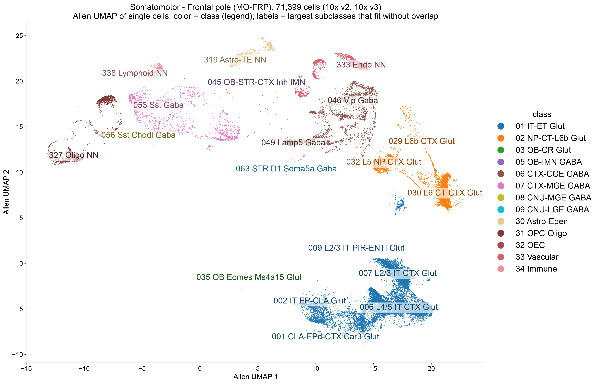

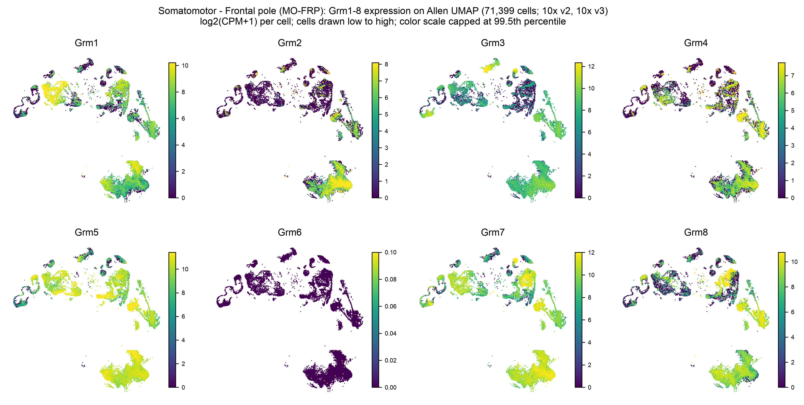

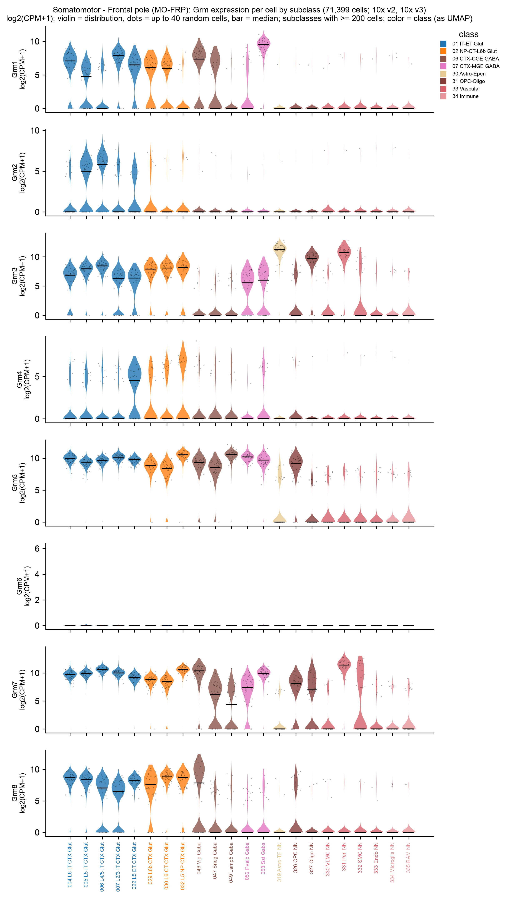

| Gene | Most enriched neuronal subclasses (fold; mean CPM; n cells) |
|---|---|
| Grm1 | 053 Sst Gaba (12.3x; 15827; 2.1k); 007 L2/3 IT CTX Glut (2.3x; 3554; 9.4k); 046 Vip Gaba (1.5x; 2811; 2.7k) |
| Grm2 | 006 L4/5 IT CTX Glut (6.4x; 589; 16.6k); 005 L5 IT CTX Glut (1.2x; 303; 2.4k) |
| Grm3 | 006 L4/5 IT CTX Glut (2.8x; 6030; 16.6k); 032 L5 NP CTX Glut (1.6x; 5191; 2.4k); 030 L6 CT CTX Glut (1.4x; 4536; 7.1k) |
| Grm4 | 032 L5 NP CTX Glut (5.4x; 622; 2.4k); 030 L6 CT CTX Glut (1.8x; 225; 7.1k); 022 L5 ET CTX Glut (1.2x; 171; 384) |
| Grm5 | 049 Lamp5 Gaba (2.1x; 42113; 2.9k); 032 L5 NP CTX Glut (2.0x; 40764; 2.4k); 052 Pvalb Gaba (1.6x; 32617; 808) |
| Grm7 | 006 L4/5 IT CTX Glut (2.3x; 45564; 16.6k); 032 L5 NP CTX Glut (1.6x; 44565; 2.4k); 046 Vip Gaba (1.6x; 44021; 2.7k) |
| Grm8 | 046 Vip Gaba (4.5x; 17110; 2.7k); 030 L6 CT CTX Glut (2.4x; 9162; 7.1k); 032 L5 NP CTX Glut (2.0x; 8617; 2.4k) |

### MOp

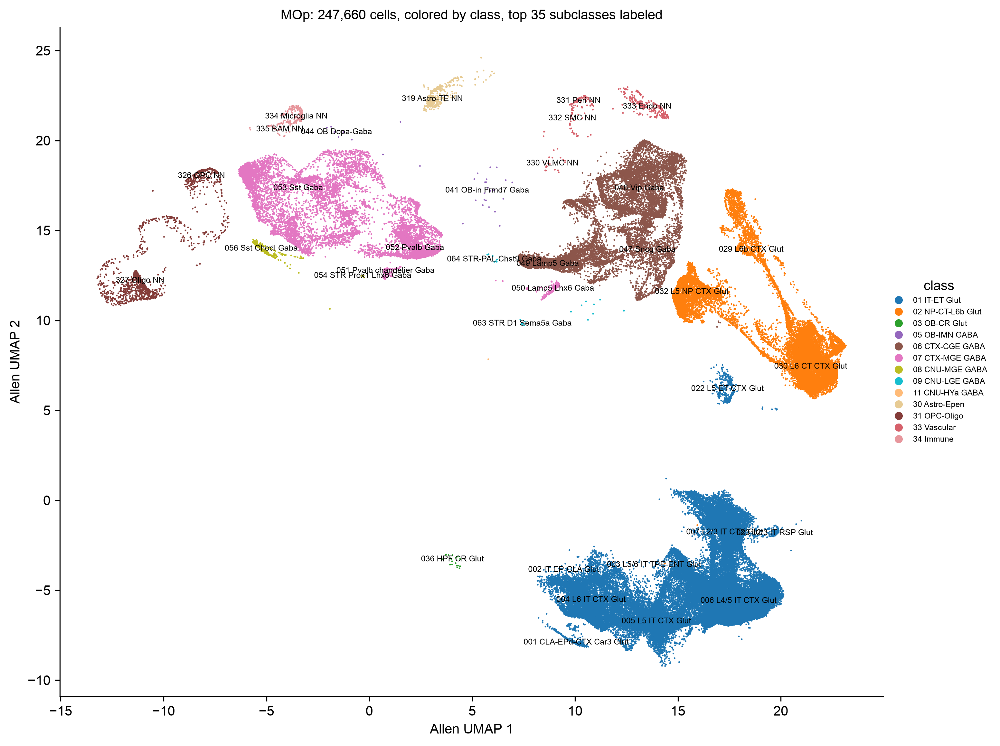

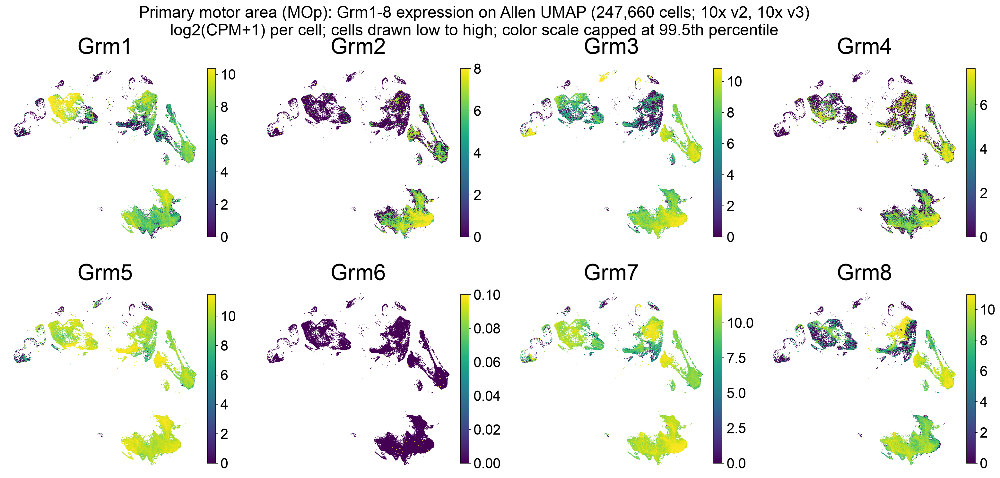

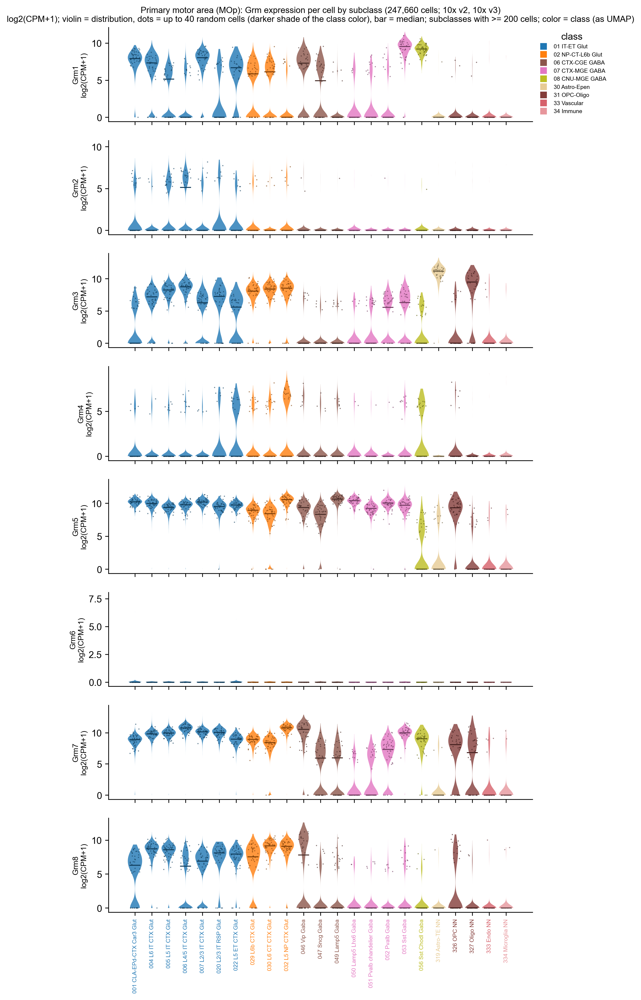

| Gene | Most enriched neuronal subclasses (fold; mean CPM; n cells) |
|---|---|
| Grm1 | 053 Sst Gaba (12.6x; 16519; 10.0k); 056 Sst Chodl Gaba (5.8x; 11204; 552); 007 L2/3 IT CTX Glut (2.5x; 4142; 29.2k) |
| Grm2 | 006 L4/5 IT CTX Glut (6.5x; 449; 74.9k); 005 L5 IT CTX Glut (1.3x; 231; 16.4k) |
| Grm3 | 006 L4/5 IT CTX Glut (2.6x; 8736; 74.9k); 032 L5 NP CTX Glut (1.4x; 6887; 9.5k); 030 L6 CT CTX Glut (1.3x; 6148; 46.1k) |
| Grm4 | 032 L5 NP CTX Glut (5.1x; 539; 9.5k); 030 L6 CT CTX Glut (1.7x; 186; 46.1k); 022 L5 ET CTX Glut (1.6x; 197; 635) |
| Grm5 | 049 Lamp5 Gaba (2.4x; 44559; 9.9k); 032 L5 NP CTX Glut (2.3x; 42152; 9.5k); 050 Lamp5 Lhx6 Gaba (1.8x; 34836; 322) |
| Grm7 | 006 L4/5 IT CTX Glut (2.6x; 53159; 74.9k); 032 L5 NP CTX Glut (1.8x; 52809; 9.5k); 046 Vip Gaba (1.7x; 50551; 10.8k) |
| Grm8 | 046 Vip Gaba (3.9x; 19078; 10.8k); 030 L6 CT CTX Glut (2.8x; 11454; 46.1k); 032 L5 NP CTX Glut (2.1x; 11293; 9.5k) |

### MY

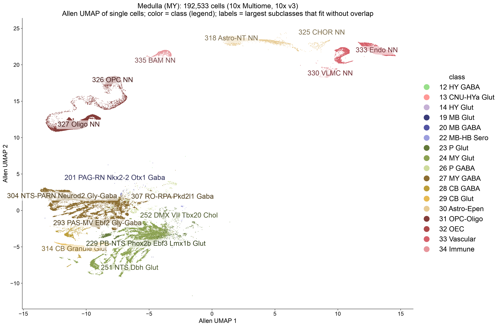

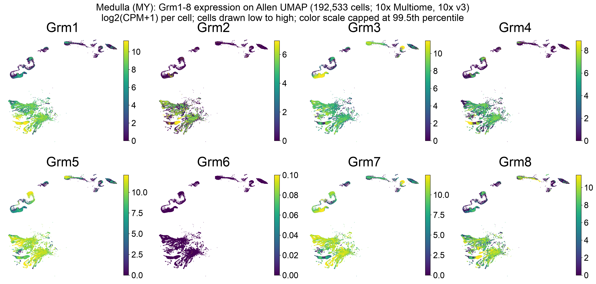

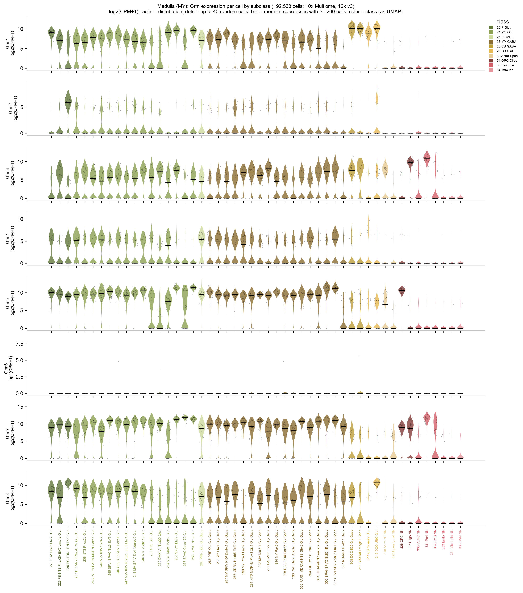

| Gene | Most enriched neuronal subclasses (fold; mean CPM; n cells) |
|---|---|
| Grm1 | 315 DCO UBC Glut (5.1x; 32742; 6.4k); 308 DCO Il22 Gly-Gaba (4.4x; 35191; 1.4k); 311 CBX MLI Megf11 Gaba (3.6x; 30218; 203) |
| Grm2 | 235 PG-TRN-LRN Fat2 Glut (9.5x; 524; 722); 315 DCO UBC Glut (8.0x; 307; 6.4k); 248 MV-SPIV Zic4 Neurod2 Glut (1.7x; 99; 2.0k) |
| Grm3 | 306 SPVI-SPVC Sall3 Lhx1 Gly-Gaba (5.4x; 8067; 2.0k); 311 CBX MLI Megf11 Gaba (4.5x; 7397; 203); 293 PAS-MV Ebf2 Gly-Gaba (3.3x; 4901; 4.5k) |
| Grm4 | 306 SPVI-SPVC Sall3 Lhx1 Gly-Gaba (1.3x; 461; 2.0k); 303 IRN Dmbx1 Pax2 Gly-Gaba (1.1x; 398; 316); 237 PRP-NI-PRNc-GRN Otp Glut (1.0x; 373; 323) |
| Grm5 | 306 SPVI-SPVC Sall3 Lhx1 Gly-Gaba (5.2x; 104826; 2.0k); 258 SPVC Nmu Glut (4.8x; 101933; 960); 256 SPVC Mafa Glut (4.7x; 90047; 3.4k) |
| Grm6 | 311 CBX MLI Megf11 Gaba (2.3x; 1; 203); 296 RPA Pax6 Hoxb5 Gly-Gaba (1.3x; 0; 323); 252 DMX VII Tbx20 Chol (1.1x; 0; 300) |
| Grm7 | 257 SPVC Ccdc172 Glut (5.2x; 150590; 592); 258 SPVC Nmu Glut (3.5x; 101063; 960); 256 SPVC Mafa Glut (3.2x; 86943; 3.4k) |
| Grm8 | 315 DCO UBC Glut (10.2x; 49290; 6.4k); 235 PG-TRN-LRN Fat2 Glut (5.9x; 46467; 722); 247 MV-SPIV Phox2b Ebf3 Lbx1 Glut (2.4x; 19485; 708) |

### OLF

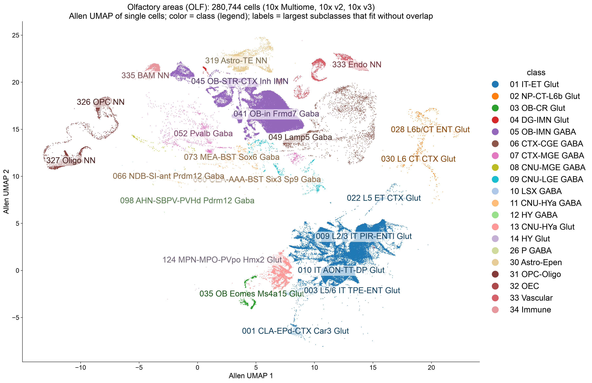

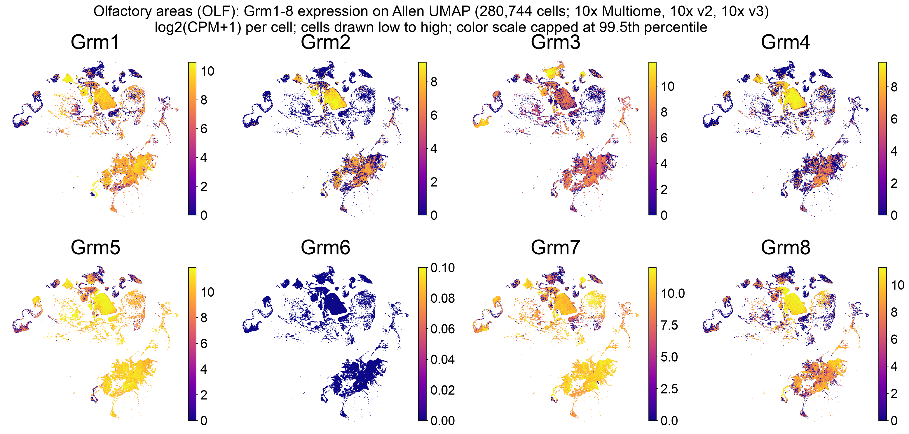

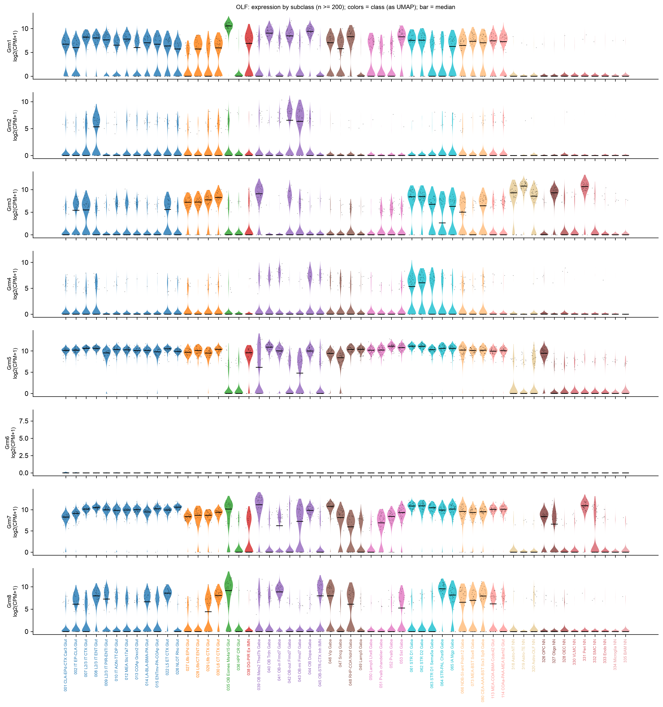

| Gene | Most enriched neuronal subclasses (fold; mean CPM; n cells) |
|---|---|
| Grm1 | 035 OB Eomes Ms4a15 Glut (20.4x; 52152; 1.5k); 044 OB Dopa-Gaba (5.8x; 15342; 4.4k); 040 OB Trdn Gaba (4.6x; 12501; 3.5k) |
| Grm2 | 042 OB-out Frmd7 Gaba (9.0x; 2994; 5.6k); 043 OB-mi Frmd7 Gaba (6.3x; 2474; 577); 041 OB-in Frmd7 Gaba (3.4x; 751; 78.7k) |
| Grm3 | 039 OB Meis2 Thsd7b Gaba (36.5x; 18737; 1.9k); 061 STR D1 Gaba (12.4x; 7996; 311); 062 STR D2 Gaba (12.0x; 7813; 204) |
| Grm4 | 041 OB-in Frmd7 Gaba (12.1x; 1822; 78.7k); 044 OB Dopa-Gaba (1.9x; 1321; 4.4k); 062 STR D2 Gaba (1.2x; 830; 204) |
| Grm5 | 052 Pvalb Gaba (2.9x; 77893; 1.0k); 061 STR D1 Gaba (2.6x; 71557; 311); 062 STR D2 Gaba (2.5x; 69113; 204) |
| Grm6 | 001 CLA-EPd-CTX Car3 Glut (2.2x; 1; 998) |
| Grm7 | 039 OB Meis2 Thsd7b Gaba (9.4x; 162504; 1.9k); 062 STR D2 Gaba (3.5x; 64774; 204); 061 STR D1 Gaba (3.5x; 63792; 311) |
| Grm8 | 035 OB Eomes Ms4a15 Glut (5.1x; 34563; 1.5k); 041 OB-in Frmd7 Gaba (3.3x; 12853; 78.7k); 064 STR-PAL Chst9 Gaba (2.8x; 19605; 246) |

### PAL

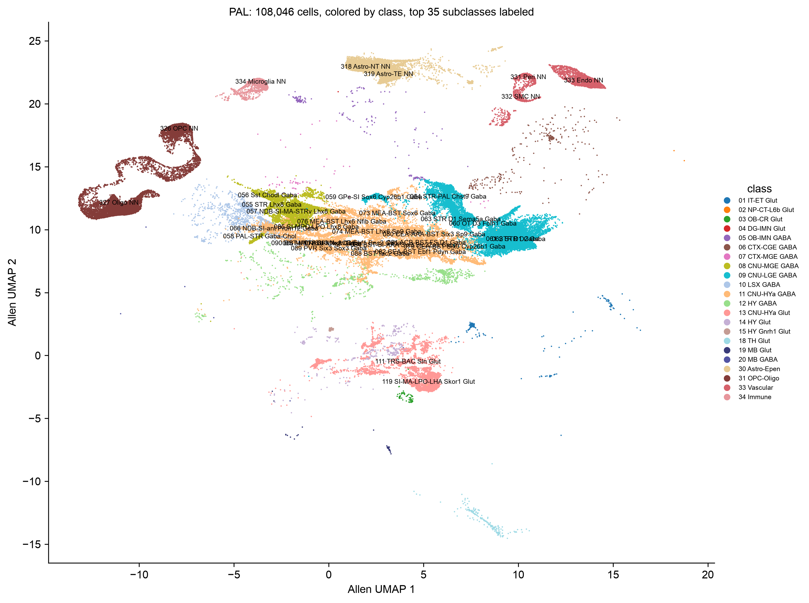

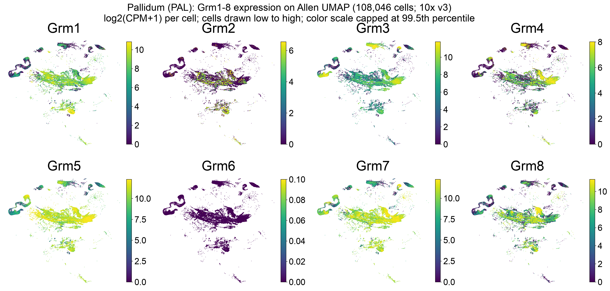

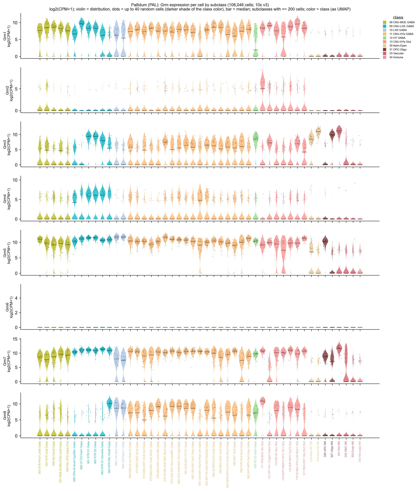

| Gene | Most enriched neuronal subclasses (fold; mean CPM; n cells) |
|---|---|
| Grm1 | 119 SI-MA-LPO-LHA Skor1 Glut (3.8x; 20364; 3.4k); 060 OT D3 Folh1 Gaba (3.7x; 18994; 4.5k); 112 GPi Tbr1 Cngb3 Gaba-Glut (1.6x; 10048; 329) |
| Grm2 | 111 TRS-BAC Sln Glut (18.1x; 472; 602); 118 ADP-MPO Trp73 Glut (3.5x; 105; 291); 116 AVPV-MEPO-SFO Tbr1 Glut (2.8x; 83; 253) |
| Grm3 | 061 STR D1 Gaba (5.8x; 15105; 5.9k); 062 STR D2 Gaba (5.0x; 14398; 5.0k); 093 RT-ZI Gnb3 Gaba (2.2x; 8601; 436) |
| Grm4 | 062 STR D2 Gaba (2.4x; 645; 5.0k); 063 STR D1 Sema5a Gaba (2.4x; 660; 3.1k); 061 STR D1 Gaba (2.1x; 561; 5.9k) |
| Grm5 | 069 LSX Nkx2-1 Gaba (2.4x; 127831; 300); 068 LSX Otx2 Gaba (2.3x; 122481; 306); 078 SI-MA-ACB Ebf1 Bnc2 Gaba (2.0x; 108403; 1.2k) |
| Grm6 | 063 STR D1 Sema5a Gaba (1.1x; 0; 3.1k) |
| Grm7 | 063 STR D1 Sema5a Gaba (2.0x; 88113; 3.1k); 061 STR D1 Gaba (1.6x; 72140; 5.9k); 060 OT D3 Folh1 Gaba (1.5x; 69561; 4.5k) |
| Grm8 | 111 TRS-BAC Sln Glut (8.3x; 54370; 602); 064 STR-PAL Chst9 Gaba (6.8x; 32770; 4.6k); 076 MEA-BST Lhx6 Nfib Gaba (2.3x; 15582; 1.0k) |

### PL-ILA-ORB

| Gene | Most enriched neuronal subclasses (fold; mean CPM; n cells) |
|---|---|
| Grm1 | 053 Sst Gaba (6.7x; 12387; 5.4k); 056 Sst Chodl Gaba (3.3x; 8117; 285); 007 L2/3 IT CTX Glut (2.5x; 5423; 8.9k) |
| Grm2 | 006 L4/5 IT CTX Glut (5.6x; 549; 14.2k); 005 L5 IT CTX Glut (1.6x; 271; 4.4k); 007 L2/3 IT CTX Glut (1.4x; 235; 8.9k) |
| Grm3 | 062 STR D2 Gaba (3.0x; 11002; 355); 006 L4/5 IT CTX Glut (2.3x; 7170; 14.2k); 061 STR D1 Gaba (2.2x; 8257; 312) |
| Grm4 | 062 STR D2 Gaba (6.0x; 679; 355); 061 STR D1 Gaba (4.3x; 496; 312); 032 L5 NP CTX Glut (4.1x; 417; 4.0k) |
| Grm5 | 061 STR D1 Gaba (3.1x; 89843; 312); 062 STR D2 Gaba (3.1x; 88810; 355); 032 L5 NP CTX Glut (2.7x; 73435; 4.0k) |
| Grm7 | 006 L4/5 IT CTX Glut (2.1x; 46289; 14.2k); 046 Vip Gaba (1.9x; 49112; 3.3k); 032 L5 NP CTX Glut (1.8x; 46511; 4.0k) |
| Grm8 | 046 Vip Gaba (2.8x; 16972; 3.3k); 030 L6 CT CTX Glut (2.1x; 10697; 21.5k); 003 L5/6 IT TPE-ENT Glut (1.8x; 11590; 711) |

### P

| Gene | Most enriched neuronal subclasses (fold; mean CPM; n cells) |
|---|---|
| Grm1 | 315 DCO UBC Glut (5.9x; 27655; 421); 311 CBX MLI Megf11 Gaba (5.6x; 26633; 257); 314 CB Granule Glut (3.4x; 14988; 1.8k) |
| Grm2 | 315 DCO UBC Glut (8.3x; 440; 421); 235 PG-TRN-LRN Fat2 Glut (4.9x; 215; 3.1k); 222 PB Evx2 Glut (1.5x; 80; 3.2k) |
| Grm3 | 311 CBX MLI Megf11 Gaba (5.8x; 4279; 257); 223 B-PB Nr4a2 Glut (4.9x; 3562; 317); 272 LDT-PCG-CS Gata3 Lhx1 Gaba (4.0x; 2849; 755) |
| Grm4 | 314 CB Granule Glut (40.1x; 7544; 1.8k) |
| Grm5 | 277 DTN-LDT-IPN Otp Pax3 Gaba (3.1x; 83563; 2.4k); 263 CS-RPO Meis2 Gaba (2.5x; 71179; 1.4k); 182 CUN-PPN Evx2 Meis2 Glut (2.3x; 68530; 470) |
| Grm6 | 220 PB Pax5 Glut (1.2x; 0; 372) |
| Grm7 | 273 PDTg-PCG Pax6 Gaba (3.0x; 78259; 2.6k); 200 PAG-ND-PCG Onecut1 Gaba (2.0x; 59087; 856); 270 LDT-DTN Gata3 Nfix Gaba (1.9x; 55153; 658) |
| Grm8 | 315 DCO UBC Glut (8.1x; 64550; 421); 235 PG-TRN-LRN Fat2 Glut (3.2x; 23221; 3.1k); 278 NLL Gata3 Gly-Gaba (2.8x; 23716; 452) |

### RHP

| Gene | Most enriched neuronal subclasses (fold; mean CPM; n cells) |
|---|---|
| Grm1 | 037 DG Glut (5.2x; 14731; 1.7k); 053 Sst Gaba (4.4x; 11658; 3.7k); 018 L2 IT PPP-APr Glut (2.8x; 7685; 5.1k) |
| Grm2 | 019 L2/3 IT PPP Glut (4.4x; 584; 24.2k); 037 DG Glut (1.6x; 440; 1.7k); 033 NP SUB Glut (1.3x; 354; 2.5k) |
| Grm3 | 028 L6b/CT ENT Glut (2.7x; 5882; 5.1k); 031 CT SUB Glut (2.6x; 5511; 7.0k); 019 L2/3 IT PPP Glut (1.9x; 3568; 24.2k) |
| Grm4 | 019 L2/3 IT PPP Glut (3.5x; 405; 24.2k); 033 NP SUB Glut (2.4x; 484; 2.5k) |
| Grm5 | 023 SUB-ProS Glut (2.9x; 100936; 6.4k); 028 L6b/CT ENT Glut (1.6x; 63101; 5.1k); 016 CA1-ProS Glut (1.3x; 48978; 6.4k) |
| Grm7 | 046 Vip Gaba (1.8x; 62045; 2.1k); 018 L2 IT PPP-APr Glut (1.6x; 56348; 5.1k); 019 L2/3 IT PPP Glut (1.5x; 47206; 24.2k) |
| Grm8 | 046 Vip Gaba (3.8x; 22149; 2.1k); 031 CT SUB Glut (3.1x; 16146; 7.0k); 028 L6b/CT ENT Glut (1.8x; 10456; 5.1k) |

### RSP

| Gene | Most enriched neuronal subclasses (fold; mean CPM; n cells) |
|---|---|
| Grm1 | 053 Sst Gaba (9.7x; 12103; 2.8k); 007 L2/3 IT CTX Glut (2.3x; 3173; 10.0k); 004 L6 IT CTX Glut (1.7x; 2540; 3.8k) |
| Grm2 | 020 L2/3 IT RSP Glut (1.9x; 629; 30.0k); 005 L5 IT CTX Glut (1.8x; 725; 8.1k); 006 L4/5 IT CTX Glut (1.7x; 710; 7.4k) |
| Grm3 | 006 L4/5 IT CTX Glut (1.8x; 4760; 7.4k); 030 L6 CT CTX Glut (1.8x; 4629; 10.3k); 005 L5 IT CTX Glut (1.8x; 4683; 8.1k) |
| Grm4 | 021 L4 RSP-ACA Glut (4.7x; 964; 5.9k); 032 L5 NP CTX Glut (2.0x; 488; 3.5k) |
| Grm5 | 032 L5 NP CTX Glut (2.4x; 43034; 3.5k); 049 Lamp5 Gaba (2.2x; 39516; 2.2k); 052 Pvalb Gaba (2.1x; 38522; 924) |
| Grm7 | 021 L4 RSP-ACA Glut (2.6x; 68259; 5.9k); 006 L4/5 IT CTX Glut (1.7x; 47430; 7.4k); 032 L5 NP CTX Glut (1.5x; 42765; 3.5k) |
| Grm8 | 046 Vip Gaba (2.6x; 13540; 2.6k); 022 L5 ET CTX Glut (1.9x; 10231; 2.3k); 032 L5 NP CTX Glut (1.8x; 9168; 3.5k) |

### SS-GU-VISC

| Gene | Most enriched neuronal subclasses (fold; mean CPM; n cells) |
|---|---|
| Grm1 | 053 Sst Gaba (8.2x; 12287; 3.2k); 007 L2/3 IT CTX Glut (2.3x; 3761; 12.1k); 001 CLA-EPd-CTX Car3 Glut (1.6x; 2972; 4.8k) |
| Grm2 | 006 L4/5 IT CTX Glut (6.9x; 462; 27.5k); 005 L5 IT CTX Glut (1.1x; 224; 2.3k) |
| Grm3 | 006 L4/5 IT CTX Glut (2.7x; 5246; 27.5k); 032 L5 NP CTX Glut (2.0x; 6029; 2.6k); 030 L6 CT CTX Glut (1.5x; 4352; 11.9k) |
| Grm4 | 032 L5 NP CTX Glut (3.2x; 405; 2.6k); 006 L4/5 IT CTX Glut (1.8x; 190; 27.5k); 053 Sst Gaba (1.4x; 179; 3.2k) |
| Grm5 | 032 L5 NP CTX Glut (2.2x; 50593; 2.6k); 049 Lamp5 Gaba (1.9x; 43743; 2.4k); 002 IT EP-CLA Glut (1.7x; 39889; 841) |
| Grm6 | 004 L6 IT CTX Glut (1.2x; 0; 6.3k) |
| Grm7 | 006 L4/5 IT CTX Glut (2.3x; 44525; 27.5k); 046 Vip Gaba (2.0x; 54747; 2.0k); 032 L5 NP CTX Glut (1.7x; 45490; 2.6k) |
| Grm8 | 046 Vip Gaba (5.3x; 16755; 2.0k); 032 L5 NP CTX Glut (3.9x; 12481; 2.6k); 030 L6 CT CTX Glut (2.8x; 7792; 11.9k) |

### SSp

| Gene | Most enriched neuronal subclasses (fold; mean CPM; n cells) |
|---|---|
| Grm1 | 053 Sst Gaba (15.8x; 12115; 930); 007 L2/3 IT CTX Glut (3.5x; 2462; 8.7k); 046 Vip Gaba (2.8x; 2507; 1.1k) |
| Grm2 | 006 L4/5 IT CTX Glut (7.1x; 640; 36.5k) |
| Grm3 | 032 L5 NP CTX Glut (2.2x; 7128; 2.3k); 006 L4/5 IT CTX Glut (1.7x; 4236; 36.5k); 030 L6 CT CTX Glut (1.2x; 3810; 10.4k) |
| Grm4 | 032 L5 NP CTX Glut (2.1x; 352; 2.3k); 006 L4/5 IT CTX Glut (1.9x; 227; 36.5k); 030 L6 CT CTX Glut (1.1x; 181; 10.4k) |
| Grm5 | 049 Lamp5 Gaba (2.9x; 48808; 1.3k); 032 L5 NP CTX Glut (2.1x; 35060; 2.3k); 007 L2/3 IT CTX Glut (1.6x; 26094; 8.7k) |
| Grm7 | 006 L4/5 IT CTX Glut (2.7x; 48320; 36.5k); 032 L5 NP CTX Glut (1.4x; 45723; 2.3k); 046 Vip Gaba (1.4x; 45300; 1.1k) |
| Grm8 | 046 Vip Gaba (6.2x; 15927; 1.1k); 032 L5 NP CTX Glut (5.0x; 12392; 2.3k); 030 L6 CT CTX Glut (3.8x; 7511; 10.4k) |

### STRd

| Gene | Most enriched neuronal subclasses (fold; mean CPM; n cells) |
|---|---|
| Grm1 | 061 STR D1 Gaba (1.4x; 11819; 16.7k); 062 STR D2 Gaba (1.0x; 9984; 18.1k) |
| Grm2 | 063 STR D1 Sema5a Gaba (6.1x; 26; 780); 064 STR-PAL Chst9 Gaba (2.2x; 9; 437); 056 Sst Chodl Gaba (2.1x; 9; 230) |
| Grm3 | 062 STR D2 Gaba (1.2x; 7407; 18.1k); 061 STR D1 Gaba (1.1x; 7053; 16.7k) |
| Grm4 | 063 STR D1 Sema5a Gaba (1.2x; 719; 780); 062 STR D2 Gaba (1.1x; 650; 18.1k); 061 STR D1 Gaba (1.1x; 651; 16.7k) |
| Grm5 | 062 STR D2 Gaba (1.2x; 96031; 18.1k); 061 STR D1 Gaba (1.1x; 92927; 16.7k) |
| Grm7 | 063 STR D1 Sema5a Gaba (1.3x; 67417; 780); 062 STR D2 Gaba (1.2x; 55500; 18.1k); 061 STR D1 Gaba (1.1x; 52365; 16.7k) |
| Grm8 | 064 STR-PAL Chst9 Gaba (10.9x; 22023; 437); 061 STR D1 Gaba (1.0x; 2266; 16.7k) |

### STRv

| Gene | Most enriched neuronal subclasses (fold; mean CPM; n cells) |
|---|---|
| Grm1 | 060 OT D3 Folh1 Gaba (4.4x; 16940; 7.7k); 055 STR Lhx8 Gaba (1.6x; 10086; 326); 054 STR Prox1 Lhx6 Gaba (1.1x; 6889; 412) |
| Grm2 | 055 STR Lhx8 Gaba (4.8x; 60; 326); 063 STR D1 Sema5a Gaba (1.5x; 18; 2.7k) |
| Grm3 | 062 STR D2 Gaba (2.3x; 12948; 11.1k); 061 STR D1 Gaba (1.8x; 11303; 12.3k) |
| Grm4 | 063 STR D1 Sema5a Gaba (1.5x; 793; 2.7k); 062 STR D2 Gaba (1.3x; 650; 11.1k) |
| Grm5 | 061 STR D1 Gaba (1.3x; 96755; 12.3k); 062 STR D2 Gaba (1.3x; 96155; 11.1k) |
| Grm7 | 062 STR D2 Gaba (1.3x; 87842; 11.1k); 061 STR D1 Gaba (1.2x; 84185; 12.3k) |
| Grm8 | 064 STR-PAL Chst9 Gaba (49.4x; 34021; 1.3k); 045 OB-STR-CTX Inh IMN (6.2x; 9926; 1.1k); 081 ACB-BST-FS D1 Gaba (5.1x; 9054; 305) |

### TEa-PERI-ECT

| Gene | Most enriched neuronal subclasses (fold; mean CPM; n cells) |
|---|---|
| Grm1 | 053 Sst Gaba (4.5x; 10092; 3.5k); 007 L2/3 IT CTX Glut (2.1x; 4974; 8.3k); 002 IT EP-CLA Glut (1.6x; 4271; 514) |
| Grm2 | 008 L2/3 IT ENT Glut (12.7x; 1585; 478); 006 L4/5 IT CTX Glut (5.1x; 450; 7.6k); 005 L5 IT CTX Glut (2.3x; 305; 268) |
| Grm3 | 006 L4/5 IT CTX Glut (2.9x; 5733; 7.6k); 030 L6 CT CTX Glut (2.5x; 5020; 9.6k); 032 L5 NP CTX Glut (1.9x; 4654; 1.6k) |
| Grm4 | 008 L2/3 IT ENT Glut (7.8x; 676; 478); 032 L5 NP CTX Glut (3.7x; 316; 1.6k); 047 Sncg Gaba (2.3x; 203; 863) |
| Grm5 | 032 L5 NP CTX Glut (2.2x; 61629; 1.6k); 052 Pvalb Gaba (1.6x; 44173; 3.1k); 022 L5 ET CTX Glut (1.5x; 40930; 2.1k) |
| Grm6 | 006 L4/5 IT CTX Glut (1.6x; 1; 7.6k) |
| Grm7 | 046 Vip Gaba (2.1x; 45886; 2.5k); 006 L4/5 IT CTX Glut (2.1x; 40983; 7.6k); 032 L5 NP CTX Glut (1.9x; 41384; 1.6k) |
| Grm8 | 030 L6 CT CTX Glut (3.1x; 10408; 9.6k); 046 Vip Gaba (2.8x; 11593; 2.5k); 032 L5 NP CTX Glut (2.2x; 9763; 1.6k) |

### TH

| Gene | Most enriched neuronal subclasses (fold; mean CPM; n cells) |
|---|---|
| Grm1 | 151 TH Prkcd Grin2c Glut (4.9x; 30050; 68.1k) |
| Grm2 | 150 CM-IAD-CL-PCN Sema5b Glut (3.2x; 666; 13.6k); 149 PVT-PT Ntrk1 Glut (2.9x; 647; 9.9k); 147 AD Serpinb7 Glut (2.0x; 487; 716) |
| Grm3 | 093 RT-ZI Gnb3 Gaba (15.3x; 10651; 7.5k); 213 SCsg Gabrr2 Gaba (7.5x; 7940; 2.1k); 203 LGv-SPFp-SPFm Nkx2-2 Tcf7l2 Gaba (2.3x; 2481; 5.6k) |
| Grm4 | 151 TH Prkcd Grin2c Glut (2.4x; 1260; 68.1k); 147 AD Serpinb7 Glut (2.1x; 1752; 716); 150 CM-IAD-CL-PCN Sema5b Glut (1.7x; 1337; 13.6k) |
| Grm5 | 213 SCsg Gabrr2 Gaba (4.3x; 78209; 2.1k); 203 LGv-SPFp-SPFm Nkx2-2 Tcf7l2 Gaba (3.7x; 63571; 5.6k); 109 LGv-ZI Otx2 Gaba (2.1x; 38075; 4.4k) |
| Grm6 | 213 SCsg Gabrr2 Gaba (5.5x; 5; 2.1k) |
| Grm7 | 153 MG-POL-SGN Nts Glut (1.7x; 55423; 2.0k); 152 RE-Xi Nox4 Glut (1.7x; 52762; 5.5k); 150 CM-IAD-CL-PCN Sema5b Glut (1.6x; 48879; 13.6k) |
| Grm8 | 109 LGv-ZI Otx2 Gaba (3.9x; 12117; 4.4k); 150 CM-IAD-CL-PCN Sema5b Glut (3.4x; 9525; 13.6k); 168 SPA-SPFm-SPFp-POL-PIL-PoT Sp9 Glut (3.3x; 9628; 10.8k) |

### VIS-PTLp

| Gene | Most enriched neuronal subclasses (fold; mean CPM; n cells) |
|---|---|
| Grm1 | 053 Sst Gaba (8.0x; 11768; 1.4k); 007 L2/3 IT CTX Glut (3.0x; 3958; 8.2k); 001 CLA-EPd-CTX Car3 Glut (1.6x; 2947; 219) |
| Grm2 | 006 L4/5 IT CTX Glut (4.9x; 400; 17.3k); 005 L5 IT CTX Glut (1.2x; 252; 2.2k) |
| Grm3 | 032 L5 NP CTX Glut (2.7x; 9074; 1.1k); 006 L4/5 IT CTX Glut (2.2x; 5341; 17.3k); 030 L6 CT CTX Glut (1.4x; 4661; 4.8k) |
| Grm4 | 032 L5 NP CTX Glut (3.1x; 394; 1.1k); 006 L4/5 IT CTX Glut (2.1x; 198; 17.3k); 053 Sst Gaba (1.5x; 200; 1.4k) |
| Grm5 | 032 L5 NP CTX Glut (2.6x; 59493; 1.1k); 049 Lamp5 Gaba (2.2x; 50950; 1.1k); 052 Pvalb Gaba (1.7x; 38469; 1.0k) |
| Grm6 | 004 L6 IT CTX Glut (1.2x; 0; 3.5k) |
| Grm7 | 006 L4/5 IT CTX Glut (2.2x; 62730; 17.3k); 032 L5 NP CTX Glut (1.5x; 62930; 1.1k) |
| Grm8 | 046 Vip Gaba (6.9x; 20012; 1.4k); 032 L5 NP CTX Glut (4.2x; 13505; 1.1k); 030 L6 CT CTX Glut (3.5x; 9524; 4.8k) |

### VIS

| Gene | Most enriched neuronal subclasses (fold; mean CPM; n cells) |
|---|---|
| Grm1 | 053 Sst Gaba (8.6x; 9385; 11.9k); 056 Sst Chodl Gaba (5.1x; 7205; 347); 007 L2/3 IT CTX Glut (2.4x; 2830; 47.2k) |
| Grm2 | 006 L4/5 IT CTX Glut (4.8x; 555; 114.8k); 005 L5 IT CTX Glut (1.3x; 354; 14.4k) |
| Grm3 | 032 L5 NP CTX Glut (2.6x; 8039; 6.7k); 006 L4/5 IT CTX Glut (2.2x; 4806; 114.8k); 030 L6 CT CTX Glut (1.6x; 4679; 36.9k) |
| Grm4 | 006 L4/5 IT CTX Glut (2.8x; 267; 114.8k); 032 L5 NP CTX Glut (2.5x; 386; 6.7k); 056 Sst Chodl Gaba (1.3x; 204; 347) |
| Grm5 | 032 L5 NP CTX Glut (2.7x; 50820; 6.7k); 049 Lamp5 Gaba (2.1x; 38838; 10.1k); 052 Pvalb Gaba (1.7x; 31783; 9.6k) |
| Grm6 | 050 Lamp5 Lhx6 Gaba (1.3x; 0; 355); 005 L5 IT CTX Glut (1.2x; 0; 14.4k); 001 CLA-EPd-CTX Car3 Glut (1.2x; 0; 2.0k) |
| Grm7 | 006 L4/5 IT CTX Glut (2.4x; 50562; 114.8k); 032 L5 NP CTX Glut (1.6x; 50133; 6.7k); 007 L2/3 IT CTX Glut (1.1x; 33342; 47.2k) |
| Grm8 | 046 Vip Gaba (5.6x; 15382; 12.5k); 030 L6 CT CTX Glut (3.6x; 8914; 36.9k); 032 L5 NP CTX Glut (3.4x; 10528; 6.7k) |

### sAMY

| Gene | Most enriched neuronal subclasses (fold; mean CPM; n cells) |
|---|---|
| Grm1 | 119 SI-MA-LPO-LHA Skor1 Glut (5.6x; 22107; 2.2k); 090 BST-MPN Six3 Nrgn Gaba (2.1x; 9347; 550); 056 Sst Chodl Gaba (1.8x; 8210; 611) |
| Grm2 | 114 COAa-PAA-MEA Barhl2 Glut (3.3x; 175; 3.7k); 113 MEA-COA-BMA Ccdc42 Glut (2.2x; 112; 9.7k); 037 DG Glut (1.9x; 111; 262) |
| Grm3 | 062 STR D2 Gaba (8.3x; 7556; 1.8k); 063 STR D1 Sema5a Gaba (8.1x; 8566; 201); 061 STR D1 Gaba (6.0x; 6233; 572) |
| Grm4 | 063 STR D1 Sema5a Gaba (6.5x; 689; 201); 083 CEA-BST Rai14 Pdyn Crh Gaba (5.0x; 530; 214); 064 STR-PAL Chst9 Gaba (5.0x; 444; 3.8k) |
| Grm5 | 062 STR D2 Gaba (2.5x; 106824; 1.8k); 061 STR D1 Gaba (2.3x; 99245; 572); 054 STR Prox1 Lhx6 Gaba (1.9x; 81240; 676) |
| Grm7 | 026 NLOT Rho Glut (1.7x; 72374; 286); 121 MEA-BST Otp Zic2 Glut (1.7x; 70004; 1.3k); 046 Vip Gaba (1.6x; 69176; 437) |
| Grm8 | 064 STR-PAL Chst9 Gaba (5.8x; 37208; 3.8k); 090 BST-MPN Six3 Nrgn Gaba (2.4x; 19043; 550); 046 Vip Gaba (2.1x; 16634; 437) |

## Caveats

- Dissection region (ROI) is coarse; fine identity comes from subclass/supertype/cluster
- `mean_log2` averages logs; `mean_cpm` is linear
- Ambient RNA: single-digit % detection is not expression (e.g. Plp1 in 30-50% of neurons)
- Enrichment is relative to other neurons in the same region; small subclasses (< 200 cells) excluded
- Allen data: mouse 10x only, CC BY-NC 4.0. Plate-based, spatial, rat, human: not yet

## Next

- Independent 10x 3' datasets per region (CELLxGENE Census, literature) to replicate Allen patterns
- Supertype/cluster-level breakdown of top hits; ambient-RNA flags
