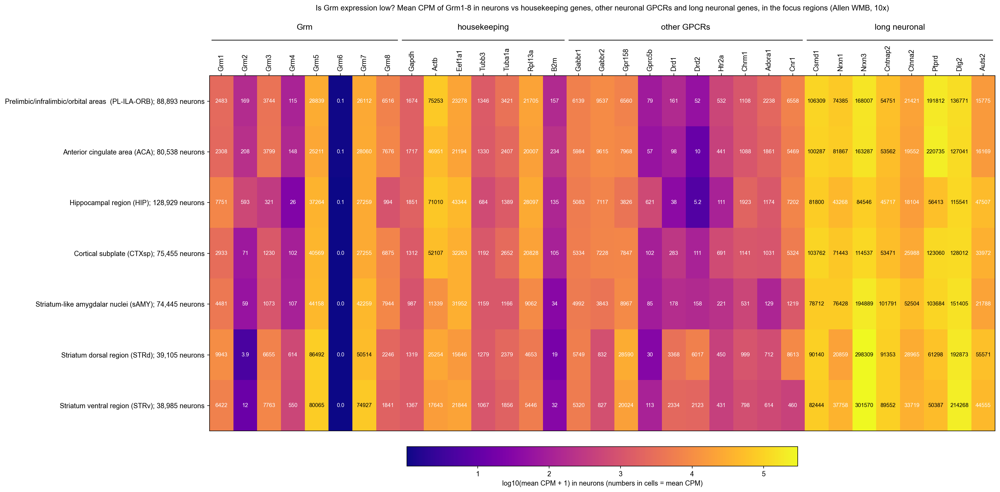
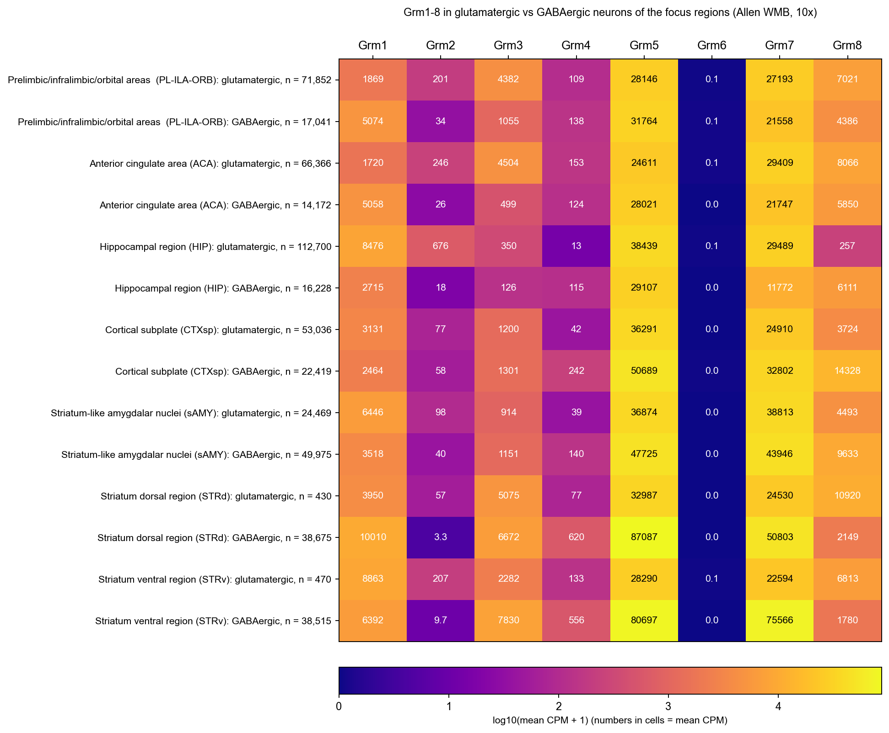
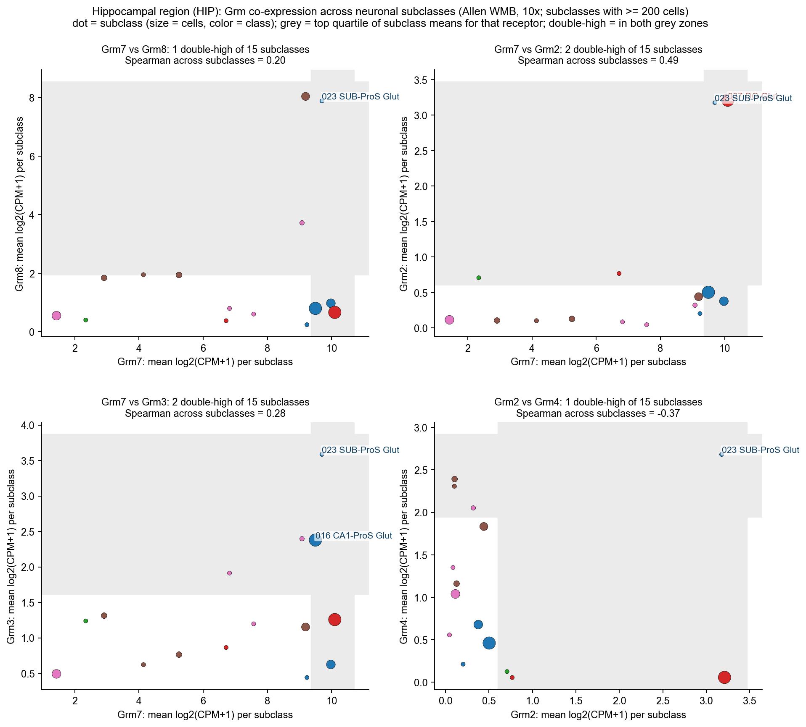
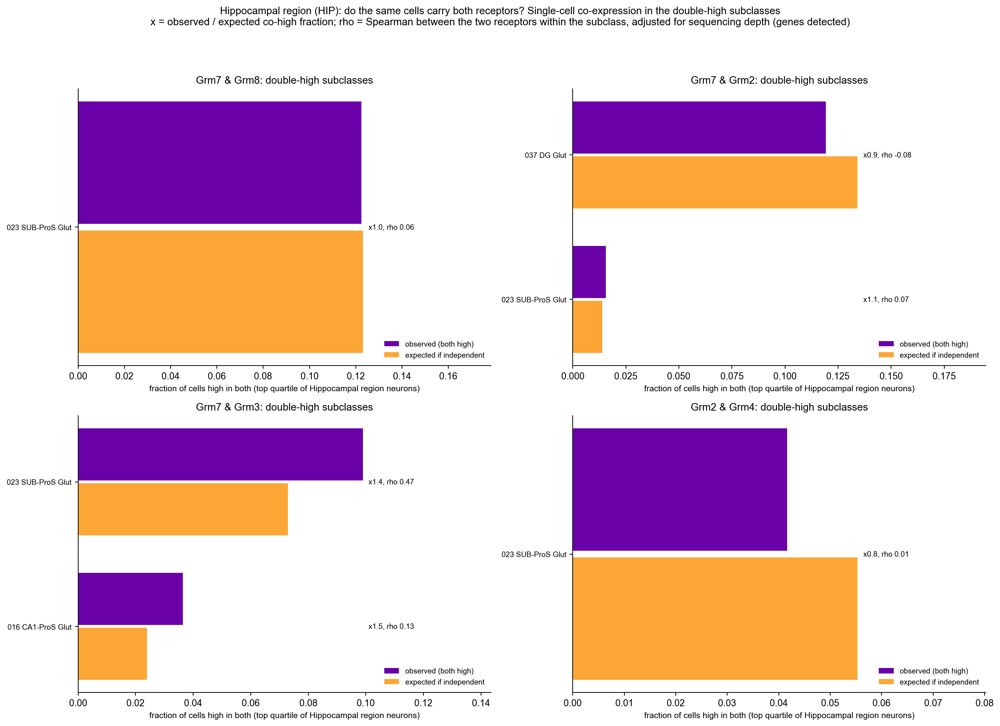

<!-- readme-v2 -->
# mglurs-brain-sc-datasets

Dataset catalogs (human, rodent, repositories): [docs/datasets.md](docs/datasets.md)

Goal: mGluR (Grm1-8) expression by fine cell type and brain region in public single-cell data. Brain needs expression levels, not % detected: detection saturates in neurons.

## Brain regions

**Focus regions** (depression and Parkinson's circuits):

| Region | Why |
|---|---|
| [Prelimbic/infralimbic/orbital areas  (PL-ILA-ORB)](#prelimbicinfralimbicorbital-areas--pl-ila-orb) | Prefrontal cortex (prelimbic, infralimbic, orbital); depression; Grm7/Grm3 heteromers reported in cortex |
| [Anterior cingulate area (ACA)](#anterior-cingulate-area-aca) | Anterior cingulate cortex; depression |
| [Hippocampal region (HIP)](#hippocampal-region-hip) | Hippocampus; depression; Grm7/Grm8 and Grm7/Grm2 heteromers reported |
| [Cortical subplate (CTXsp)](#cortical-subplate-ctxsp) | Cortical subplate incl. basolateral amygdala; depression |
| [Striatum-like amygdalar nuclei (sAMY)](#striatum-like-amygdalar-nuclei-samy) | Central and medial amygdala; depression |
| [Striatum dorsal region (STRd)](#striatum-dorsal-region-strd) | Dorsal striatum; Parkinson's (Grm4, Grm2) |
| [Striatum ventral region (STRv)](#striatum-ventral-region-strv) | Ventral striatum (nucleus accumbens, olfactory tubercle); depression; Parkinson's |

**Appendix** ([all other regions](#appendix-other-regions), 22 Allen dissection regions):

| | | |
|---|---|---|
| [Agranular insular area (AI)](#agranular-insular-area-ai) | [Auditory areas (AUD)](#auditory-areas-aud) | [Auditory/temporal/perirhinal/ectorhinal areas (AUD-TEa-PERI-ECT)](#auditorytemporalperirhinalectorhinal-areas-aud-tea-peri-ect) |
| [Cerebellum (CB)](#cerebellum-cb) | [Entorhinal area (ENT)](#entorhinal-area-ent) | [Hypothalamus (HY)](#hypothalamus-hy) |
| [Lateral septal complex (LSX)](#lateral-septal-complex-lsx) | [Medulla (MY)](#medulla-my) | [Midbrain (MB)](#midbrain-mb) |
| [Olfactory areas (OLF)](#olfactory-areas-olf) | [Pallidum (PAL)](#pallidum-pal) | [Pons (P)](#pons-p) |
| [Primary motor area (MOp)](#primary-motor-area-mop) | [Primary somatosensory area (SSp)](#primary-somatosensory-area-ssp) | [Retrohippocampal region (RHP)](#retrohippocampal-region-rhp) |
| [Retrosplenial area (RSP)](#retrosplenial-area-rsp) | [Somatomotor - Frontal pole (MO-FRP)](#somatomotor---frontal-pole-mo-frp) | [Somatosensory/gustatory/visceral areas (SS-GU-VISC)](#somatosensorygustatoryvisceral-areas-ss-gu-visc) |
| [Temporal/perirhinal/ectorhinal areas  (TEa-PERI-ECT)](#temporalperirhinalectorhinal-areas--tea-peri-ect) | [Thalamus (TH)](#thalamus-th) | [Visual areas (VIS)](#visual-areas-vis) |
| [Visual/posterior parietal  areas (VIS-PTLp)](#visualposterior-parietal--areas-vis-ptlp) |  |  |

## Module 1: Allen whole mouse brain (10x)

- Data: Allen ABC Atlas WMB, 4.04M cells, 10x v2/v3/Multiome 3' GEX, log2(CPM+1), 29 dissection regions (ROI)
- Labels: class > subclass > supertype > cluster (Allen taxonomy). UMAP: Allen `x`,`y` (10 nearest neighbours share subclass 80-99%; shuffled 4-43%)
- Colors in all figures = class
- Overall % cells detecting: Grm1 52, Grm2 17, Grm3 60, Grm4 24, Grm5 76, Grm6 0.03, Grm7 77, Grm8 43
- Enrichment = (mean CPM in subclass + 1) / (mean CPM in other neurons of the same region + 1); one-sided rank-sum, BH q < 0.05
- Tables: `results/allen_wmb/` (`master_enrichment.csv.gz`: region x chemistry x gene x subclass)

### Whole brain: subclass x Grm (mean log2 CPM)

Top 5 subclasses per class by Grm expression; all subclasses: `figures/allen_wmb/ALL_fig4_heatmap_all_subclasses_full.png`.

## Analysis: depression and Parkinson's regions

### 1. Are Grm genes low?

- **Did:** mean CPM (linear) of Grm1-8 in neurons of the focus regions, next to housekeeping, other neuronal GPCRs and long neuronal genes
- **Shows:** median mean CPM in neurons: Grm 2395, housekeeping 2379, other GPCRs 1098, long neuronal genes 80256. Highest Grm: Grm5 40569, Grm7 28060, Grm8 6516; lowest: Grm6 0
- **Next:** use these ratios as the 'low vs high' reference in the rest of the analysis

### 2. Which Grm where: glutamatergic vs GABAergic neurons

- **Did:** mean CPM of Grm1-8 in glutamatergic vs GABAergic neurons, one row per focus region
- **Shows:** top 2 Grm per neuron type (mean CPM)
  - PL-ILA-ORB: glut: Grm5 (28146), Grm7 (27193); GABA: Grm5 (31764), Grm7 (21558)
  - ACA: glut: Grm7 (29409), Grm5 (24611); GABA: Grm5 (28021), Grm7 (21747)
  - HIP: glut: Grm5 (38439), Grm7 (29489); GABA: Grm5 (29107), Grm7 (11772)
  - CTXsp: glut: Grm5 (36291), Grm7 (24910); GABA: Grm5 (50689), Grm7 (32802)
  - sAMY: glut: Grm7 (38813), Grm5 (36874); GABA: Grm5 (47725), Grm7 (43946)
  - STRd: glut: Grm5 (32987), Grm7 (24530); GABA: Grm5 (87087), Grm7 (50803)
  - STRv: glut: Grm5 (28290), Grm7 (22594); GABA: Grm5 (80697), Grm7 (75566)
- **Next:** subclass level (below) for the Grm7 pairs

### 3. Co-expression: Grm7 with Grm8, Grm2, Grm3 (and Grm2 with Grm4)

Heteromers need both receptors in the same cell. Two levels: (a) subclasses where both receptors are high (top quartile of subclass means), (b) within those subclasses, whether single cells carrying one receptor also carry the other more often than chance.

| Pair | Region | Double-high subclasses | Median obs/expected | Median partial rho (depth-adjusted) |
|---|---|---|---|---|
| Grm7/Grm8 | PL-ILA-ORB | 1 | 1.05 | 0.06 |
| Grm7/Grm8 | ACA | 1 | 1.11 | 0.11 |
| Grm7/Grm8 | HIP | 1 | 0.99 | 0.06 |
| Grm7/Grm8 | CTXsp | 3 | 1.17 | 0.29 |
| Grm7/Grm8 | sAMY | 3 | 1.07 | 0.15 |
| Grm7/Grm8 | STRd | 1 | 0.86 | -0.07 |
| Grm7/Grm8 | STRv | 0 | - | - |
| Grm7/Grm2 | PL-ILA-ORB | 2 | 0.98 | -0.00 |
| Grm7/Grm2 | ACA | 3 | 0.97 | -0.01 |
| Grm7/Grm2 | HIP | 2 | 1.01 | -0.01 |
| Grm7/Grm2 | CTXsp | 4 | 1.12 | 0.02 |
| Grm7/Grm2 | sAMY | 2 | 0.92 | -0.06 |
| Grm7/Grm2 | STRd | 1 | 0.52 | -0.12 |
| Grm7/Grm2 | STRv | 0 | - | - |
| Grm7/Grm3 | PL-ILA-ORB | 4 | 1.17 | 0.22 |
| Grm7/Grm3 | ACA | 2 | 1.20 | 0.22 |
| Grm7/Grm3 | HIP | 2 | 1.44 | 0.30 |
| Grm7/Grm3 | CTXsp | 3 | 1.09 | 0.18 |
| Grm7/Grm3 | sAMY | 3 | 1.06 | 0.15 |
| Grm7/Grm3 | STRd | 1 | 1.66 | 0.36 |
| Grm7/Grm3 | STRv | 2 | 1.23 | 0.22 |
| Grm2/Grm4 | PL-ILA-ORB | 1 | 1.10 | 0.06 |
| Grm2/Grm4 | ACA | 3 | 1.03 | 0.03 |
| Grm2/Grm4 | HIP | 1 | 0.75 | 0.01 |
| Grm2/Grm4 | CTXsp | 2 | 1.40 | 0.03 |
| Grm2/Grm4 | sAMY | 1 | 1.02 | -0.02 |
| Grm2/Grm4 | STRd | 1 | 0.68 | -0.03 |
| Grm2/Grm4 | STRv | 1 | 1.16 | 0.05 |

obs/expected: fraction of cells high in both divided by the product of the single-receptor fractions (1 = independent). rho: Spearman within subclass, adjusted for genes detected.

#### Vignette: Hippocampal region (HIP)

- **Did:** subclass mean log2 for each receptor pair (dots = subclasses); labeled subclasses are high in both
- **Shows:** which neuron types could host each heteromer
- **Next:** check the same pairs at single-cell level

- **Did:** in double-high subclasses, observed vs expected fraction of cells high in both, plus depth-adjusted correlation
- **Shows:** whether the receptors sit in the same cells (obs/expected > 1, rho > 0) or in separate cells of the same type
- **Next:** same figures for the other focus regions are in the sections below; replicate in independent 10x data

Other focus regions: [PL-ILA-ORB subclass](figures/allen_wmb/PL-ILA-ORB_fig8_coexpr_subclass.png) / [PL-ILA-ORB cells](figures/allen_wmb/PL-ILA-ORB_fig9_coexpr_cells.png), [ACA subclass](figures/allen_wmb/ACA_fig8_coexpr_subclass.png) / [ACA cells](figures/allen_wmb/ACA_fig9_coexpr_cells.png), [CTXsp subclass](figures/allen_wmb/CTXsp_fig8_coexpr_subclass.png) / [CTXsp cells](figures/allen_wmb/CTXsp_fig9_coexpr_cells.png), [sAMY subclass](figures/allen_wmb/sAMY_fig8_coexpr_subclass.png) / [sAMY cells](figures/allen_wmb/sAMY_fig9_coexpr_cells.png), [STRd subclass](figures/allen_wmb/STRd_fig8_coexpr_subclass.png) / [STRd cells](figures/allen_wmb/STRd_fig9_coexpr_cells.png), [STRv subclass](figures/allen_wmb/STRv_fig8_coexpr_subclass.png) / [STRv cells](figures/allen_wmb/STRv_fig9_coexpr_cells.png)

Tables: `results/allen_wmb/coexpression/`

## Focus regions

Per region: UMAP by class and Grm violins per subclass. Feature plots (Grm on UMAP) and enrichment tables: `figures/allen_wmb/`, `results/allen_wmb/master_enrichment.csv.gz`.

### Prelimbic/infralimbic/orbital areas  (PL-ILA-ORB)

### Anterior cingulate area (ACA)

### Hippocampal region (HIP)

### Cortical subplate (CTXsp)

### Striatum-like amygdalar nuclei (sAMY)

### Striatum dorsal region (STRd)

### Striatum ventral region (STRv)

## Caveats

- Dissection region (ROI) is coarse; fine identity comes from subclass/supertype/cluster
- `mean_log2` averages logs; `mean_cpm` is linear
- Ambient RNA: single-digit % detection is not expression (e.g. Plp1 in 30-50% of neurons)
- Enrichment is relative to other neurons in the same region; small subclasses (< 200 cells) excluded
- Allen data: mouse 10x only, CC BY-NC 4.0. Plate-based, spatial, rat, human: not yet

## Next

- Independent 10x 3' datasets per region (CELLxGENE Census, literature) to replicate Allen patterns
- Supertype/cluster-level breakdown of top hits; ambient-RNA flags

## Appendix: other regions

### Agranular insular area (AI)

### Auditory areas (AUD)

### Auditory/temporal/perirhinal/ectorhinal areas (AUD-TEa-PERI-ECT)

### Cerebellum (CB)

### Entorhinal area (ENT)

### Hypothalamus (HY)

### Lateral septal complex (LSX)

### Medulla (MY)

### Midbrain (MB)

### Olfactory areas (OLF)

### Pallidum (PAL)

### Pons (P)

### Primary motor area (MOp)

### Primary somatosensory area (SSp)

### Retrohippocampal region (RHP)

### Retrosplenial area (RSP)

### Somatomotor - Frontal pole (MO-FRP)

### Somatosensory/gustatory/visceral areas (SS-GU-VISC)

### Temporal/perirhinal/ectorhinal areas  (TEa-PERI-ECT)

### Thalamus (TH)

### Visual areas (VIS)

### Visual/posterior parietal  areas (VIS-PTLp)

