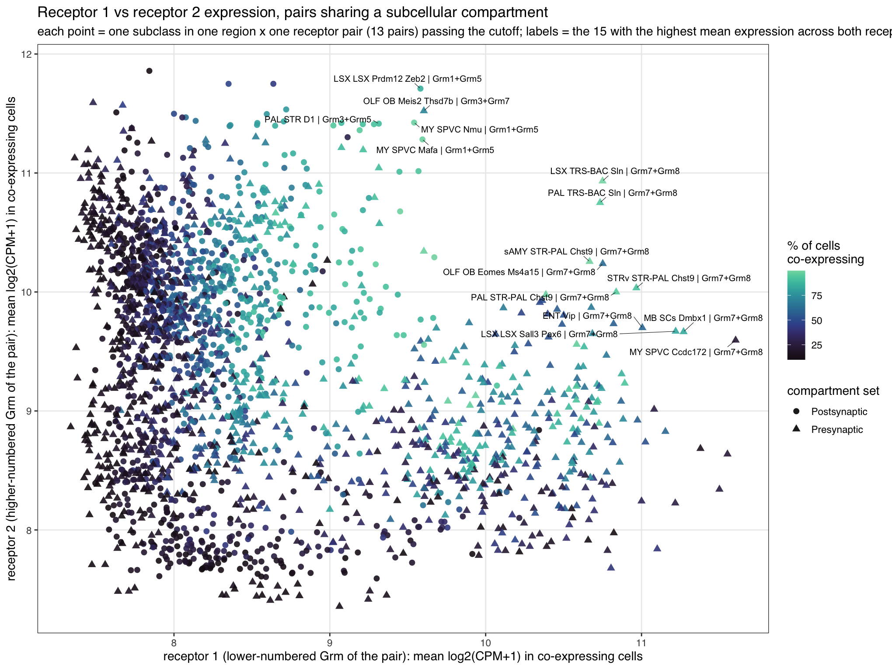
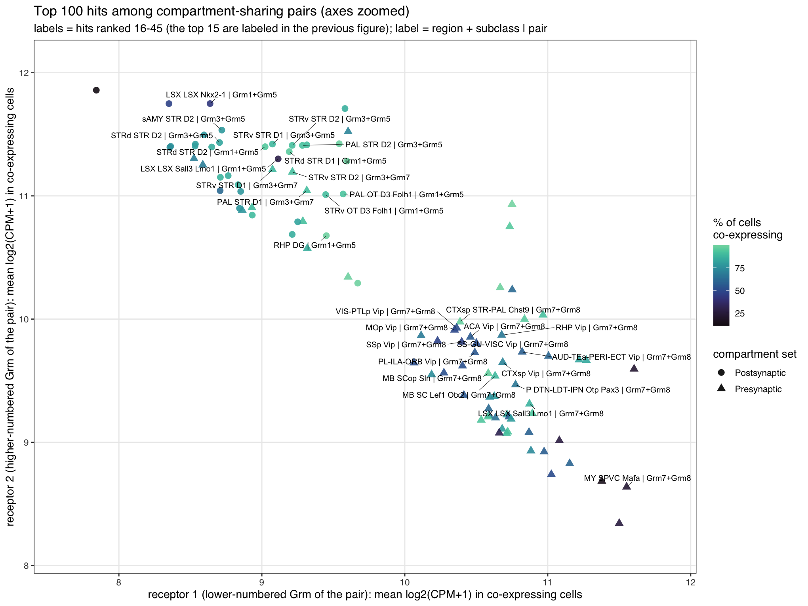

# Co-expression restricted to pairs sharing a subcellular compartment

Tables: `results/allen_wmb/compartment_coexpr/`. Back to the [main README](../../../README.md).

## 1. Receptor 1 vs receptor 2, top 15 labeled

## 2. Top 100, zoomed, ranks 16-45 labeled

