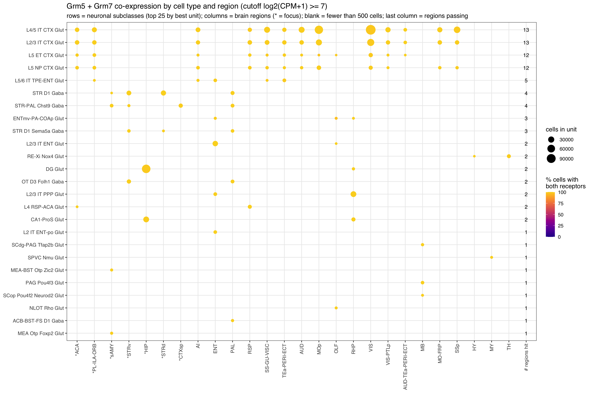
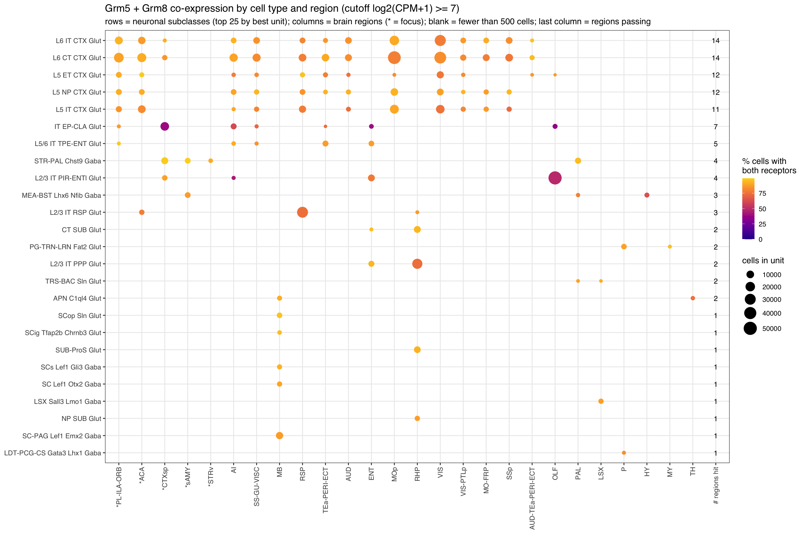
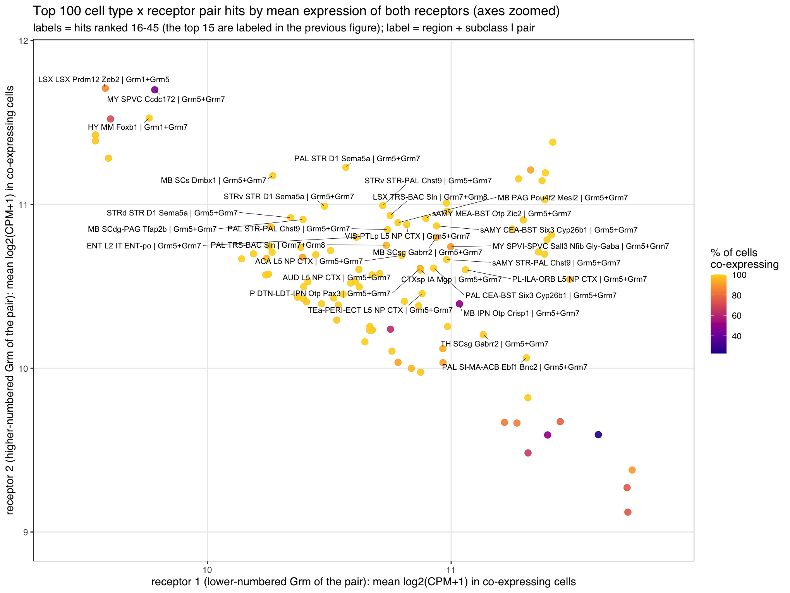
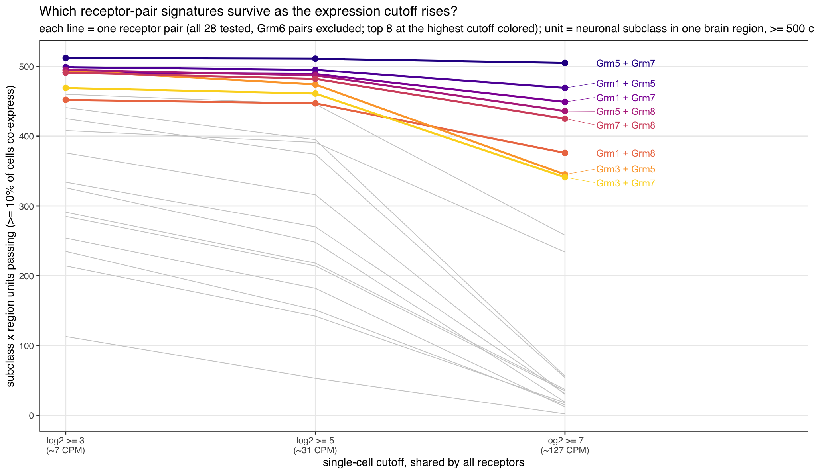
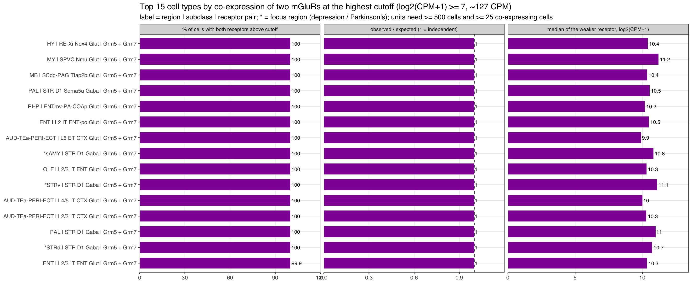
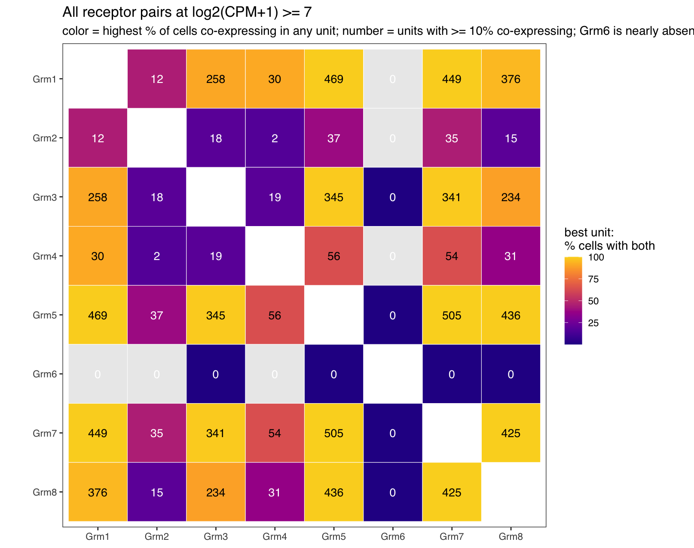

# Unbiased look at mGluR co-expression (by pairs of receptors) across cell types across the whole ABA dataset

All 28 pairs of Grm1-8, no restriction by subcellular localization. Back to the [main README](../../../README.md). Tables: `results/allen_wmb/allpairs/`.

Processing: the unit of analysis is a neuronal subclass within one dissection region (>= 500 cells). All 28 pairs of Grm1-8 were tested. A cell counts as co-expressing a pair when both receptors are above one shared absolute cutoff for all receptors, run at log2(CPM+1) >= 3, 5, 7 (about 7, 31, 127 CPM). A unit passes when >= 10% of its cells (and >= 25 cells) co-express a pair; units and pairs were then ranked at the highest cutoff (log2 >= 7). The dot plots below show, for the top 4 receptor pairs, which cell types pass in which regions. The figures for each processing step (stringency, top hits, pair heatmap, region discordance, threshold check) are in [pairs_coexpression_whole_atlas](figures/allen_wmb/pairs_coexpression_whole_atlas/).

Each point is one cell type (subclass in one region) x receptor pair that passes the cutoff; x and y are the mean expression of the two receptors in the co-expressing cells (receptor 1 is the lower-numbered Grm of the pair); color = % of the unit's cells co-expressing. Labeled points are the 15 with the highest mean expression across both receptors; label = region + subclass | receptor pair.

Label key:

- **MY SPVC Nmu | Grm5+Grm7**: Medulla (MY); subclass 258 SPVC Nmu Glut (class 24 MY Glut); Grm5 + Grm7; 960 cells, 100% co-express
- **STRv STR D1 | Grm5+Grm7**: Striatum ventral region (STRv); subclass 061 STR D1 Gaba (class 09 CNU-LGE GABA); Grm5 + Grm7; 12,350 cells, 100% co-express
- **LSX LSX Sall3 Pax6 | Grm5+Grm7**: Lateral septal complex (LSX); subclass 067 LSX Sall3 Pax6 Gaba (class 10 LSX GABA); Grm5 + Grm7; 1,029 cells, 92% co-express
- **STRv STR D2 | Grm5+Grm7**: Striatum ventral region (STRv); subclass 062 STR D2 Gaba (class 09 CNU-LGE GABA); Grm5 + Grm7; 11,148 cells, 99% co-express
- **MY SPVC Mafa | Grm5+Grm7**: Medulla (MY); subclass 256 SPVC Mafa Glut (class 24 MY Glut); Grm5 + Grm7; 3,388 cells, 99% co-express
- **PAL STR D1 | Grm5+Grm7**: Pallidum (PAL); subclass 061 STR D1 Gaba (class 09 CNU-LGE GABA); Grm5 + Grm7; 5,851 cells, 100% co-express
- **sAMY STR D1 | Grm5+Grm7**: Striatum-like amygdalar nuclei (sAMY); subclass 061 STR D1 Gaba (class 09 CNU-LGE GABA); Grm5 + Grm7; 572 cells, 100% co-express
- **LSX LSX Sall3 Lmo1 | Grm5+Grm7**: Lateral septal complex (LSX); subclass 072 LSX Sall3 Lmo1 Gaba (class 10 LSX GABA); Grm5 + Grm7; 2,423 cells, 99% co-express
- **PAL STR D2 | Grm5+Grm7**: Pallidum (PAL); subclass 062 STR D2 Gaba (class 09 CNU-LGE GABA); Grm5 + Grm7; 4,970 cells, 99% co-express
- **MY SPVI-SPVC Sall3 Lhx1 Gly-Gaba | Grm5+Grm7**: Medulla (MY); subclass 306 SPVI-SPVC Sall3 Lhx1 Gly-Gaba (class 27 MY GABA); Grm5 + Grm7; 2,002 cells, 100% co-express
- **STRd STR D2 | Grm5+Grm7**: Striatum dorsal region (STRd); subclass 062 STR D2 Gaba (class 09 CNU-LGE GABA); Grm5 + Grm7; 18,139 cells, 100% co-express
- **STRd STR D1 | Grm5+Grm7**: Striatum dorsal region (STRd); subclass 061 STR D1 Gaba (class 09 CNU-LGE GABA); Grm5 + Grm7; 16,660 cells, 100% co-express
- **sAMY STR D2 | Grm5+Grm7**: Striatum-like amygdalar nuclei (sAMY); subclass 062 STR D2 Gaba (class 09 CNU-LGE GABA); Grm5 + Grm7; 1,808 cells, 95% co-express
- **STRv OT D3 Folh1 | Grm5+Grm7**: Striatum ventral region (STRv); subclass 060 OT D3 Folh1 Gaba (class 09 CNU-LGE GABA); Grm5 + Grm7; 7,665 cells, 100% co-express
- **PAL OT D3 Folh1 | Grm5+Grm7**: Pallidum (PAL); subclass 060 OT D3 Folh1 Gaba (class 09 CNU-LGE GABA); Grm5 + Grm7; 4,471 cells, 100% co-express

Same plot restricted to the 100 highest-expressing hits (ranked by mean expression across both receptors), with axes zoomed to that range so the points spread out. Labeled points are ranks 16-45; ranks 1-15 are labeled in the plot above.

Label key:

- **sAMY MEA-BST Otp Zic2 | Grm5+Grm7**: Striatum-like amygdalar nuclei (sAMY); subclass 121 MEA-BST Otp Zic2 Glut (class 13 CNU-HYa Glut); Grm5 + Grm7; 1,255 cells, 100% co-express
- **sAMY CEA-BST Six3 Cyp26b1 | Grm5+Grm7**: Striatum-like amygdalar nuclei (sAMY); subclass 079 CEA-BST Six3 Cyp26b1 Gaba (class 11 CNU-HYa GABA); Grm5 + Grm7; 4,675 cells, 100% co-express
- **PAL STR D1 Sema5a | Grm5+Grm7**: Pallidum (PAL); subclass 063 STR D1 Sema5a Gaba (class 09 CNU-LGE GABA); Grm5 + Grm7; 3,109 cells, 100% co-express
- **MY SPVI-SPVC Sall3 Nfib Gly-Gaba | Grm5+Grm7**: Medulla (MY); subclass 305 SPVI-SPVC Sall3 Nfib Gly-Gaba (class 27 MY GABA); Grm5 + Grm7; 1,582 cells, 89% co-express
- **MB SCsg Gabrr2 | Grm5+Grm7**: Midbrain (MB); subclass 213 SCsg Gabrr2 Gaba (class 20 MB GABA); Grm5 + Grm7; 13,642 cells, 96% co-express
- **STRv STR-PAL Chst9 | Grm5+Grm7**: Striatum ventral region (STRv); subclass 064 STR-PAL Chst9 Gaba (class 09 CNU-LGE GABA); Grm5 + Grm7; 1,349 cells, 100% co-express
- **VIS-PTLp L5 NP CTX | Grm5+Grm7**: Visual/posterior parietal  areas (VIS-PTLp); subclass 032 L5 NP CTX Glut (class 02 NP-CT-L6b Glut); Grm5 + Grm7; 1,092 cells, 100% co-express
- **LSX TRS-BAC Sln | Grm7+Grm8**: Lateral septal complex (LSX); subclass 111 TRS-BAC Sln Glut (class 13 CNU-HYa Glut); Grm7 + Grm8; 534 cells, 100% co-express
- **MB PAG Pou4f2 Mesi2 | Grm5+Grm7**: Midbrain (MB); subclass 174 PAG Pou4f2 Mesi2 Glut (class 19 MB Glut); Grm5 + Grm7; 5,075 cells, 99% co-express
- **PL-ILA-ORB L5 NP CTX | Grm5+Grm7**: Prelimbic/infralimbic/orbital areas  (PL-ILA-ORB); subclass 032 L5 NP CTX Glut (class 02 NP-CT-L6b Glut); Grm5 + Grm7; 3,988 cells, 100% co-express
- **sAMY STR-PAL Chst9 | Grm5+Grm7**: Striatum-like amygdalar nuclei (sAMY); subclass 064 STR-PAL Chst9 Gaba (class 09 CNU-LGE GABA); Grm5 + Grm7; 3,766 cells, 100% co-express
- **PAL STR-PAL Chst9 | Grm5+Grm7**: Pallidum (PAL); subclass 064 STR-PAL Chst9 Gaba (class 09 CNU-LGE GABA); Grm5 + Grm7; 4,603 cells, 100% co-express
- **PAL CEA-BST Six3 Cyp26b1 | Grm5+Grm7**: Pallidum (PAL); subclass 079 CEA-BST Six3 Cyp26b1 Gaba (class 11 CNU-HYa GABA); Grm5 + Grm7; 1,019 cells, 100% co-express
- **ACA L5 NP CTX | Grm5+Grm7**: Anterior cingulate area (ACA); subclass 032 L5 NP CTX Glut (class 02 NP-CT-L6b Glut); Grm5 + Grm7; 3,541 cells, 100% co-express
- **PAL TRS-BAC Sln | Grm7+Grm8**: Pallidum (PAL); subclass 111 TRS-BAC Sln Glut (class 13 CNU-HYa Glut); Grm7 + Grm8; 602 cells, 95% co-express
- **MY SPVC Ccdc172 | Grm5+Grm7**: Medulla (MY); subclass 257 SPVC Ccdc172 Glut (class 24 MY Glut); Grm5 + Grm7; 592 cells, 45% co-express
- **P DTN-LDT-IPN Otp Pax3 | Grm5+Grm7**: Pons (P); subclass 277 DTN-LDT-IPN Otp Pax3 Gaba (class 26 P GABA); Grm5 + Grm7; 2,410 cells, 91% co-express
- **CTXsp IA Mgp | Grm5+Grm7**: Cortical subplate (CTXsp); subclass 065 IA Mgp Gaba (class 09 CNU-LGE GABA); Grm5 + Grm7; 1,299 cells, 98% co-express
- **STRv STR D1 Sema5a | Grm5+Grm7**: Striatum ventral region (STRv); subclass 063 STR D1 Sema5a Gaba (class 09 CNU-LGE GABA); Grm5 + Grm7; 2,707 cells, 100% co-express
- **MB SCs Dmbx1 | Grm5+Grm7**: Midbrain (MB); subclass 207 SCs Dmbx1 Gaba (class 20 MB GABA); Grm5 + Grm7; 5,592 cells, 99% co-express
- **MB IPN Otp Crisp1 | Grm5+Grm7**: Midbrain (MB); subclass 214 IPN Otp Crisp1 Gaba (class 20 MB GABA); Grm5 + Grm7; 2,996 cells, 51% co-express
- **ENT L2 IT ENT-po | Grm5+Grm7**: Entorhinal area (ENT); subclass 011 L2 IT ENT-po Glut (class 01 IT-ET Glut); Grm5 + Grm7; 3,544 cells, 100% co-express
- **PAL SI-MA-ACB Ebf1 Bnc2 | Grm5+Grm7**: Pallidum (PAL); subclass 078 SI-MA-ACB Ebf1 Bnc2 Gaba (class 11 CNU-HYa GABA); Grm5 + Grm7; 1,164 cells, 100% co-express
- **TH SCsg Gabrr2 | Grm5+Grm7**: Thalamus (TH); subclass 213 SCsg Gabrr2 Gaba (class 20 MB GABA); Grm5 + Grm7; 2,082 cells, 99% co-express
- **TEa-PERI-ECT L5 NP CTX | Grm5+Grm7**: Temporal/perirhinal/ectorhinal areas  (TEa-PERI-ECT); subclass 032 L5 NP CTX Glut (class 02 NP-CT-L6b Glut); Grm5 + Grm7; 1,572 cells, 100% co-express
- **MB SCdg-PAG Tfap2b | Grm5+Grm7**: Midbrain (MB); subclass 179 SCdg-PAG Tfap2b Glut (class 19 MB Glut); Grm5 + Grm7; 1,750 cells, 100% co-express
- **LSX LSX Prdm12 Zeb2 | Grm1+Grm5**: Lateral septal complex (LSX); subclass 071 LSX Prdm12 Zeb2 Gaba (class 10 LSX GABA); Grm1 + Grm5; 6,520 cells, 86% co-express
- **HY MM Foxb1 | Grm1+Grm7**: Hypothalamus (HY); subclass 144 MM Foxb1 Glut (class 16 HY MM Glut); Grm1 + Grm7; 8,270 cells, 99% co-express
- **AUD L5 NP CTX | Grm5+Grm7**: Auditory areas (AUD); subclass 032 L5 NP CTX Glut (class 02 NP-CT-L6b Glut); Grm5 + Grm7; 2,236 cells, 100% co-express
- **STRd STR D1 Sema5a | Grm5+Grm7**: Striatum dorsal region (STRd); subclass 063 STR D1 Sema5a Gaba (class 09 CNU-LGE GABA); Grm5 + Grm7; 780 cells, 100% co-express

## All figures by step

### 1. Stringency

Units (subclass x region) passing as the shared cutoff rises, one line per receptor pair.

### 2. Top hits at the highest cutoff

Cell types with the highest % of cells co-expressing two receptors, with observed/expected and the weaker-receptor median.

### 3. All 8 x 8 pairs

Best unit per pair (color) and the number of passing units (number).

### 5. Region discordance

Same subclass, different regions: lowest vs highest % co-expressing.

### 6. Threshold sanity check

Where the three cutoffs fall in the distribution of subclass x region mean expression.

