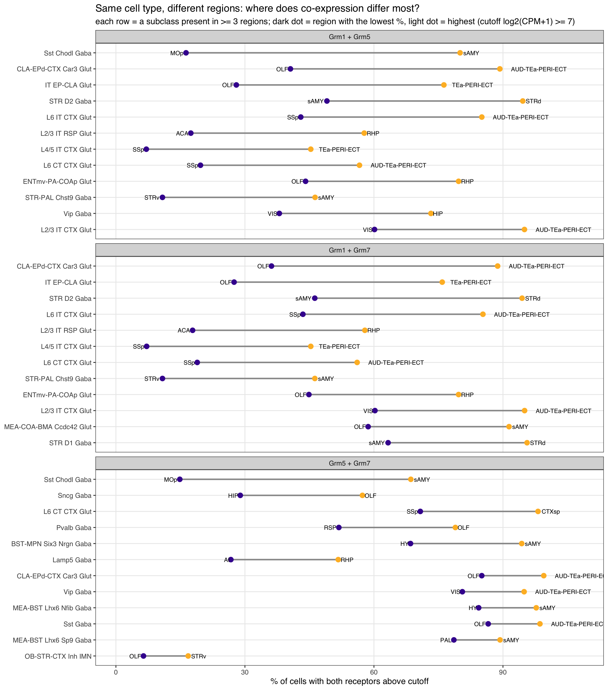
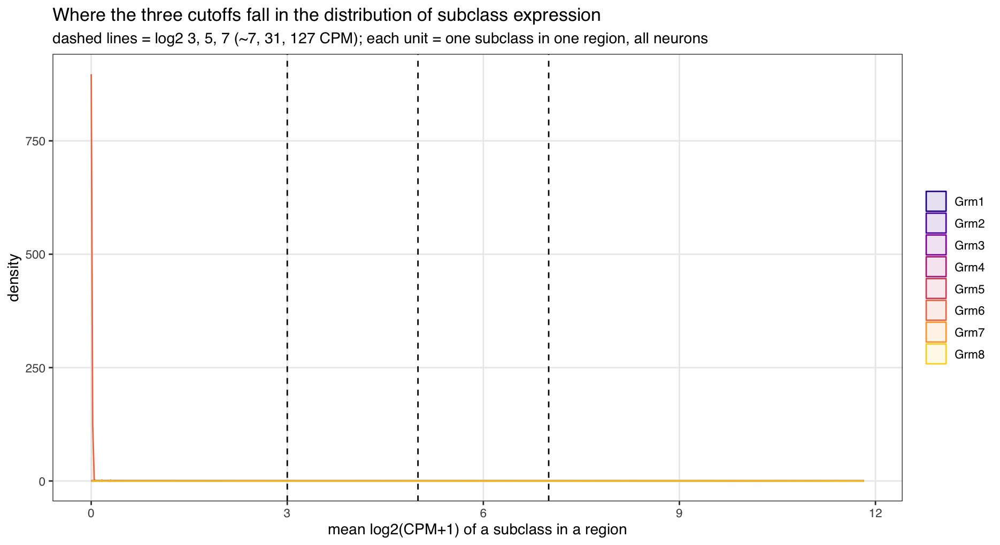
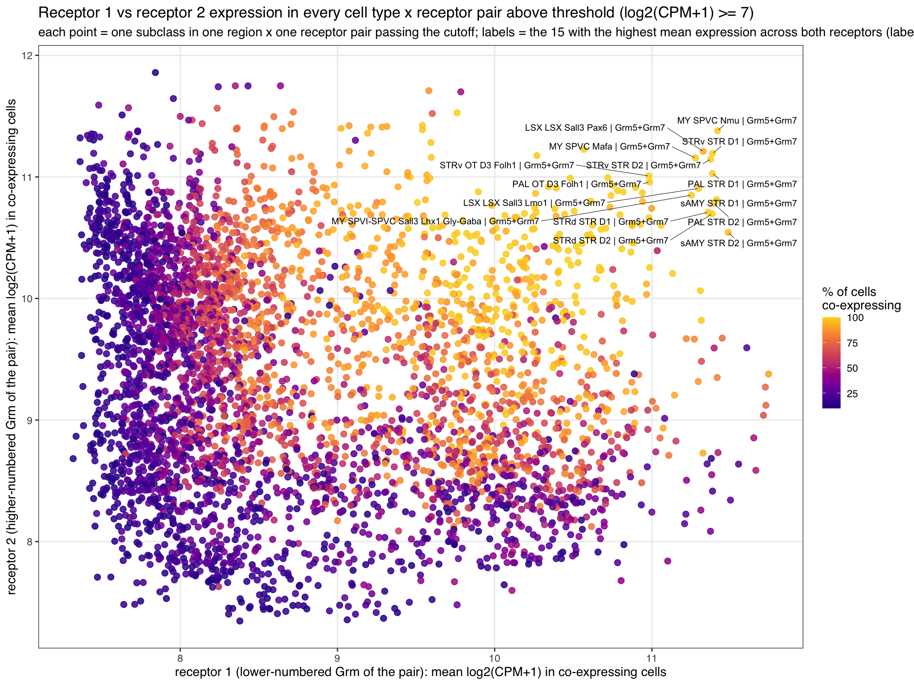
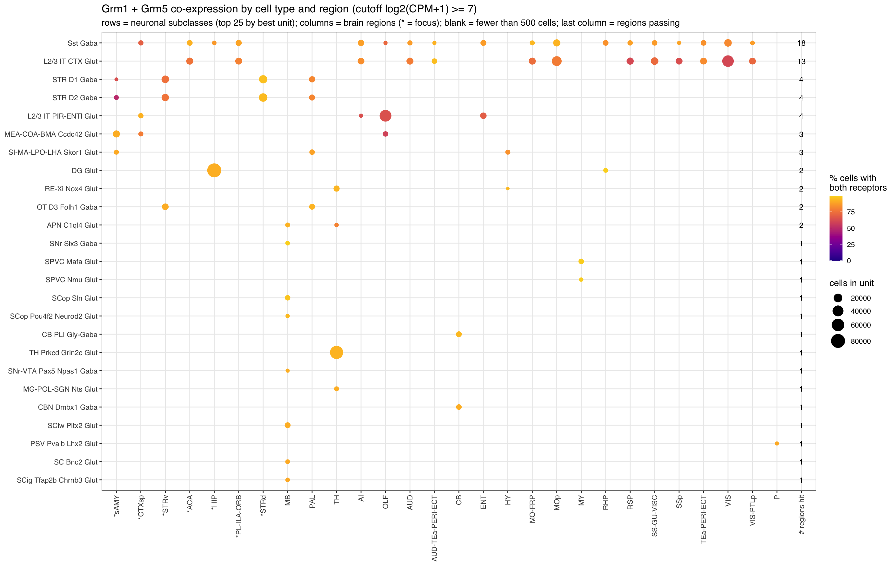
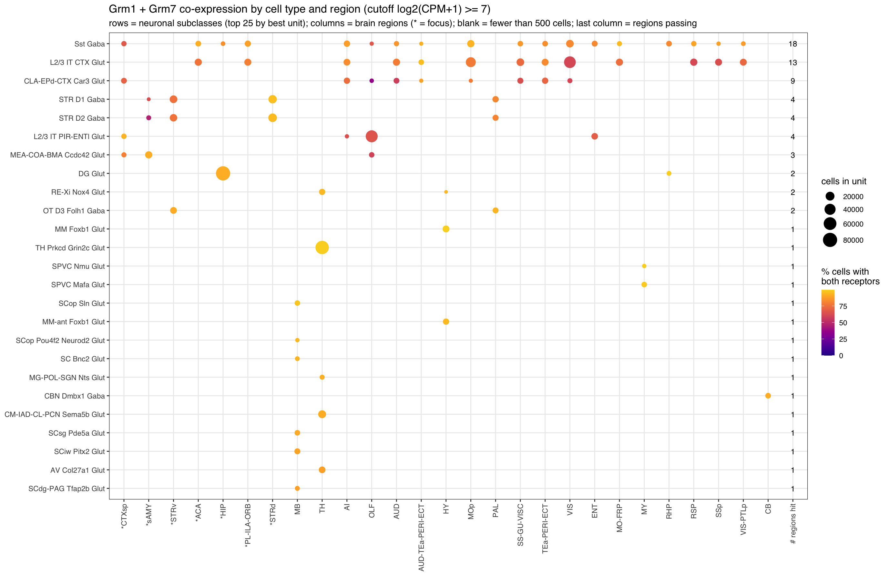

# Unbiased look at mGluR co-expression (by receptor pair) across the whole ABA dataset

Figures for each step of the all-pairs analysis. Tables: `results/allen_wmb/allpairs/`. Back to the [main README](../../../README.md).

## 1. Stringency

Units (subclass x region) passing as the shared cutoff rises, one line per receptor pair.

## 2. Top hits at the highest cutoff

Cell types with the highest % of cells co-expressing two receptors, with observed/expected and the weaker-receptor median.

## 3. All 8 x 8 pairs

Best unit per pair (color) and the number of passing units (number).

## 5. Region discordance

Same subclass, different regions: lowest vs highest % co-expressing.

## 6. Threshold sanity check

Where the three cutoffs fall in the distribution of subclass x region mean expression.

## 7. Receptor 1 vs receptor 2 expression

Every passing cell type x pair; top 15 labeled.

## 4. Cell type x region dot plots (top pairs)

Rows = subclasses, columns = regions (* = focus), color = % co-expressing, size = cells; last column = regions passing.

